# Propuesta de Arquitectura de Solución — Banca por Internet BP

| Campo | Valor |
|---|---|
| **Documento** | Propuesta de Arquitectura de Solución (versión resumida) |
| **Entidad** | BP — Institución financiera regulada en la República del Ecuador |
| **Rol** | Arquitecto de Soluciones |
| **Documento base** | Ejercicio Práctico |
| **Fecha** | 2026-11-15 |
| **Notación de diagramas** | C4-PlantUML (`plantuml-stdlib/C4-PlantUML`) |

## Índice

1. [Introducción y metas](#1-introducción-y-metas)
2. [Restricciones y supuestos](#2-restricciones-y-supuestos)
3. [Contexto del sistema (C4 Nivel 1)](#3-contexto-del-sistema-c4-nivel-1)
4. [Estrategia de solución](#4-estrategia-de-solución)
5. [Vista de bloques (C4 Niveles 2 y 3)](#5-vista-de-bloques-c4-niveles-2-y-3)
6. [Vista de ejecución](#6-vista-de-ejecución)
7. [Vista de despliegue](#7-vista-de-despliegue)
8. [Conceptos transversales](#8-conceptos-transversales)
9. [Decisiones de arquitectura (ADR)](#9-decisiones-de-arquitectura-adr)
10. [Requerimientos de calidad](#10-requerimientos-de-calidad)
11. [Riesgos y validaciones pendientes](#11-riesgos-y-validaciones-pendientes)
12. [Glosario](#12-glosario)
- [Anexo A. Fuentes](#anexo-a-fuentes)

> **Convenciones:** **[Norma]** = exigencia regulatoria; **; **[Objetivo propuesto]** = meta sugerida, a ajustar con BP.

---

## 1. Introducción y metas

Este documento describe la arquitectura propuesta para la plataforma de Banca por Internet de BP, como respuesta al Ejercicio Práctico.

### 1.1 Requerimientos funcionales y su impacto

| ID | Requerimiento | Impacto en la arquitectura |
|---|---|---|
| RF-01 | Histórico de movimientos | Servicio Movimientos: consulta directa al Core vía ACL, paginación por cursor y caché de la primera página. |
| RF-02 | Transferencias y pagos (propias, terceros BP, interbancarias) | Servicio Transferencias con Saga, idempotencia, límites y antifraude; una Strategy por tipo de transacción. Conector interbancario aislado. |
| RF-03 | Datos básicos (Core) y detallados (complementario) | Servicio Clientes con Aggregator y caché para clientes frecuentes. |
| RF-04 | Notificación de movimientos (≥ 2 sistemas) | Servicio Notificaciones guiado por eventos, 3 canales con fallback. |
| RF-05 | SPA + app móvil multiplataforma | Angular + Flutter, un BFF por canal. |
| RF-06 | OAuth 2.0, recomendar flujo | Authorization Code + PKCE, BFF y DPoP (§8.1). |
| RF-07 | Onboarding con reconocimiento facial | Servicio Onboarding + proveedor biométrico + DGRCIC + enrolamiento de dispositivo (§8.2). |
| RF-08 | BD de auditoría de todas las acciones | Pipeline de auditoría inmutable (§8.5). |
| RF-09 | Persistencia para clientes frecuentes basada en patrones | Cache-Aside + Decorator + Strategy (§5.3). |
| RF-10 | API Gateway + 3 servicios (+ opcionales) | Azure API Management + 3 servicios requeridos + 6 adicionales justificados + 3 adaptadores ACL (§5.1.2). |

### 1.2 Metas de calidad (priorizadas)

| # | Meta | Origen | Motivación | Medición (§10) |
|---|---|---|---|---|
| 1 | **Seguridad** | RNF-03, **[Norma]** SB, LOPDP | Entidad regulada que mueve dinero y trata datos biométricos. Prevalece sobre latencia y comodidad (p. ej. *step-up* en toda transacción monetaria). | Q-04 |
| 2 | **Disponibilidad y resiliencia** | RNF-01, 02, 06 | Una caída afecta a todos los clientes; la norma de riesgo operativo exige continuidad. Prevalece sobre latencia y costo (*warm standby*). | Q-01, Q-02, Q-03, Q-07 |
| 3 | **Baja latencia** | RNF-07 | Único RNF con presupuesto declarado. Cede ante seguridad y disponibilidad. | Q-05 |
| 4 | **Desacoplamiento y reutilización** | RNF-08 | Canales futuros sobre las mismas APIs de proceso (API-led). | Q-06 |
| 5 | **Auditabilidad** | RF-08, **[Norma]** | Evidencia inmutable para SB, auditoría interna y reclamos. | Q-11 |

### 1.3 Partes interesadas

*Borrador — validar con BP.*

| Rol | Expectativa principal |
|---|---|
| Cliente final | Operar seguro, rápido y disponible; abrir su acceso sin ir a agencia; aviso inmediato de cada movimiento. |
| Negocio — Banca digital | Rapidez de lanzamiento, reutilización de APIs, costo controlado. |
| Seguridad de la información | PKCE, DPoP, *step-up*, Zero Trust, cifrado, gestión de vulnerabilidades. |
| Cumplimiento (LA/FT, LOPDP) y SB | Debida diligencia, protección de datos biométricos, continuidad, auditoría inmutable, notificación de transacciones. |
| Dueños de sistemas existentes | Integración sin modificar Core/IdP y carga controlada sobre el Core. |
| Operaciones / SRE y desarrollo | Observabilidad, auto-healing, despliegues sin ventana, límites claros entre servicios. |

---

## 2. Restricciones y supuestos

### 2.1 Restricciones del Ejercicio Práctico

- La información del cliente proviene **exclusivamente** del Core y del sistema complementario.
- El servidor OAuth 2.0 **ya existe** y solo se configura.
- Nube permitida: AWS o Azure; hay presupuesto para baja latencia.
- Modelado C4 hasta el nivel de Componentes.

### 2.2 Restricciones normativas (Ecuador) y su traducción a controles

| Norma | Exigencia relevante | Control de arquitectura |
|---|---|---|
| **LOPDP y reglamento**; normativa SPDP sobre transferencias | Biometría como categoría especial; consentimiento; seguridad; transferencia internacional. | Consentimiento explícito registrado; sin imágenes biométricas en bruto (§8.2.3); cifrado; proveedor de nube como **encargado del tratamiento** (§7.4). |
| **Codificación SB, Libro I, Título IX, Cap. V — Riesgo operativo** | Notificación en línea del acceso y transacciones; 2 de 3 factores en transacciones monetarias; segundo factor siempre para destinos no registrados; usuario ≠ cédula; cierre de sesión; registro de IP; cambio de contacto solo presencial o con autenticación fuerte; renovación anual de clave. | Servicio Notificaciones (§8.6); MFA y *step-up* (§8.1.4); Servicio Beneficiarios; política del IdP; IP y dispositivo en auditoría (§8.5); *step-up* biométrico para cambio de contacto. |
| **Misma norma — servicios de terceros (nube)** | Informar a la SB; centros de datos TIA-942 **TIER III**; proveedor ISO 27001; proveedores alternos. | Notificación previa a la SB; portabilidad (P8); riesgo R-01. |
| **Misma norma — seguridad de la información** | Segmentación de red; pentest por tercero independiente. | Hub-spoke, NSG, Private Endpoints; pentest anual (§8.8). |
| **COMF** | Sigilo bancario; conservación de documentos. | Datos financieros *Confidencial*; retención según política documental (§8.5). |
| **Pagos inmediatos BCE / Norma Técnica SPI v2** | Formatos técnicos del BCE. | Conector de Pagos aislado como ACL. |
| **Prevención LA/FT** | Debida diligencia. | Controles LA/FT en onboarding y monitoreo transaccional. |
| **DGRCIC — web service demográfico + biométrico** | Validación oficial de identidad para personas jurídicas privadas. | Integración en el onboarding (§8.2). |

**Estándares adoptados:** RFC 9700 (OAuth Security BCP), RFC 10017 (Browser-Based Apps — BFF), RFC 8252 (Native Apps), RFC 9449 (DPoP), RFC 9126 (PAR), RFC 9470 (Step-up), FAPI 2.0, ISO/IEC 27001 e ISO 22301, OWASP ASVS/MASVS, ISO/IEC 30107-3 (liveness), FIDO2/WebAuthn, NIST CSF 2.0, OpenTelemetry.

### 2.3 Supuestos

Cada supuesto indica qué cambia si es falso; en todos los casos el impacto queda en un adaptador o componente acotado.

| ID | Supuesto | Si resulta falso |
|---|---|---|
| S-01 | BP ya participa en el SPI del BCE y tiene un conector o *switch* | El Conector de Pagos implementa directamente la mensajería BCE (crece ese ACL, no el dominio). |
| S-02 | BP tiene o puede firmar el contrato con la DGRCIC | Validación solo con el proveedor biométrico, o cierre en agencia. |
| S-03 | Existe una plataforma corporativa LA/FT | El `LaftAdapter` consulta listas contratadas; casos dudosos a revisión manual. |
| S-04 | **No** existe motor antifraude reutilizable | El Servicio Riesgo Transaccional pasa a ser un adaptador. |
| S-05 | BP tiene SIEM y SOC | Se despliega Microsoft Sentinel y BP contrata un SOC administrado. |
| S-06 | Puede habilitarse conectividad privada nube ↔ centro de datos del Core | Dos túneles VPN IPsec activos. |
| S-07 | BP contrata proveedores de SMS, correo, biometría y cuentas Apple/Google | Sin efecto en la arquitectura (adaptadores intercambiables). |
| S-08 | El centro de datos del Core y las regiones de nube acreditan TIER III ante la SB | Limita el SLO (Q-01) o fuerza otra región/proveedor. |

---

## 3. Contexto del sistema (C4 Nivel 1)

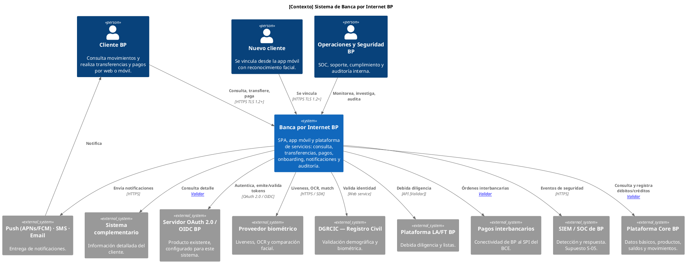

**Límite del sistema.** El IdP, el Core, el sistema complementario y la conectividad de pagos quedan **fuera**: existen y solo se integran mediante adaptadores. **Antifraude, límites y beneficiarios** quedan **dentro**: son exigencias normativas del canal electrónico que ningún sistema existente descrito cubre.

---

## 4. Estrategia de solución

### 4.1 Resumen y decisiones principales

Plataforma **desacoplada, orientada a dominios y guiada por eventos**, en **Microsoft Azure** sobre el par **Chile Central ↔ Brazil South** (ambas con 3 zonas): una región primaria y otra de recuperación, a fijar antes de contratar midiendo latencia y catálogo de servicios (ADR-05). Integración híbrida con Core, sistema complementario, IdP y pagos BCE.

| Tema | Decisión | Justificación |
|---|---|---|
| Estilo | Microservicios por dominio (DDD) + hexagonal + API-led + eventos | Despliegue independiente y reutilización por canales futuros (RNF-08). |
| Front-end | **Angular** (vs. React) | Framework completo y opinado: uniformidad, seguridad integrada (sanitización, Trusted Types, XSRF) y soporte LTS predecible. |
| Móvil | **Flutter** (vs. React Native) | AOT a código nativo (más difícil de manipular), UI idéntica en iOS/Android, rendimiento predecible en la captura del onboarding. RN perdería su ventaja (compartir lenguaje) porque la web es Angular. |
| Backend | **Java 25 LTS / Spring Boot 4** (vs. .NET 10) | Versiones con soporte vigente, *virtual threads* para servicios de I/O, ecosistema maduro (Spring Security, Resilience4j, Kafka, OpenTelemetry), portabilidad. Final según competencias del equipo. |
| Autenticación | Auth Code + PKCE en ambos canales; **BFF** en web; **DPoP** y vinculación de dispositivo en móvil | Estándar vigente; tokens restringidos al emisor (§8.1). |
| Onboarding | Documento + **liveness** + cotejo con **DGRCIC** + LA/FT + enrolamiento de dispositivo | Servicio oficial disponible para personas jurídicas privadas (§8.2). |
| Transferencias | **Saga orquestada + Transactional Outbox + idempotencia** | Sin doble débito ni notificaciones perdidas (§5.2.1). |
| Auditoría | Interceptor + outbox → bus → almacén **append-only** + archivo **WORM** con cadena de hash | Inmutable y verificable (§8.5). |
| Clientes frecuentes | **Cache-Aside + Decorator + Strategy** con Redis | Baja latencia sin acoplar el dominio a la caché (§5.3). |
| Notificaciones | 3 canales con **Strategy + Chain of Responsibility** | La norma exige notificar en línea; el ejercicio, ≥ 2 sistemas (§8.6). |
| Nube | **Azure** (vs. AWS) | Única nube permitida con dos regiones en Sudamérica en GA y 3 zonas. |
| HA/DR | Zona-redundante + *warm standby* + auto-healing | Sin puntos únicos de falla; recuperación regional (§8.7). |

### 4.2 Principios

| # | Principio | Aplicación |
|---|---|---|
| P1 | Seguridad por diseño y Zero Trust | mTLS entre servicios; tokens con audiencia y alcance. |
| P2 | Desacoplamiento por dominio | Un *bounded context* y una BD por servicio; contratos API/eventos. |
| P3 | Anti-Corruption Layer | El modelo del Core no se filtra al dominio digital. |
| P4 | Asincronía donde no hace falta respuesta | Notificación, auditoría e invalidación de caché por eventos. |
| P5 | Diseño para la falla | Timeouts, reintentos con backoff, circuit breaker, bulkhead, idempotencia. |
| P6 | Observabilidad nativa | OpenTelemetry y `traceId` de punta a punta, también en auditoría. |
| P7 | Todo como código | IaC, políticas y GitOps versionados. |
| P8 | Portabilidad razonable | Kubernetes, Kafka, PostgreSQL, OpenTelemetry. **[Norma]** mitigar dependencia de un proveedor. |
| P9 | Minimización de datos | Solo lo necesario, cifrado y con retención definida. **[Norma]** LOPDP. |

**API-led en tres capas:** (1) **Experiencia** — BFF Web y BFF Móvil; (2) **Proceso** — servicios de dominio reutilizables; (3) **Sistema** — adaptadores ACL hacia Core, complementario, pagos y proveedores.

**¿Por qué un BFF por canal?** *Seguridad:* el BFF Web es cliente OAuth confidencial y mantiene los tokens fuera del navegador (RFC 10017); el BFF Móvil valida DPoP y atestación. *Rendimiento:* una llamada por pantalla. *Desacoplamiento:* cada canal evoluciona su contrato sin tocar las APIs de proceso.

---

## 5. Vista de bloques (C4 Niveles 2 y 3)

### 5.1 Diagrama de Contenedores (C4 Nivel 2)

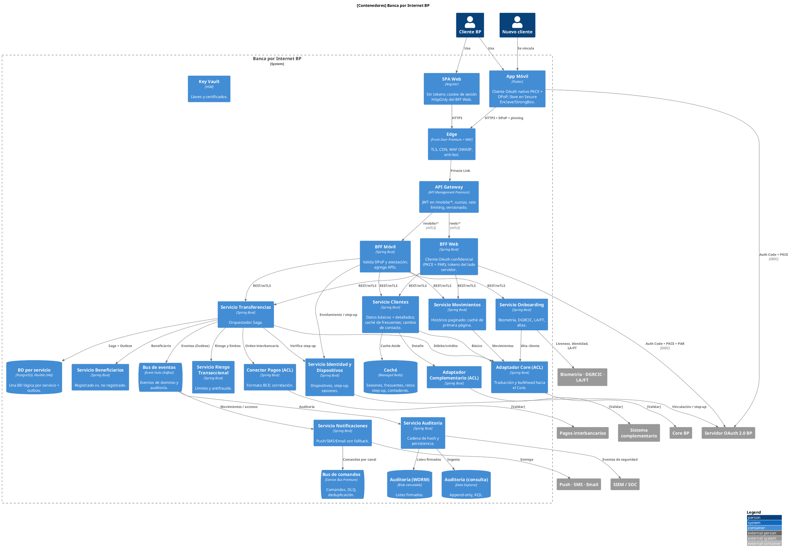

> Por legibilidad no se dibujan todas las relaciones con Event Hubs, Key Vault y PostgreSQL: todos los servicios publican auditoría, leen secretos por Workload Identity y tienen su BD lógica propia cuando la necesitan.

### 5.1.1 Servicios: requeridos y adicionales

| Servicio | Origen | Justificación |
|---|---|---|
| **Clientes**, **Movimientos**, **Transferencias** | Requeridos (RF-10) | Clientes también es dueño del cambio de contacto (**[Norma]** autenticación fuerte). |
| **Beneficiarios** | Adicional | **[Norma]** Segundo factor para destinos no registrados: requiere registro con estado. Evita inflar Transferencias. |
| **Riesgo Transaccional** | Adicional | **[Norma]** Monitoreo y bloqueo ante eventos inusuales; límites por cliente, canal y tipo. |
| **Identidad y Dispositivos** | Adicional | RF-07: dispositivo como factor de posesión; *step-up*; sesiones. |
| **Notificaciones**, **Auditoría**, **Onboarding** | Adicionales | RF-04, RF-08, RF-07. Auditoría concentra la escritura en la BD de auditoría. |
| **Adaptadores ACL** (Core, Complementario, Pagos) | Adicionales | Aíslan protocolos, **protegen el Core** con techo de concurrencia (bulkhead) y concentran *request coalescing*. |

### 5.1.2 Estilo de comunicación

| Origen → Destino | Estilo | Justificación |
|---|---|---|
| Canal → Edge → APIM → BFF → servicios → ACL | Síncrono, REST sobre mTLS | Interacción con respuesta inmediata. |
| Servicios → eventos | Asíncrono, Kafka vía **Transactional Outbox** | El evento se publica si y solo si la transacción se confirmó. |
| Eventos → Notificaciones / Auditoría / invalidación de caché | Asíncrono, Kafka | Desacople y reprocesamiento. |
| Notificaciones → canal | Service Bus (cola por canal) | Reintentos, DLQ, fallback. |

### 5.2 Diagramas de Componentes (C4 Nivel 3)

Todos los servicios siguen arquitectura hexagonal: controlador REST → caso de uso → dominio → puertos de salida → adaptadores envueltos por Resilience4j.

#### 5.2.1 Servicio Transferencias

Ejecuta RF-02 sin duplicados: valida riesgo, límites y segundo factor, coordina Core y pagos, y publica el evento que dispara la notificación obligatoria.

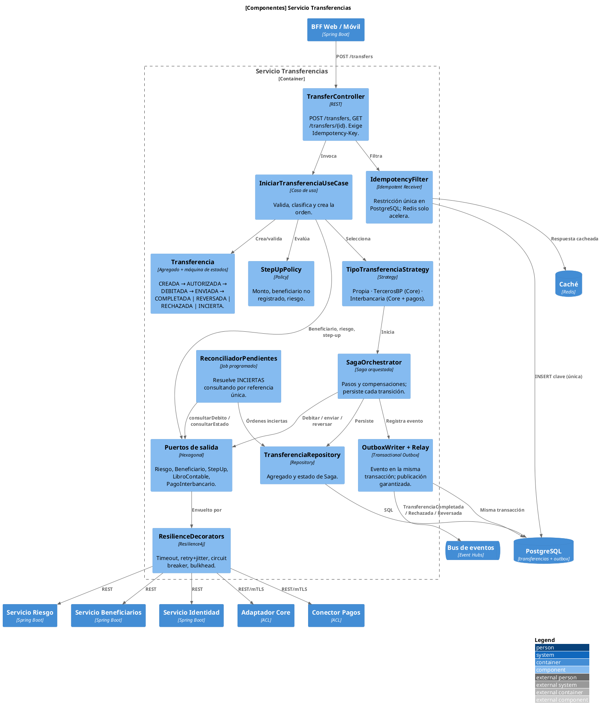

**Decisiones clave del servicio**
- **Idempotencia:** el cliente genera un `Idempotency-Key` por intención de pago; la garantía es una **restricción única en PostgreSQL** en la misma transacción que crea la orden, así que la protección se mantiene aunque Redis falle. Un doble débito es el defecto más grave en banca.
- **Saga orquestada (no coreografía):** no hay 2PC posible con el Core ni el BCE; el flujo es secuencial, con pocos participantes y requiere estado auditable en un solo lugar. Tras un reinicio, se retoma desde el último estado persistido.
- **Strategy por tipo:** cumple "invocar servicios externos según el tipo de transacción"; un tipo nuevo (p. ej. pago de servicios) es una estrategia nueva sin tocar la Saga.
- **Outbox:** **[Norma]** la notificación es obligatoria; sin outbox, un fallo entre commit y publicación dejaría una transacción sin notificar.
- **Reconciliador:** un *timeout* no es un rechazo; antes de compensar se consulta el estado real (§6.3).

| Tipo | Estrategia | Sistemas | Segundo factor en la transacción |
|---|---|---|---|
| Entre cuentas del mismo cliente | `PropiaStrategy` | Core | No; basta la sesión con 2 factores vigente |
| A terceros en BP | `TercerosBPStrategy` | Core | Sí, si el beneficiario no está registrado **[Norma]** |
| Interbancaria | `InterbancariaStrategy` | Core + pagos | Sí, si el beneficiario no está registrado **[Norma]** |

Las transferencias dentro de BP no tienen paso de envío: siguen operando aunque el conector de pagos esté caído.

#### 5.2.2 Servicio Clientes

Entrega RF-03 (básico desde Core, detalle desde el complementario), implementa la persistencia para clientes frecuentes (RF-09, detalle en §5.3) y gestiona el cambio de contacto con autenticación fuerte.

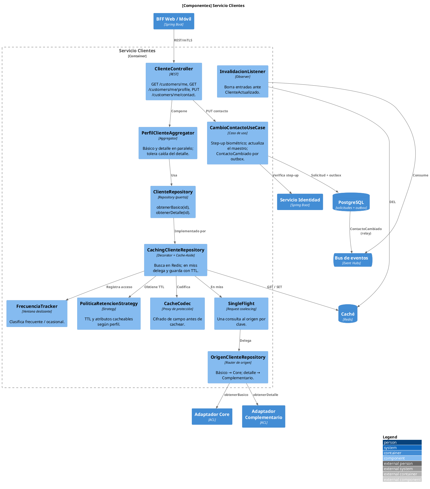

**Puntos clave:** el Aggregator es el único punto de composición y, si el complementario falla, devuelve el básico (degradación controlada). `ContactoCambiado` dispara la alerta al contacto **anterior**, la auditoría y la invalidación de caché.

#### 5.2.3 Servicio Movimientos

Entrega RF-01 paginado y filtrado, consultando directamente al Core (sin CQRS, ADR-15).

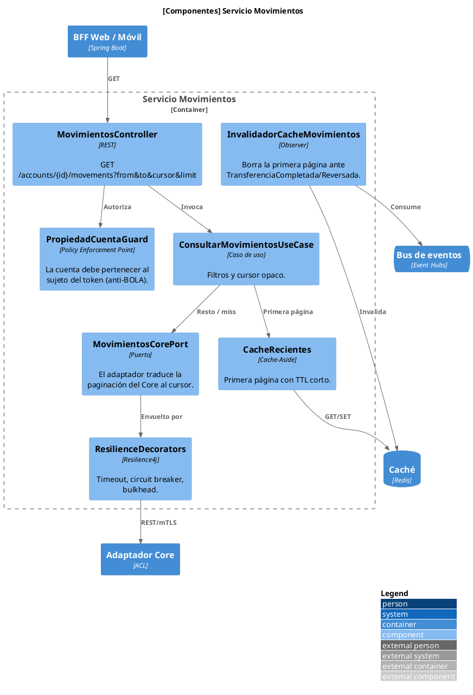

**Puntos clave:** BOLA es el riesgo n.º 1 del OWASP API Top 10, por eso nunca se confía en el `accountId` del cliente. La primera página es la consulta más frecuente: servirla desde caché reduce latencia (Q-05) y carga sobre el Core (R-04).

#### 5.2.4 Servicio Onboarding

Vincula a un nuevo cliente desde la app (RF-07). El flujo paso a paso está en §8.2.

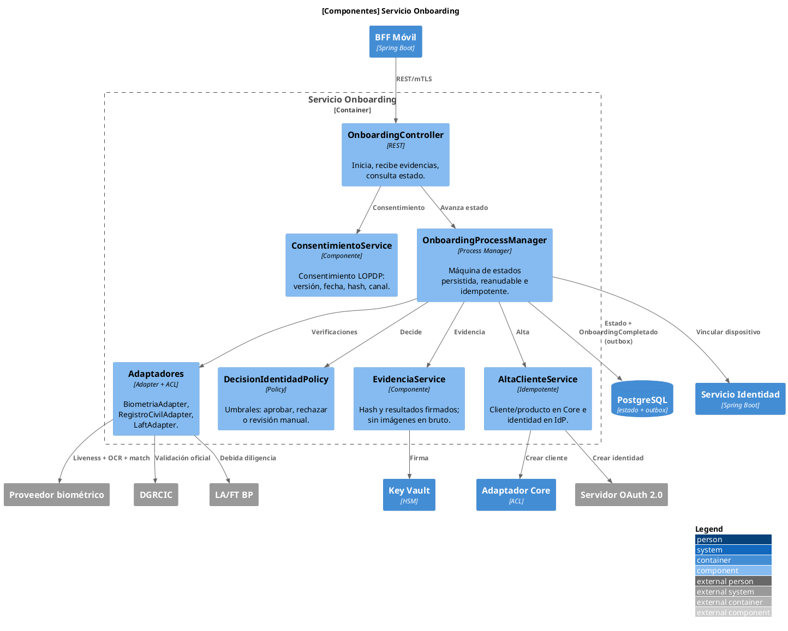

#### 5.2.5 Servicio Identidad y Dispositivos

Gestiona los factores propios del canal: dispositivo como factor de posesión, *step-up* por transacción y políticas de sesión.

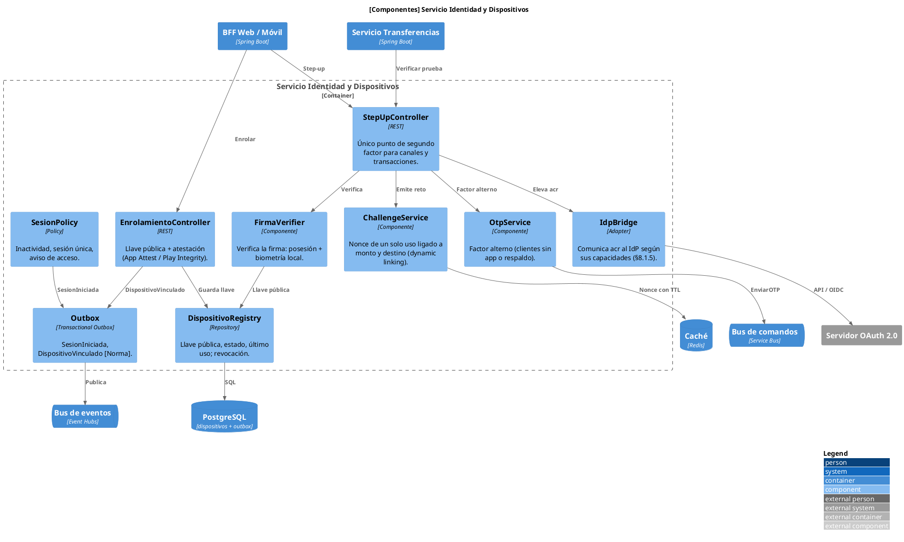

**Puntos clave:** la llave privada nunca sale del hardware seguro del teléfono; BP solo guarda la pública. La atestación impide vincular emuladores o apps modificadas.

#### 5.2.6 Servicio Notificaciones

Notifica cada movimiento y acceso (RF-04, **[Norma]**) con respaldo entre canales y evidencia de entrega.

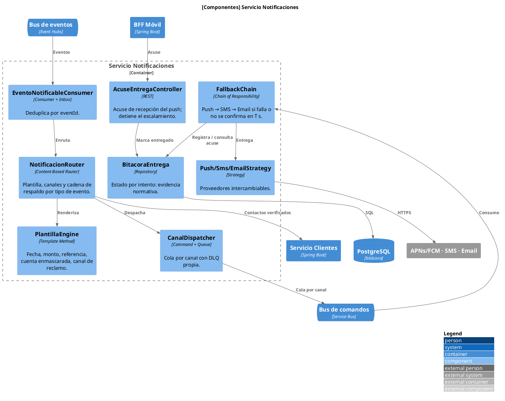

#### 5.2.7 Servicio Auditoría

Registra de forma inmutable todas las acciones (RF-08) y reenvía eventos de seguridad al SIEM (RNF-04). Diseño detallado en §8.5.

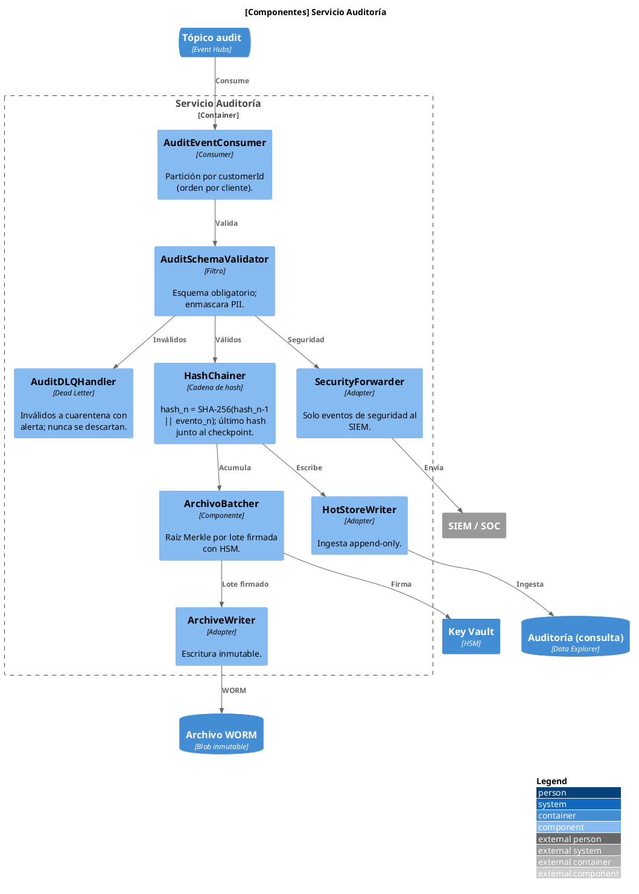

#### 5.2.8 BFFs y clientes (resumen de componentes)

| Contenedor | Componentes principales | Propósito |
|---|---|---|
| **BFF Web** | `LoginController` (cliente OIDC confidencial: PAR, callback con PKCE, logout) · `SessionManager` (cookie `__Host-sid` Secure/HttpOnly/SameSite=Strict, rotación) · `TokenStore` (tokens cifrados en Redis, refresh y revocación) · `CsrfGuard` (token anti-CSRF + `Origin`) · `VistaAggregator` (API Composition) · `DownstreamClient` (token exchange por audiencia, `traceId`, mTLS) · `AuditInterceptor` | Los tokens nunca llegan al navegador; un XSS no puede robarlos. |
| **BFF Móvil** | `ProofOfPossessionFilter` (DPoP contra `cnf.jkt`; sin DPoP en el IdP, firma de solicitud verificada por Identidad) · `AttestationGuard` · `VersionGuard` (fuerza actualización) · `VistaAggregator` · `OnboardingFacade` (única entrada al onboarding) · `PushAckController` · `DownstreamClient` · `AuditInterceptor` | Cada solicitud viene de un dispositivo vinculado y una app íntegra. |
| **App Móvil (Flutter)** | Presentación (widgets + BLoC) · Dominio (Dart puro, Clean Architecture) · Repositorios · `AuthModule` (AppAuth, RFC 8252) · `DPoPSigner` · `SecureKeyManager` (Secure Enclave / StrongBox) · `BiometriaLocal` (BiometricPrompt Clase 3) · `SecureStorage` · `HttpClient` (pinning, DPoP, `Idempotency-Key`, `traceparent`) · RASP + atestación · `OnboardingCapture` (SDK) · `PushHandler` | La biometría se valida en el teléfono y nunca se envía a BP; sin datos financieros en caché local (OWASP MASVS). |
| **SPA (Angular)** | App Shell (standalone + router, carga diferida) · Features · Estado (Signals / SignalStore, sin datos sensibles) · `ApiClient` (cookie, CSRF, `Idempotency-Key`, `traceparent`) · `SessionGuard` · Design System (WCAG 2.2 AA) · RUM OpenTelemetry · CSP estricta + Trusted Types + SRI | Sin tokens en el navegador; endurecimiento contra XSS y supply chain. |

### 5.3 Persistencia para clientes frecuentes (RF-09)

**Problema.** Los clientes frecuentes consultan repetidamente los mismos datos; ir al Core y al complementario en cada sesión agrega latencia y carga a sistemas que no escalan como la nube.

**Solución basada en patrones**

| Patrón | Componente | Rol |
|---|---|---|
| **Repository** | `ClienteRepository` | Abstracción que usa el dominio. |
| **Decorator + Cache-Aside** | `CachingClienteRepository` | Agrega caché sin modificar dominio ni origen (abierto/cerrado). |
| **Strategy** | `PoliticaRetencionStrategy` | Cuánto tiempo y qué se retiene según frecuencia. |
| **Observer** | `InvalidacionListener` | Invalida ante `ClienteActualizado` o cambio de contacto. |
| **Single-flight** | `SingleFlight` | Evita estampidas sobre el Core. |
| **Proxy de protección** | `CacheCodec` | Cifra atributos sensibles antes de cachear. |
| **Router de origen** | `OrigenClienteRepository` | Básico → Core, detalle → Complementario. |

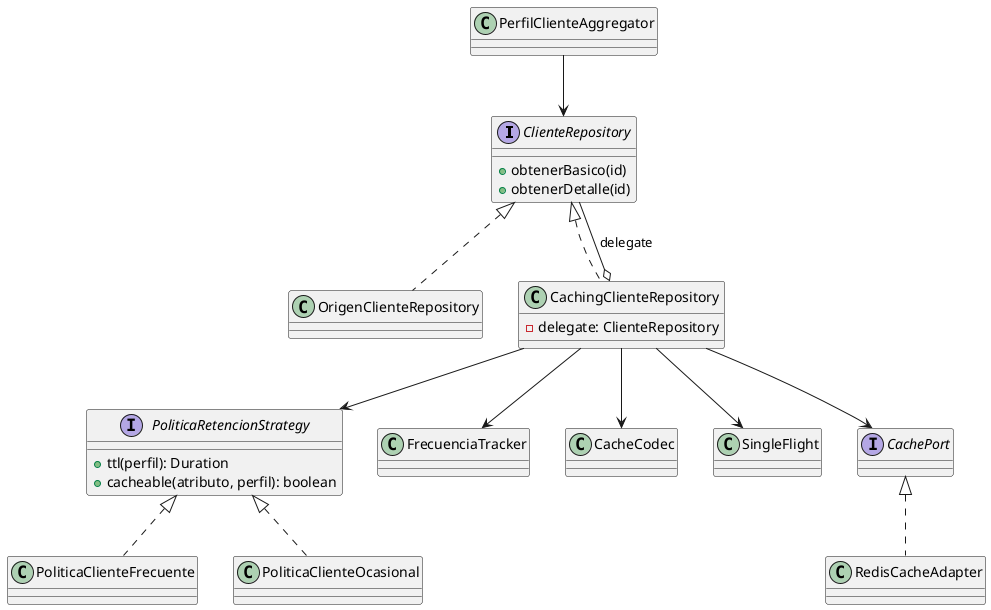

**Funcionamiento**
1. `FrecuenciaTracker` cuenta accesos en ventana deslizante (Redis `ZADD`/`ZCOUNT`); el umbral es configurable y se calibra con datos reales **[Validar]**.
2. **Frecuente:** TTL extendido para básico y detalle, con precalentamiento asíncrono al iniciar sesión. **Ocasional:** TTL corto, sin cachear el detalle.
3. **Nunca se cachean** saldos, credenciales ni datos de autenticación.
4. **Consistencia:** el TTL acota la antigüedad; la invalidación por evento la reduce a segundos si el Core emite eventos **[Validar]**.
5. **Seguridad:** cifrado de campo (llave en Key Vault), claves derivadas del `sub` opaco con sal (nunca de la cédula), Redis solo por Private Endpoint.
6. **Resiliencia:** si Redis falla, el Decorator degrada a llamada directa con circuit breaker.

**Beneficio:** menos latencia para el segmento que más usa el canal, menos carga sobre el Core y un dominio que no sabe que existe una caché.

---

## 6. Vista de ejecución

### 6.1 Inicio de sesión web (BFF)

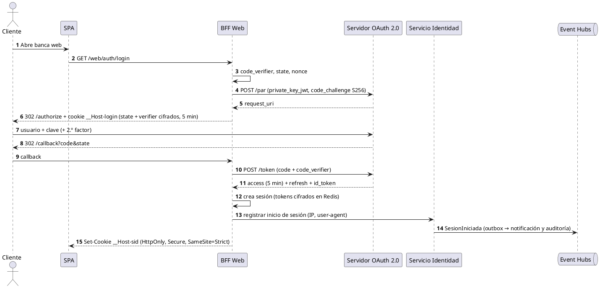

### 6.2 Transferencia interbancaria con *step-up*

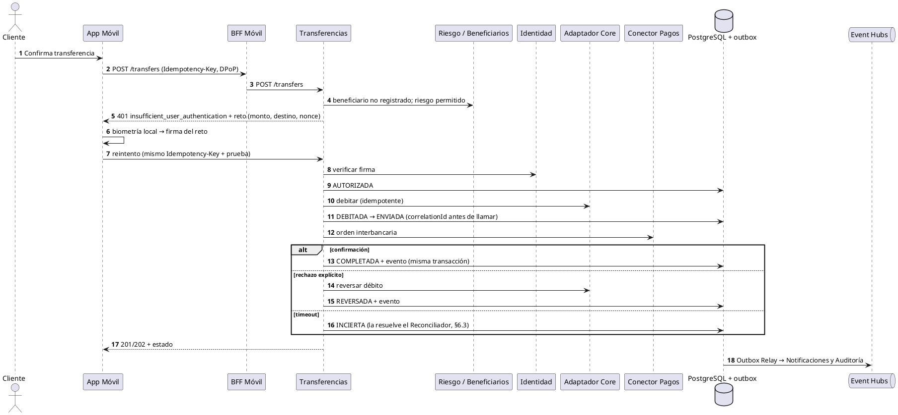

### 6.3 Falla y compensación

**Principio:** un *timeout* no es un rechazo. Nunca se compensa ni se informa un rechazo sin consultar antes el estado real por la referencia única.

| Punto de falla | Estado | Resolución del Reconciliador | Qué ve el cliente |
|---|---|---|---|
| Timeout del débito en el Core | `INCIERTA` | Aplicado → la Saga continúa; no aplicado → `RECHAZADA` sin efectos; sin respuesta → reintenta (sin consulta por referencia: conciliación por archivo, V-03) | "En proceso", luego notificación |
| Rechazo explícito del Core | — | `RECHAZADA` inmediata | Rechazo inmediato |
| Timeout del envío a pagos | `INCIERTA` | Liquidada → `COMPLETADA`; rechazada → reverso → `REVERSADA`; desconocido → reintenta | "En proceso", luego notificación |
| Rechazo explícito de pagos | — | Reverso → `REVERSADA` | Rechazo con reverso informado |

**Garantías:** el reverso usa la misma referencia y es idempotente (no puede reversar dos veces); cada transición se persiste con su evento en el outbox, de modo que el cliente siempre recibe la notificación del resultado final y la auditoría registra todo el recorrido. El cliente puede consultar con `GET /transfers/{id}`.

El onboarding se describe paso a paso en §8.2.1.

---

## 7. Vista de despliegue

### 7.1 Diagrama de despliegue

> Ilustra Chile Central como primaria; si se elige Brazil South (ADR-05), solo se intercambian los roles.

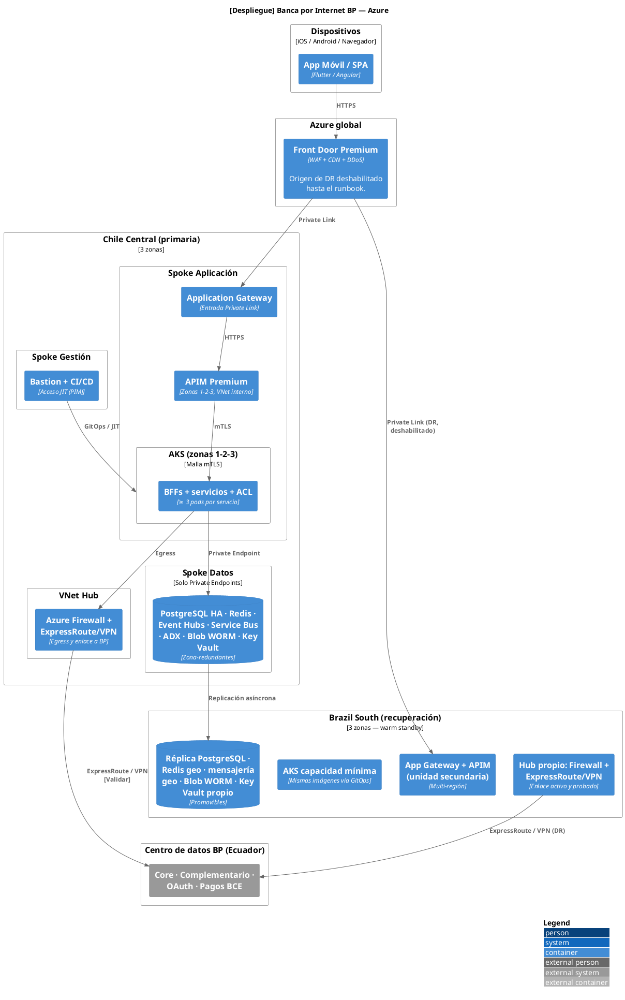

### 7.2 Red y latencia

- **Hub-and-spoke** por región: el Hub concentra conectividad híbrida, firewall y DNS privado; los *spokes* separan aplicación, datos y gestión. La región de recuperación tiene **su propio Hub** y no depende de la primaria.
- **Sin IPs públicas** en el backend: la única entrada pública es Front Door, que llega por **Private Link a un Application Gateway** (APIM en modo VNet interno no admite *private endpoint* de entrada).
- **Private Endpoints** para todos los servicios de datos; **egress** a Internet solo por Azure Firewall con lista de FQDN permitidos.
- **Tácticas de baja latencia:** CDN para estáticos, TLS en el borde con HTTP/2 persistente al origen, composición paralela en el BFF, caché de frecuentes y primera página de movimientos, asincronía en notificación y auditoría, *keep-alive* hacia el Core por el enlace privado.

### 7.3 Datos personales en la nube

La plataforma **no replica como maestro** ningún dato del Core, pero sí persiste datos personales propios: órdenes y beneficiarios (cuentas, montos, terceros), proceso de onboarding y consentimientos (sin biometría en bruto), llaves públicas de dispositivos, bitácora de notificaciones (destino enmascarado), cachés cifradas con TTL y auditoría seudonimizada (`sub` opaco, IP, dispositivo).

**Base legal:** según la LOPDP no hay transferencia cuando el **encargado** accede a los datos para prestar un servicio al responsable; por eso el contrato con el proveedor de nube se instrumenta como **encargo de tratamiento**. Si el dictamen fuera restrictivo, el plan escalonado es: seudonimización, cifrado con llaves de BP, reducción de datos y, en último caso, bases con PII on-premise (R-05).

---

## 8. Conceptos transversales

### 8.1 Autenticación y autorización

#### 8.1.1 Flujos recomendados

| Cliente | Flujo | Fundamento |
|---|---|---|
| **SPA (vía BFF Web)** | **Authorization Code + PKCE (S256) + PAR**, ejecutado por el BFF como cliente confidencial (`private_key_jwt` o mTLS). Tokens fuera del navegador; cookie `__Host-`; refresh rotado y cifrado en servidor. | RFC 9700, RFC 10017 (BFF), FAPI 2.0. |
| **App móvil** | **Authorization Code + PKCE** como cliente público nativo en el navegador del sistema, con **DPoP** firmado por llave no exportable; refresh restringido por DPoP y rotado. | RFC 8252, RFC 9449. FAPI 2.0 excluye clientes públicos: se compensa con DPoP, atestación y vinculación de dispositivo. |
| **Servicio a servicio** | **Client Credentials** (mTLS / `private_key_jwt`) + **Token Exchange** (RFC 8693) con audiencia por servicio. | Mínimo privilegio; un token filtrado no sirve contra otro servicio. |

**Descartados:** *Implicit* (fuga del token, RFC 9700); *ROPC* (expone la clave, impide MFA; prohibido por RFC 9700 y FAPI); Auth Code sin PKCE (inyección de código); tokens en `localStorage` (extraíbles por XSS).

#### 8.1.2 Gestión de tokens

| Aspecto | Decisión |
|---|---|
| Access token | JWT **PS256/ES256** (FAPI 2.0), vida **5 min**, audiencia por API, `cnf` (DPoP/mTLS); validación local. |
| Refresh token | Rotación en cada uso con detección de reutilización (revoca la familia). Web: en el BFF. Móvil: DPoP + Keychain/Keystore. |
| Sesión web | Inactividad 5 min con aviso, vida absoluta 30 min **[Objetivo propuesto]**. **[Norma]** cierre y reautenticación. |
| Revocación | Logout → revocación en el IdP (RFC 7009) + borrado en Redis + evento `SesionCerrada`. |
| Claims | `sub` opaco (**no** la cédula), `acr`, `amr`, `auth_time`, `scope`, `cnf`. |

#### 8.1.3 Métodos de ingreso post-onboarding

| Método | Canal | Factores (SB: 2 de 3) |
|---|---|---|
| **Usuario + clave** | Web y móvil | Conocimiento + posesión: en móvil el dispositivo vinculado; en web la **aprobación en el móvil vinculado** o, sin app, **OTP**. **[Norma]** usuario ≠ cédula, renovación anual. |
| **Biometría del dispositivo** con llave vinculada (modelo FIDO2) | Móvil | Inherencia (biometría local) + posesión (llave en hardware seguro). |

La **biometría nunca sale del dispositivo**: el servidor solo verifica una firma criptográfica, sin base biométrica central (minimización LOPDP). El **OTP** se usa solo para clientes sin app o como respaldo; por ser el factor más débil (SIM swap), el Servicio Riesgo aplica **límites menores** a esas operaciones **[Objetivo propuesto]**.

#### 8.1.4 *Step-up* por transacción

| Disparador | Exigencia |
|---|---|
| Toda transacción monetaria | Autenticación de 2 factores vigente (`acr` ≥ 2) **[Norma]** |
| Beneficiario **no registrado** | **Siempre** segundo factor en la transacción **[Norma]** |
| Registro de nuevo beneficiario | *Step-up* + notificación |
| Cambio de teléfono o correo | *Step-up* **biométrico** (no OTP al canal que se cambia) **[Norma]** |
| Riesgo alto | *Step-up*, retención o bloqueo preventivo **[Norma]** |

**Mecanismo (RFC 9470):** el servicio responde `401 insufficient_user_authentication`; el cliente obtiene la prueba y reintenta con el mismo `Idempotency-Key`. El reto firmado incluye **monto, destino y nonce** (*dynamic linking*), así que no sirve para otra transacción. En web, el *step-up* se resuelve preferentemente con un **push de aprobación a la app vinculada**.

#### 8.1.5 Variantes según capacidades del IdP **[Validar]**

| Capacidad | Si no la tiene |
|---|---|
| PAR | Auth Code + PKCE con parámetros en el *front channel* (sigue conforme a RFC 9700). |
| DPoP | El BFF Móvil exige una firma de solicitud con la llave del dispositivo, verificada por el Servicio Identidad. |
| FIDO2 nativo | El Servicio Identidad gestiona llaves y retos y comunica el resultado al IdP (RFC 7523). |
| Step-up por `acr_values` | El Servicio Identidad emite un token de transacción de un solo uso. |
| Token Exchange | Tokens de servicio + contexto del usuario firmado por el BFF. |

### 8.2 Onboarding con reconocimiento facial

#### 8.2.1 Flujo

Proceso largo con pasos externos, modelado como **Process Manager** persistido: reanudable e idempotente en cada paso.

| Paso | Detalle | Control |
|---|---|---|
| 1. Consentimiento | Texto versionado (incluye biometría), aceptación explícita y hash | **[Norma]** LOPDP |
| 2. Documento | OCR de la cédula y elementos de seguridad (SDK) | — |
| 3. Selfie con *liveness* | Detección de ataques de presentación | Proveedor ISO/IEC 30107-3 **[Validar]** |
| 4. Validación oficial | Consulta demográfica + biométrica a la **DGRCIC** | Contrato de adhesión |
| 5. Decisión | Aprobado / rechazado / **revisión manual** por umbrales | Configurables sin redeploy, auditados |
| 6. Debida diligencia | Listas y perfil de riesgo | **[Norma]** LA/FT |
| 7. Alta | Cliente y producto en el Core + identidad en el IdP | Idempotente (identificación + id de proceso) |
| 8. Credenciales | Usuario (≠ cédula) y clave | **[Norma]** SB |
| 9. Vinculación | Llave de dispositivo + atestación + biometría local | Habilita el ingreso biométrico |
| 10. Cierre | `OnboardingCompletado` → bienvenida y auditoría | — |

Si la DGRCIC no responde, el proceso queda "pendiente de validación" y se reanuda: nunca se aprueba una identidad sin validación.

#### 8.2.2 Relación con la autenticación

El onboarding deja **tres anclas de confianza**: identidad verificada (DGRCIC + liveness), credencial de conocimiento y **dispositivo vinculado**, que es el factor de posesión de todos los ingresos y *step-ups* posteriores. El **reenrolamiento** (pérdida o cambio de teléfono) repite liveness + DGRCIC, revoca el dispositivo anterior y se notifica por todos los canales.

#### 8.2.3 Protección de datos biométricos

- **Imágenes:** las procesa el proveedor; no se persisten en BP salvo la evidencia que exija la política LA/FT.
- **Plantillas biométricas:** no se crean ni guardan en BP.
- **Evidencia:** hash + resultado + puntajes + ids de transacción, firmados con HSM.
- **Contrato con el proveedor:** encargado del tratamiento, sin usos secundarios, con borrado verificable.

### 8.3 Integración

**API Gateway (APIM Premium):** enruta `/web/*` → BFF Web y `/mobile/*` → BFF Móvil (los servicios de dominio no se exponen a Internet). En `/mobile/*` valida JWT y presencia de DPoP; en `/web/*` solo viaja la cookie (la valida el BFF) y APIM verifica `Origin`. Además: rate limiting, cuotas, tamaño de payload, esquemas OpenAPI, versionado por ruta, `traceparent` W3C. Zona-redundante con unidad en la región de DR.

| Sistema externo | Patrón | Resiliencia |
|---|---|---|
| Core | ACL + Adapter + Bulkhead; protocolo **[Validar]** | Timeout, circuit breaker, **techo de concurrencia** pactado, retry solo en operaciones idempotentes |
| Sistema complementario | ACL + caché | Si falla, se muestra el básico sin detalle |
| Pagos interbancarios | ACL + Messaging Gateway + Correlation Identifier | Envío idempotente, consulta de estado, reconciliación; aísla cambios de formato del BCE |
| Biometría / DGRCIC | Adapter intercambiable | Timeout, circuit breaker, estado reanudable |
| Push / SMS / Email | Strategy + Chain of Responsibility | Fallback entre canales |

**Otros patrones aplicados:** Transactional Outbox (en todos los servicios cuyos eventos tienen notificación obligatoria), Idempotent Receiver / Inbox (Transferencias, Notificaciones, Auditoría), Publish-Subscribe, Competing Consumers, Dead Letter Channel, Request Coalescing y Correlation Identifier.

### 8.4 Acceso a datos

**Principios:** (1) **base de datos por servicio**, sin lectura de tablas ajenas; (2) **el Core y el complementario son la fuente de verdad**: la plataforma no los replica como maestros, solo cachea con TTL e invalidación por evento; (3) **Repository** como puerto: el dominio no conoce SQL, Redis ni el protocolo del Core.

| Fuente | Caché | Consistencia |
|---|---|---|
| Core — básico del cliente | Cache-Aside + política de frecuencia | Eventual acotada (TTL + eventos) |
| Core — movimientos | Primera página, TTL corto | Fuerte en consulta directa |
| Core — **saldos** | **Sin caché** | Fuerte |
| Sistema complementario | Cache-Aside, TTL medio | Eventual |
| Estado propio (transferencias, beneficiarios, onboarding, identidad, notificaciones, riesgo) | — | ACID local en PostgreSQL |

**PostgreSQL Flexible Server:** ACID, JSONB, particionamiento, *row-level security* y portabilidad. HA zona-redundante **síncrona** (RPO 0 ante pérdida de zona), réplica **asíncrona** entre regiones promovible, acceso solo por Private Endpoint con identidad administrada, TDE + cifrado de campo para PII.

**Clasificación:** *Restringido* (credenciales, llaves, tokens, hash biométrico: HSM, nunca en logs) · *Confidencial / sigilo bancario* (saldos, movimientos, beneficiarios, contactos: cifrado, enmascarado, acceso auditado) · *Interno* · *Público*.

### 8.5 Auditoría

**Objetivo:** registrar **todas** las acciones del cliente de forma completa, inmutable, verificable y consultable, sin agregar latencia.

| Capa | Patrón | Aplicación |
|---|---|---|
| Captura | **Interceptor (AOP)** | Librería común en BFFs y servicios: toda acción emite un `AuditEvent`. |
| Captura garantizada | **Transactional Outbox** | En comandos, el evento se escribe en la misma transacción del cambio. |
| Transporte | **Publish-Subscribe** | Tópico `audit` particionado por `customerId`. |
| Procesamiento | **Pipes and Filters** | Validar → enmascarar → encadenar hash → escribir. |
| Integridad | **Hash chain + Merkle firmado** | Cadena por partición; raíz Merkle por lote firmada con HSM; un verificador independiente recalcula periódicamente. |
| Persistencia | **Append-only + WORM** | Data Explorer para consulta forense (sin permisos de borrado); Blob inmutable para retención legal; SIEM solo con eventos de seguridad. |

**Esquema del evento:** `eventId`, `timestamp` (UTC/NTP), `actor` (`sub` opaco), `action`, `resource` (enmascarado), `result`, `channel`, `ip`/`userAgent`/`deviceId`/`geo` (**[Norma]** registro de IP), `authContext` (`acr`, `amr`), `traceId`, monto/moneda/contraparte enmascarada, `prevHash`/`hash`.

**Segregación:** el equipo que opera la plataforma no puede escribir ni borrar auditoría. **Retención:** la define Cumplimiento (COMF, SB, política documental); el diseño la resuelve con políticas configurables por tipo de evento (*hot* en meses, WORM en años).

### 8.6 Notificaciones

| Canal | Uso principal | Justificación |
|---|---|---|
| **Push** (APNs/FCM) | Transacciones, accesos, aprobación de *step-up* web | Inmediato, costo marginal casi nulo |
| **SMS** **[Validar]** proveedor | Respaldo de push; clientes sin app; eventos críticos | **[Norma]** "mensajería móvil"; alcance universal |
| **Email** (SPF, DKIM, DMARC) | Comprobantes, eventos no urgentes, respaldo | **[Norma]** "correo electrónico" |

| Evento | Canales | Criticidad |
|---|---|---|
| Inicio de sesión | Push (o SMS sin app) | Alta **[Norma]** |
| Transferencia o pago | Push + Email (comprobante); SMS si falla el push | Alta **[Norma]** |
| Nuevo beneficiario | Push + SMS | Alta |
| Cambio de teléfono o correo | **SMS al número anterior + Email al correo anterior** + push | Crítica (posible toma de cuenta) |
| Nuevo dispositivo vinculado | Push al dispositivo anterior + SMS + Email | Crítica |

**Alcance de RF-04:** se notifican los movimientos que el cliente **realiza** en la plataforma (todos salen de la Saga por outbox, así que la notificación está garantizada). Los movimientos externos (recibidos, cajero, ventanilla) se habilitan cuando el Core emita eventos (V-02), sin cambiar el servicio. **Contenido mínimo:** fecha y hora, tipo, monto, referencia, cuenta enmascarada y canal para reportar una transacción no reconocida **[Validar]** formato SB. Solo se usan contactos **verificados** y siempre enmascarados.

### 8.7 Alta disponibilidad, DR y auto-healing

#### 8.7.1 Alta disponibilidad en la región

| Capa | Mecanismo | Falla tolerada |
|---|---|---|
| Edge | Front Door global (anycast) | PoP o región |
| Gateway | APIM Premium zona-redundante | Zona |
| Cómputo | AKS en 3 zonas, ≥ 3 réplicas, `topologySpreadConstraints`, `PodDisruptionBudget` | Nodo o zona |
| Datos / caché / mensajería | PostgreSQL HA síncrona; Redis, Event Hubs y Service Bus zona-redundantes | Zona (RPO 0) |
| Conectividad on-premise | 2 enlaces independientes **en cada región** | Un enlace |
| Dependencias | Circuit breakers + degradación controlada | Caída de complementario, proveedores, etc. |

#### 8.7.2 Recuperación ante desastres: *Warm Standby*

| Opción | RTO | Decisión |
|---|---|---|
| Backup & Restore | Horas | Descartada: incompatible con un canal transaccional crítico |
| Pilot Light | ~1–2 h | Descartada: arranque en frío de cómputo y APIM |
| **Warm Standby** | **≤ 60 min** **[Objetivo propuesto]** | **Elegida**: equilibrio RTO/RPO/costo |
| Activo-Activo | Minutos | No justificada: el Core es único on-premise; duplica costo sin eliminar esa dependencia |

**Mecanismos y RPO:** código y configuración por GitOps (0); imágenes con réplica geográfica (0); PostgreSQL con réplica entre regiones (≤ 5 min); Redis geo-replicado (segundos, reconstruible); mensajería geo-replicada o reconstruida desde el outbox (≤ 5 min); auditoría con copia WORM en DR (ADX se reingesta); **una bóveda Key Vault por región** (Chile Central es no emparejada): las llaves que deben ser idénticas (cifrado de campo) las genera BP y las importa en ambas (BYOK), los secretos se sincronizan por pipeline.

**Activación:** el failover regional es **una sola decisión controlada**. El origen de DR permanece deshabilitado en Front Door (si recibiera tráfico antes de promover la BD, las transferencias fallarían contra una réplica de solo lectura). Un runbook automatizado, con aprobación de dos personas para evitar *split-brain*: (1) confirmar la pérdida de la primaria, (2) promover las réplicas de PostgreSQL, (3) escalar AKS y APIM, (4) verificar el enlace al Core desde el Hub de DR, (5) habilitar el origen de DR en Front Door.

#### 8.7.3 Auto-healing

Probes de *liveness*, *readiness* y *startup* · HPA y **KEDA** (lag y colas) · Cluster Autoscaler y reparación automática de nodos · **GitOps** que revierte cambios manuales · **rollback automático** de *canary* · circuit breaker *half-open* · failover automático de PostgreSQL · reintentos → DLQ → reprocesamiento · **chaos engineering** (Azure Chaos Studio) en preproducción y luego producción controlada.

#### 8.7.4 Degradación controlada

| Falla | Comportamiento |
|---|---|
| Complementario caído | Perfil básico; detalle "no disponible temporalmente". |
| Core lento | Bulkhead y timeout; consultas desde caché. Con circuit breaker abierto, las transferencias nuevas se rechazan **antes de debitar**; un débito ya enviado queda `INCIERTA` ("en proceso"). |
| Pagos interbancarios caídos | Las transferencias dentro de BP siguen; las interbancarias muestran aviso y no se debita. |
| Proveedor SMS caído | Proveedor alterno o cadena Push/Email. |
| Redis caído | Lectura directa con circuit breaker; las sesiones web se reautentican; la idempotencia **no se afecta** (PostgreSQL); los *step-ups* se rechazan (falla segura). |

### 8.8 Seguridad

| Capa | Controles |
|---|---|
| Perímetro | WAF (OWASP CRS + bots), DDoS, geo-filtering, TLS 1.2+ (preferente 1.3), HSTS |
| API | Validación JWT, OpenAPI, rate limiting, protección BOLA, OWASP API Top 10 |
| Identidad | OAuth 2.0/OIDC, MFA, *step-up*, DPoP, vinculación de dispositivo (§8.1) |
| Servicio a servicio | mTLS de malla (SPIFFE), políticas *deny-by-default*, Workload Identity |
| Red | Hub-spoke, NSG, Private Endpoints, egress por firewall |
| Datos y llaves | Cifrado en reposo con llaves del cliente en HSM, cifrado de campo, enmascarado en logs, rotación automática |
| Clientes | Web: BFF, CSP, Trusted Types, SRI, cookies `__Host-`. Móvil: llaves en hardware, RASP, atestación, pinning, ofuscación (OWASP MASVS) |
| Supply chain | SBOM, SAST/SCA/DAST/contenedores en CI, **firma de imágenes** y admisión solo de imágenes firmadas |
| Acceso privilegiado | JIT (PIM), MFA resistente a phishing, *break-glass* auditado, sin acceso permanente a producción |
| Detección | Defender for Cloud, SIEM/SOAR, casos de uso de fraude y toma de cuenta |

**Gestión de vulnerabilidades:** STRIDE por servicio en cada cambio arquitectónico; **pentest independiente [Norma]** antes de producción, anual y ante cambios mayores; SLA de remediación por severidad; verificación con OWASP ASVS y MASVS/MASTG.

**Trazabilidad normativa:** notificación en línea → §8.6 · 2 de 3 factores y segundo factor para no registrados → §8.1.3–8.1.4 · usuario ≠ cédula y renovación de clave → IdP · cierre de sesión → §8.1.2 · registro de IP → §8.5 · cambio de contacto con autenticación fuerte → §5.2.2 · bloqueo ante eventos inusuales → Servicio Riesgo · segmentación y pentest → §7.2, §8.8 · requisitos de nube → R-01, P8 · LOPDP → §7.3, §8.2.3, §8.4.

### 8.9 Monitoreo y observabilidad

**Arquitectura:** SDK/agente **OpenTelemetry** en SPA, app, BFFs y servicios → **OpenTelemetry Collector** (enriquece, elimina PII, *tail sampling*) → **Managed Prometheus** (métricas) y **Log Analytics / Application Insights** (logs y trazas) → **Managed Grafana** (dashboards) y **Azure Monitor** (alertas) → guardia/ITSM **[Validar]**; eventos de seguridad al SIEM.

**Qué se mide:** experiencia (RUM, *crash-free sessions*), APIs (RED: tasa, errores, p50/p95/p99), infraestructura (USE), dependencias (latencia y errores hacia Core, pagos, DGRCIC, proveedores; estado de circuit breakers), negocio (transferencias/min, tasa de éxito, tiempo hasta la notificación, onboardings), seguridad (logins fallidos, anomalías de dispositivo, WAF, RASP) y cumplimiento (% notificado a tiempo, lag e integridad de auditoría).

| SLI | SLO **[Objetivo propuesto]** |
|---|---|
| Disponibilidad de login y de transferencia | 99,95 % |
| Latencia p95 de consultas en caché | ≤ 300 ms |
| Notificación entregada al proveedor | 99 % en ≤ 30 s |
| Lag de auditoría | ≤ 60 s p99 |

Alertas por **burn-rate del presupuesto de error** (ventanas múltiples); **pruebas sintéticas** cada minuto de login, consulta y transferencia; nunca se registran tokens, claves ni números completos de cuenta.

### 8.10 Excelencia operativa

**IaC** con Terraform (módulos versionados, `plan` auditado) · **GitOps** con Flux o Argo CD · **CI/CD** con pruebas unitarias y de contrato, SAST/SCA, escaneo y firma de imágenes **[Validar]** herramienta · **despliegue progresivo** (*canary* con rollback automático, *feature flags*) · ambientes Dev, QA, Preproducción (datos sintéticos o enmascarados) y Producción · cambios mayores coordinados con Riesgo Operativo · **runbooks** automatizables · post-mortems sin culpables · pruebas de carga antes de fechas pico.

### 8.11 Gestión de costos

Sin métricas transaccionales de BP, las cifras son **ilustrativas** (orden de magnitud, precios de lista en USD consultados el 16-nov-2026). Escenario supuesto: 300 000 usuarios activos/mes, 6 000 sesiones concurrentes pico, 150 TPS pico, ~30 M solicitudes/mes, ~10 GB/día de logs, ~2 TB de auditoría archivada.

| Capa | Primaria | DR | Total | % |
|---|---|---|---|---|
| Entrada: APIM, Front Door, App Gateway | 9 080 | 2 795 | 11 875 | 41 % |
| Cómputo: AKS | 3 020 | 1 410 | 4 430 | 15 % |
| Mensajería: Event Hubs y Service Bus Premium | 1 995 | 2 180 | 4 175 | 15 % |
| Datos: PostgreSQL y Redis | 1 940 | 1 475 | 3 415 | 12 % |
| Red: Firewall, VPN, App Gateway DR | 1 325 | 1 630 | 2 955 | 10 % |
| Observabilidad | 1 015 | — | 1 015 | 4 % |
| Auditoría y Key Vault | 680 | 85 | 765 | 3 % |
| **Total mensual** | **19 055** | **9 575** | **~28 600** | 100 % |

**Lectura:** con reservas a 1 año en AKS baja a **~27 000 USD/mes** (~0,09–0,10 USD por usuario activo). **APIM (39 %)** y la **región de DR (33 %)** concentran ~62 % y son las primeras decisiones a revisar con volúmenes reales. *No incluye:* ExpressRoute, proveedores de SMS/correo/push/biometría, consultas DGRCIC, Defender/SIEM, ambientes no productivos, soporte, tráfico entre regiones e impuestos.

**Decisiones de costo/beneficio y palancas**

| Decisión | Alternativa más barata y por qué no | Palanca de optimización |
|---|---|---|
| APIM Premium | Standard: sin zonas, sin VNet interno ni multi-región → punto único de falla expuesto | Ajustar unidades; 2 unidades en 2 zonas ahorran ~2 800/mes |
| DR Warm Standby | Pilot Light / Backup: RTO de horas | Capacidad mínima; una unidad de APIM |
| AKS | Container Apps: menos control de red, mTLS y portabilidad | Reservas (−38 % en nodos), *spot* fuera de producción |
| PostgreSQL HA | Sin HA: una caída de zona puede perder transferencias | Servidores compartidos con aislamiento lógico |
| Service Bus / Event Hubs Premium | Standard: sin Private Endpoints / sin réplica geográfica | Event Hubs Standard si se acepta reconstruir desde el outbox (~2 800/mes) |
| Front Door Premium | Standard: sin Private Link ni WAF gestionado | — |
| Auditoría en ADX + Blob | Log Analytics (~3,2 USD/GB ingerido) | Tiers Cool/Archive por antigüedad |
| Push primero | SMS para todo (mayor costo unitario) | — |

**Control:** etiquetado obligatorio por servicio, ambiente y centro de costo, presupuestos con alertas. **Parámetros a validar:** usuarios y concurrencia pico, TPS, eventos de auditoría y retención, notificaciones por canal, onboardings/mes y volumen de logs.

---

## 9. Decisiones de arquitectura (ADR)

| ADR | Decisión | Alternativas | Motivo principal | Consecuencia |
|---|---|---|---|---|
| 01 | SPA en **Angular** | React | Gobierno, seguridad integrada, soporte predecible | Mayor curva de aprendizaje |
| 02 | App en **Flutter** | React Native | AOT nativo, UI consistente, hardware seguro | Verificar SDKs de terceros |
| 03 | **Java 25 / Spring Boot 4** | .NET 10 | Soporte vigente, virtual threads, ecosistema | Según competencias del equipo **[Validar]** |
| 04 | **Microservicios + hexagonal + API-led** | Monolito modular | Despliegue independiente, reutilización, aislamiento | Más complejidad operativa (mitigada con PaaS y GitOps) |
| 05 | **Azure, Chile Central ↔ Brazil South**; primaria según latencia y catálogo | AWS sa-east-1 + DR fuera de Sudamérica; AWS Chile (sin GA) | Única opción con primaria y DR en Sudamérica, 3 zonas | Chile Central no emparejada: DR diseñado por el cliente |
| 06 | **Auth Code + PKCE**, BFF web, DPoP móvil, PAR, RFC 9470 | Implicit, ROPC, tokens en navegador | RFC 9700, RFC 10017, FAPI 2.0 | Depende del IdP (variantes §8.1.5) |
| 07 | **Biometría local + llave de dispositivo** (FIDO2) | Biometría central; OTP SMS principal | Minimización LOPDP; resistencia a phishing y SIM swap | Reenrolamiento robusto |
| 08 | **Saga orquestada + Outbox + idempotencia** | 2PC; coreografía | Sin 2PC con Core/BCE; estado auditable | Construir el reconciliador |
| 09 | **Event Hubs (eventos) + Service Bus (comandos)** | Solo uno | Re-lectura y volumen vs. DLQ y deduplicación | Dos tecnologías gestionadas |
| 10 | **PostgreSQL Flexible** por servicio | Azure SQL, Cosmos DB | ACID, portabilidad, HA zonal | — |
| 11 | Auditoría **interceptor + outbox → Event Hubs → ADX + WORM**, hash + HSM | BD relacional única | Inmutabilidad verificable y escala | Dos almacenes |
| 12 | **Repository + Decorator + Cache-Aside + Strategy** con Redis | Caché en BFF; réplica del Core | Desacople, sin réplica maestra | Consistencia ligada a TTL/eventos |
| 13 | **3 canales** con fallback | 2 canales | Robustez y evidencia normativa | Costo SMS (mitigado con push-first) |
| 14 | DR **Warm Standby** | Pilot Light, Activo-Activo | RTO vs. costo con un Core único | RTO en minutos |
| 15 | **Movimientos: consulta directa + caché de primera página** (sin CQRS) | CQRS con modelo de lectura | Sin depender de CDC del Core; sin replicar histórico (LOPDP) | Carga de lectura en el Core, mitigada |

---

## 10. Requerimientos de calidad

| ID | Atributo | Origen | Objetivo medible **[Objetivo propuesto]** | Tácticas |
|---|---|---|---|---|
| Q-01 | Disponibilidad | RNF-01 | SLO 99,95 % mensual en consulta y transferencia | Zonas, ≥ 3 réplicas, failover automático, degradación |
| Q-02 | Recuperación | RNF-02 | Zona: RPO 0, RTO ≤ 2 min. Región: RTO ≤ 60 min, RPO ≤ 5 min | Replicación síncrona/asíncrona, runbooks probados |
| Q-03 | Auto-healing | RNF-06 | Recuperación sin intervención de fallas de contenedor, nodo, zona y dependencia, verificada con *chaos engineering* | §8.7.3 |
| Q-04 | Seguridad | RNF-03 | MFA en toda transacción monetaria, tokens restringidos al emisor, cifrado en tránsito y reposo | §8.1, §8.8 |
| Q-05 | Latencia | RNF-07 | p95 ≤ 300 ms en consultas en caché; p95 ≤ 1,5 s en transferencias dentro de BP (sin latencia del Core) | CDN, caché, BFF paralelo, asincronía |
| Q-06 | Mantenibilidad | RNF-08 | Despliegue independiente sin ventana; canal nuevo sin modificar APIs de proceso | Contratos versionados, *canary*, API-led |
| Q-07 | Escalabilidad | RNF-01/07 | Escalado horizontal automático | HPA/KEDA, servicios sin estado |
| Q-08 | Monitoreo | RNF-04 | Sintéticas cada minuto; alertas por burn-rate; `traceId` de punta a punta | §8.9 |
| Q-09 | Excelencia operativa | RNF-05 | 100 % infraestructura y despliegues desde código; rollback automático | §8.10 |
| Q-10 | Costos | RNF-09 | Costo por transacción digital medido mensualmente junto con el SLO | §8.11 |
| Q-11 | Auditabilidad | RF-08 **[Norma]** | 100 % de acciones con evidencia inmutable; lag ≤ 60 s p99 | §8.5 |

**Escenarios de calidad (estímulo → respuesta → medida)**

| ID | Estímulo | Respuesta | Medida |
|---|---|---|---|
| E-01 | Cae un nodo de AKS con réplicas de Transferencias | Readiness saca las réplicas; otras zonas atienden; AKS repara el nodo | Sin intervención; ninguna transferencia aceptada se pierde |
| E-02 | Se pierde la zona 1 en hora pico | Cómputo continúa en zonas 2 y 3; PostgreSQL conmuta a la réplica síncrona | RPO 0, RTO ≤ 2 min |
| E-03 | Se pierde la región primaria | Runbook con aprobación dual: promover BD, escalar, verificar Core, habilitar origen DR | RTO ≤ 60 min, RPO ≤ 5 min |
| E-04 | Atacante reutiliza un token móvil robado desde otro dispositivo | La prueba DPoP no corresponde al `cnf`; rechazo y evento al SIEM | 0 solicitudes aceptadas sin prueba de posesión |
| E-05 | Transferencia a beneficiario no registrado | `401` RFC 9470; firma biométrica de reto con monto, destino y nonce | 100 % con segundo factor ligado a la transacción **[Norma]** |
| E-06 | Consulta de histórico en hora pico | Primera página desde caché | p95 ≤ 300 ms |
| E-07 | Transferencia entre cuentas propias | Saga y confirmación; notificación y auditoría asíncronas | p95 ≤ 1,5 s sin Core |
| E-08 | El Core no responde a un débito enviado | `INCIERTA`; el Reconciliador consulta por referencia y completa o compensa | 0 dobles débitos; 100 % de inciertas resueltas y auditadas |

---

## 11. Riesgos y validaciones pendientes

### 11.1 Riesgos

| ID | Riesgo | Impacto | Mitigación |
|---|---|---|---|
| **R-01** | La exigencia SB de **TIA-942 TIER III** podría no estar respaldada por una certificación pública del hiperescalador en el formato esperado | Alto (regulatorio) | Atestaciones del proveedor, consulta formal previa a la SB, equivalencia de controles documentada, notificación previa |
| R-02 | Servicios no disponibles en Chile Central | Medio | Primaria en Brazil South si son críticos (ADR-05); resolver antes de validar el plan de DR |
| R-03 | Latencia del enlace híbrido hacia el Core | Medio-alto | Medición previa, caché, menos llamadas encadenadas, enlace privado |
| R-04 | Capacidad del Core ante el crecimiento digital | Alto | Bulkhead con techo de concurrencia, caché, pruebas de carga conjuntas |
| R-05 | Dictamen LOPDP restrictivo sobre región extranjera | Alto | Sin réplica maestra de PII + plan escalonado (§7.3) |
| R-06 | Fraude por ingeniería social | Alto | *Dynamic linking*, Servicio Riesgo, notificación inmediata y canal de reclamo |
| R-07 | Dependencia de la DGRCIC | Medio | Estado "pendiente" reanudable y monitoreo |
| R-08 | Indisponibilidad de proveedores de notificación | Medio | 3 canales + fallback + SMS alterno |

### 11.2 Información que BP debe confirmar (el diseño ya contempla cada variante)

| ID | Tema | Variante prevista |
|---|---|---|
| V-01 | Protocolo del Core, del complementario y de LA/FT | Cualquiera: lo encapsula el ACL |
| V-02 | Paginación del Core y si emite eventos de movimientos | Cursor opaco; invalidación por evento o por TTL |
| V-03 | Retención/captura en el Core y consulta por referencia | Hold/capture o débito/reverso; consulta o conciliación por archivo |
| V-04 | Modelo de conexión a pagos y modalidad de liquidación (tiempo real o cortes SPI) | ACL de pagos; en cortes, `ENVIADA` hasta liquidar |
| V-05 | Plataforma LA/FT y motor antifraude corporativos | Adaptador hacia ellos, o servicio/listas propios |
| V-06 | Proveedores de biometría, SMS y correo | Adaptadores intercambiables |
| V-07 | ExpressRoute con proveedor en Ecuador hacia ambas regiones | ExpressRoute + VPN, o 2 VPN IPsec |
| V-08 | Certificación ISO/IEC 30107-3 del proveedor biométrico | Requisito de contratación |
| V-09 | Sistema maestro de contactos y si emite eventos de cambio | `CambioContactoUseCase` escribe en el maestro; caché por evento o TTL |
| V-10 | Si "pagos" incluye servicios, tarjetas o recaudaciones | Nueva `PagoServiciosStrategy` + ACL, sin cambiar la Saga |
| V-11 | Cálculo de comisiones | Las calcula el Core; la plataforma las muestra |
| V-12 | SIEM y SOC de BP | Integración por `SecurityForwarder` o Sentinel + SOC administrado |
| V-13 | Contrato DGRCIC y tipo de validación habilitada | Integración en onboarding, o validación con proveedor / agencia |
| V-14 | Nivel TIA-942 del centro de datos del Core y evidencia de la nube | Condiciona el SLO y la región |

---

## 12. Glosario

| Término | Definición |
|---|---|
| ACL (Anti-Corruption Layer) | Adaptadores que traducen protocolos y modelos de sistemas legados para que no contaminen el dominio. |
| ADR | Registro breve de una decisión de arquitectura (§9). |
| API-led | APIs en tres capas —Experiencia, Proceso, Sistema— para reutilizar las de proceso. |
| BFF (Backend for Frontend) | Backend dedicado a un canal; en web guarda los tokens en el servidor. |
| Cache-Aside | Leer de la caché y, si no está, leer del origen y guardarlo. |
| Circuit breaker | Deja de llamar temporalmente a una dependencia que falla. |
| DGRCIC | Registro Civil del Ecuador; fuente oficial de identidad y biometría. |
| DLQ | Cola de mensajes que no pudieron procesarse, para revisarlos sin perderlos. |
| DPoP | Liga el token a una llave del cliente; un token robado no sirve sin ella (RFC 9449). |
| Dynamic linking | Vincular el *step-up* al monto y destino concretos que el cliente aprueba. |
| FAPI 2.0 | Perfil de seguridad OAuth para APIs financieras (OpenID Foundation). |
| FIDO2 | Autenticación con llaves en el dispositivo desbloqueadas con biometría local. |
| HSM | Hardware que genera y custodia llaves criptográficas sin exponerlas. |
| Idempotencia | Repetir una operación con la misma clave tiene efecto una sola vez. |
| INCIERTA | Estado de una transferencia de resultado desconocido (p. ej. tras timeout), que resuelve el Reconciliador. |
| LA/FT | Lavado de Activos y Financiamiento del Terrorismo. |
| Liveness | Prueba de vida frente a fotos, videos o máscaras. |
| LOPDP | Ley Orgánica de Protección de Datos Personales del Ecuador. |
| Outbox | Guardar el evento en la misma transacción que el cambio de estado y publicarlo después. |
| PAR / PKCE | PAR: parámetros de autorización enviados servidor a servidor (RFC 9126). PKCE: protege el código de autorización (RFC 7636). |
| RPO / RTO | Pérdida máxima de datos tolerada / tiempo máximo de restablecimiento. |
| Saga orquestada | Transacciones locales coordinadas por un orquestador, con compensaciones ante fallas. |
| SB | Superintendencia de Bancos del Ecuador. |
| Step-up | Autenticación reforzada en una operación sensible (RFC 9470). |
| Warm standby | Región secundaria desplegada con capacidad reducida que escala al activarse. |
| WORM | Almacenamiento que impide modificar o borrar durante la retención. |
| Zero Trust | Ninguna llamada es confiable por venir de la red interna. |

---

## Anexo A. Fuentes

**Normativa Ecuador**
- [Reglamento General de la LOPDP (gob.ec)](https://www.gob.ec/regulaciones/reglamento-general-ley-organica-proteccion-datos-personales-0)
- [SPDP — Normativa sobre transferencias de datos personales (NMS Law)](https://nmslaw.com.ec/blog/2025/08/04/alcance-transferencias-datos-personales-ecuador/)
- [Resolución SB-2018-771 — Gestión del riesgo operativo (Superintendencia de Bancos)](https://www.superbancos.gob.ec/bancos/wp-content/uploads/downloads/2018/08/resol_SB-2018-771.pdf)
- [Resolución SB-2025-02322 — Prevención LA/FT (Asobanca)](https://asobanca.org.ec/wp-content/uploads/2025/09/resolucion-SB-2025-2322.pdf)
- [SEPS — Norma de seguridades en canales electrónicos](https://www.seps.gob.ec/wp-content/uploads/Norma-canales-electro%CC%81nicos.pdf)
- [JPRM-2024-029-M — Transferencias inmediatas (Primicias)](https://primicias.ec/economia/transferencias-bancarias-ecuador-resolucion-junta-monetaria-banco-central-87660)
- [Res. BCE-GG-007-2026 — Estándar de mensajería de pagos en tiempo real (Asobanca)](https://asobanca.org.ec/wp-content/uploads/2026/03/RO-Res.-BCE-GG-007-2026-Estandar-mensajeria-transferencias-electronicas-pago-tiempo-real.pdf)
- [Circular BCE-GMPSN-2026-008-C — Norma Técnica SPI v2 (Asobanca)](https://asobanca.org.ec/wp-content/uploads/2026/03/Circular-BCE-GMPSN-2026-008-C-Cambio-SPI-LAFT.pdf)
- [Ley Reformatoria del COMF, 13-oct-2025 (NMS Law)](https://nmslaw.com.ec/blog/2025/10/20/ecuador-ley-reformatoria-codigo-organico-monetario-financiero/)
- [DGRCIC — Verificación por web service demográfico o demográfico + biométrico (gob.ec)](https://www.gob.ec/dgrcic/tramites/validacion-mediante-consulta-datos-web-service-demografico)

**Estándares**
- [RFC 9700 — OAuth 2.0 Security BCP](https://www.rfc-editor.org/rfc/rfc9700.html)
- [RFC 10017 — OAuth 2.0 for Browser-Based Applications](https://datatracker.ietf.org/doc/rfc10017/)
- [FAPI 2.0 Security Profile — Final](https://openid.net/specs/fapi-security-profile-2_0-final.html)

**Nube**
- [Azure — Region pairs and nonpaired regions](https://learn.microsoft.com/en-us/azure/reliability/regions-paired)
- [Azure — Services that support availability zones](https://learn.microsoft.com/en-us/azure/reliability/availability-zones-service-support)
- [Microsoft inaugura la región Chile Central](https://news.microsoft.com/es-xl/microsoft-inaugura-su-primera-region-de-datacenters-en-chile-para-acelerar-la-innovacion-y-el-desarrollo-economico-local/)
- [AWS abre la región de Chile a clientes seleccionados (DCD, 12-nov-2026)](https://www.datacenterdynamics.com/en/news/aws-launches-chile-cloud-region-for-select-customers/)
