# Propuesta de Arquitectura de Solución — Banca por Internet BP

| Campo | Valor |
|---|---|
| **Documento** | Propuesta de Arquitectura de Solución |
| **Entidad** | BP — Institución financiera regulada en la República del Ecuador |
| **Rol** | Arquitecto de Soluciones |
| **Documento base** | Ejercicio Práctico |
| **Fecha** | 2026-11-15 |
| **Notación de diagramas** | C4-PlantUML (`plantuml-stdlib/C4-PlantUML`) |

## Índice

- [Propuesta de Arquitectura de Solución — Banca por Internet BP](#propuesta-de-arquitectura-de-solución--banca-por-internet-bp)
  - [Índice](#índice)
  - [1. Introducción y metas](#1-introducción-y-metas)
    - [1.1 Vista de requerimientos](#11-vista-de-requerimientos)
      - [1.1.1 Requerimientos funcionales y su impacto](#111-requerimientos-funcionales-y-su-impacto)
    - [1.2 Metas de calidad](#12-metas-de-calidad)
    - [1.3 Partes interesadas (Stakeholders)](#13-partes-interesadas-stakeholders)
  - [2. Restricciones de la arquitectura](#2-restricciones-de-la-arquitectura)
    - [2.1 Restricciones del Ejercicio Práctico](#21-restricciones-del-ejercicio-práctico)
    - [2.2 Restricciones normativas (Ecuador) e impacto en el diseño](#22-restricciones-normativas-ecuador-e-impacto-en-el-diseño)
      - [2.2.1 Normas y su traducción a controles de arquitectura](#221-normas-y-su-traducción-a-controles-de-arquitectura)
      - [2.2.2 Estándares de industria adoptados](#222-estándares-de-industria-adoptados)
    - [2.3 Supuestos](#23-supuestos)
  - [3. Alcance y contexto del sistema](#3-alcance-y-contexto-del-sistema)
    - [3.1 Contexto de negocio — C4 Nivel 1 (Diagrama de Contexto)](#31-contexto-de-negocio--c4-nivel-1-diagrama-de-contexto)
      - [3.1.1 Diagrama](#311-diagrama)
      - [3.1.2 Descripción de elementos](#312-descripción-de-elementos)
      - [3.1.3 Justificación del límite del sistema](#313-justificación-del-límite-del-sistema)
  - [4. Estrategia de solución](#4-estrategia-de-solución)
    - [4.1 Resumen de la solución y decisiones principales](#41-resumen-de-la-solución-y-decisiones-principales)
    - [4.2 Principios y estilo arquitectónico](#42-principios-y-estilo-arquitectónico)
    - [4.3 Arquitectura Front-end (SPA) y Móvil](#43-arquitectura-front-end-spa-y-móvil)
      - [4.3.1 SPA Web — Angular vs. React](#431-spa-web--angular-vs-react)
      - [4.3.2 App móvil multiplataforma — Flutter vs. React Native](#432-app-móvil-multiplataforma--flutter-vs-react-native)
      - [4.3.3 ¿Por qué un BFF por canal?](#433-por-qué-un-bff-por-canal)
  - [5. Vista de bloques](#5-vista-de-bloques)
    - [5.1 Nivel 1 — C4 Nivel 2 (Diagrama de Contenedores)](#51-nivel-1--c4-nivel-2-diagrama-de-contenedores)
      - [5.1.1 Diagrama](#511-diagrama)
      - [5.1.2 Catálogo de contenedores](#512-catálogo-de-contenedores)
      - [5.1.3 Servicios: los 3 requeridos y los adicionales justificados](#513-servicios-los-3-requeridos-y-los-adicionales-justificados)
      - [5.1.4 Estilo de comunicación](#514-estilo-de-comunicación)
    - [5.2 Nivel 2 — C4 Nivel 3 (Diagramas de Componentes)](#52-nivel-2--c4-nivel-3-diagramas-de-componentes)
      - [5.2.1 Servicio Transferencias](#521-servicio-transferencias)
      - [5.2.2 Servicio Clientes (incluye la persistencia para clientes frecuentes)](#522-servicio-clientes-incluye-la-persistencia-para-clientes-frecuentes)
      - [5.2.3 Servicio Movimientos](#523-servicio-movimientos)
      - [5.2.4 Servicio Onboarding](#524-servicio-onboarding)
      - [5.2.5 Servicio Identidad y Dispositivos](#525-servicio-identidad-y-dispositivos)
      - [5.2.6 Servicio Notificaciones](#526-servicio-notificaciones)
      - [5.2.7 Servicio Auditoría](#527-servicio-auditoría)
      - [5.2.8 BFF Web](#528-bff-web)
      - [5.2.9 BFF Móvil](#529-bff-móvil)
      - [5.2.10 App Móvil (Flutter)](#5210-app-móvil-flutter)
      - [5.2.11 SPA Web (Angular)](#5211-spa-web-angular)
    - [5.3 Nivel 3 — Persistencia para clientes frecuentes](#53-nivel-3--persistencia-para-clientes-frecuentes)
      - [5.3.1 Problema](#531-problema)
      - [5.3.2 Alternativa basada en patrones](#532-alternativa-basada-en-patrones)
      - [5.3.3 Funcionamiento](#533-funcionamiento)
      - [5.3.4 Beneficio](#534-beneficio)
  - [6. Vista de ejecución](#6-vista-de-ejecución)
    - [6.1 Secuencia — inicio de sesión web (BFF)](#61-secuencia--inicio-de-sesión-web-bff)
    - [6.2 Secuencia — onboarding móvil](#62-secuencia--onboarding-móvil)
    - [6.3 Secuencia — transferencia interbancaria](#63-secuencia--transferencia-interbancaria)
    - [6.4 Secuencia — falla y compensación de una transferencia](#64-secuencia--falla-y-compensación-de-una-transferencia)
  - [7. Vista de despliegue](#7-vista-de-despliegue)
    - [7.1 Diagrama de despliegue](#71-diagrama-de-despliegue)
    - [7.2 Topología de red](#72-topología-de-red)
    - [7.3 Estrategia de baja latencia](#73-estrategia-de-baja-latencia)
    - [7.4 Consideración de datos personales](#74-consideración-de-datos-personales)
  - [8. Conceptos transversales](#8-conceptos-transversales)
    - [8.1 Arquitectura de Autenticación y Autorización](#81-arquitectura-de-autenticación-y-autorización)
      - [8.1.1 Flujos recomendados según el estándar](#811-flujos-recomendados-según-el-estándar)
      - [8.1.2 Gestión de tokens](#812-gestión-de-tokens)
      - [8.1.3 Métodos de ingreso después del onboarding](#813-métodos-de-ingreso-después-del-onboarding)
      - [8.1.4 Autenticación reforzada (*step-up*) por transacción](#814-autenticación-reforzada-step-up-por-transacción)
      - [8.1.5 Variantes según las capacidades del IdP de BP (sin asumir)](#815-variantes-según-las-capacidades-del-idp-de-bp-sin-asumir)
    - [8.2 Arquitectura de Onboarding con reconocimiento facial](#82-arquitectura-de-onboarding-con-reconocimiento-facial)
      - [8.2.1 Diseño](#821-diseño)
      - [8.2.2 Relación del onboarding con la autenticación y la autorización](#822-relación-del-onboarding-con-la-autenticación-y-la-autorización)
      - [8.2.3 Protección de datos biométricos](#823-protección-de-datos-biométricos)
    - [8.3 Arquitectura de Integración](#83-arquitectura-de-integración)
      - [8.3.1 API Gateway (Azure API Management)](#831-api-gateway-azure-api-management)
      - [8.3.2 Integración con sistemas externos](#832-integración-con-sistemas-externos)
      - [8.3.3 Patrones de integración aplicados](#833-patrones-de-integración-aplicados)
    - [8.4 Arquitectura de Acceso a Datos](#84-arquitectura-de-acceso-a-datos)
      - [8.4.1 Principios](#841-principios)
      - [8.4.2 Fuentes y estrategias](#842-fuentes-y-estrategias)
      - [8.4.3 Motor de base de datos — PostgreSQL Flexible Server](#843-motor-de-base-de-datos--postgresql-flexible-server)
      - [8.4.4 Clasificación de datos](#844-clasificación-de-datos)
    - [8.5 Solución de Auditoría](#85-solución-de-auditoría)
      - [8.5.1 Objetivo](#851-objetivo)
      - [8.5.2 Diseño (patrones)](#852-diseño-patrones)
      - [8.5.3 Esquema del evento de auditoría](#853-esquema-del-evento-de-auditoría)
      - [8.5.4 Almacenes](#854-almacenes)
      - [8.5.5 Retención](#855-retención)
    - [8.6 Notificaciones](#86-notificaciones)
      - [8.6.1 Canales (mínimo exigido: 2; se proponen 3)](#861-canales-mínimo-exigido-2-se-proponen-3)
      - [8.6.2 Reglas de entrega](#862-reglas-de-entrega)
    - [8.7 Alta disponibilidad, recuperación ante desastres y auto-healing](#87-alta-disponibilidad-recuperación-ante-desastres-y-auto-healing)
      - [8.7.1 Alta disponibilidad (dentro de la región)](#871-alta-disponibilidad-dentro-de-la-región)
      - [8.7.2 Recuperación ante desastres (entre regiones)](#872-recuperación-ante-desastres-entre-regiones)
      - [8.7.3 Auto-healing](#873-auto-healing)
      - [8.7.4 Degradación controlada](#874-degradación-controlada)
    - [8.8 Seguridad](#88-seguridad)
      - [8.8.1 Controles por capa](#881-controles-por-capa)
      - [8.8.2 Gestión de vulnerabilidades y pruebas](#882-gestión-de-vulnerabilidades-y-pruebas)
      - [8.8.3 Cumplimiento normativo de seguridad (resumen)](#883-cumplimiento-normativo-de-seguridad-resumen)
    - [8.9 Monitoreo y observabilidad](#89-monitoreo-y-observabilidad)
      - [8.9.1 Arquitectura](#891-arquitectura)
      - [8.9.2 Qué se mide](#892-qué-se-mide)
      - [8.9.3 SLOs y alertas](#893-slos-y-alertas)
    - [8.10 Excelencia operativa](#810-excelencia-operativa)
    - [8.11 Gestión de costos](#811-gestión-de-costos)
      - [8.11.1 Decisiones de infraestructura: costo/beneficio](#8111-decisiones-de-infraestructura-costobeneficio)
      - [8.11.2 Estimación de referencia (un escenario)](#8112-estimación-de-referencia-un-escenario)
      - [8.11.3 Parámetros para ajustar la estimación **\[Validar\]**](#8113-parámetros-para-ajustar-la-estimación-validar)
  - [9. Decisiones de diseño](#9-decisiones-de-diseño)
    - [9.1 Registro de decisiones de arquitectura (ADR)](#91-registro-de-decisiones-de-arquitectura-adr)
  - [10. Requerimientos de calidad](#10-requerimientos-de-calidad)
    - [10.2 Requisitos de calidad medibles](#102-requisitos-de-calidad-medibles)
      - [10.2.1 Escenarios en formato estímulo–respuesta](#1021-escenarios-en-formato-estímulorespuesta)
  - [11. Riesgos](#11-riesgos)
    - [11.1 Riesgos](#111-riesgos)
    - [11.2 Información que BP debe confirmar (el diseño ya contempla cada variante)](#112-información-que-bp-debe-confirmar-el-diseño-ya-contempla-cada-variante)
  - [12. Glosario](#12-glosario)
  - [Anexo A. Fuentes](#anexo-a-fuentes)

---

## 1. Introducción y metas

Este documento describe la arquitectura de solución propuesta para la plataforma de Banca por Internet de BP, como respuesta al Ejercicio Práctico.

### 1.1 Vista de requerimientos

#### 1.1.1 Requerimientos funcionales y su impacto

| ID Ejercicio Práctico | Requerimiento | Impacto en la arquitectura |
|---|---|---|
| RF-01 | Histórico de movimientos | Servicio de Movimientos con consulta directa al Core por el adaptador ACL, paginación por cursor y caché de la primera página. |
| RF-02 | Transferencias y pagos: entre cuentas propias, a terceros en BP e interbancarias | Servicio de Transferencias con Saga, idempotencia, límites y antifraude; una estrategia por tipo de transacción decide qué servicios externos se invocan. El conector de pagos interbancarios queda aislado. |
| RF-03 | Datos básicos (Core) y detallados (complementario) | Servicio de Clientes con composición de fuentes (patrón Aggregator) y caché para clientes frecuentes. |
| RF-04 | Notificación de movimientos (≥ 2 sistemas) | Servicio de Notificaciones guiado por eventos, con 3 canales y fallback. |
| RF-05 | SPA + app móvil multiplataforma | Angular + Flutter, con un BFF por canal. |
| RF-06 | OAuth 2.0, recomendar flujo | Authorization Code + PKCE, BFF y DPoP (§8.1). |
| RF-07 | Onboarding con reconocimiento facial | Servicio de Onboarding + proveedor biométrico + DGRCIC + enrolamiento de dispositivo (§8.2). |
| RF-08 | BD de auditoría de todas las acciones | Pipeline de auditoría inmutable (§8.5). |
| RF-09 | Persistencia para clientes frecuentes basada en patrones | Cache-Aside + Decorator + Strategy (§5.3). |
| RF-10 | API Gateway + 3 servicios (+ opcionales) | Azure API Management + los 3 servicios requeridos + 6 servicios adicionales justificados + 3 adaptadores ACL (§5.1.3). |

### 1.2 Metas de calidad

Las metas se derivan de los requerimientos no funcionales del Ejercicio Práctico y de la normativa aplicable. Todos los RNF, con sus objetivos medibles, están en la §10.

| Prioridad | Meta de calidad | Origen | Motivación | Requisitos medibles (§10.2) |
|---|---|---|---|---|
| 1 | **Seguridad** | RNF-03. **[Norma]** SB, LOPDP | BP es una entidad regulada que mueve dinero y trata datos personales y biométricos: una brecha tiene impacto financiero, legal y reputacional. Prevalece sobre la latencia y la comodidad; por ejemplo, el *step-up* añade un paso, pero se exige en toda transacción monetaria. | Q-04 |
| 2 | **Disponibilidad y resiliencia** | RNF-01, RNF-02, RNF-06 | El canal digital atiende a todos los clientes a la vez y una caída los afecta a todos. **[Norma]** La norma de riesgo operativo exige gestionar la continuidad. Prevalece sobre la latencia y el costo; por ejemplo, el *warm standby* cuesta más que un *pilot light* (ADR-14). | Q-01, Q-02, Q-03, Q-07 |
| 3 | **Baja latencia** | RNF-07 | Es el único RNF para el que el Ejercicio Práctico declara presupuesto disponible, lo que indica el peso que BP le da a la experiencia del cliente. Cede ante la seguridad y la disponibilidad. | Q-05 |
| 4 | **Desacoplamiento y reutilización** | RNF-08 | Los futuros canales y módulos deben construirse sobre las mismas APIs de proceso sin rehacerlas (API-led, §4.2). | Q-06 |
| 5 | **Auditabilidad** | RF-08. **[Norma]** | Toda acción del cliente debe dejar evidencia inmutable y verificable para la SB, la auditoría interna y la atención de reclamos. No es un RNF del Ejercicio Práctico, pero en banca es una meta de calidad de primer nivel. | Q-11 |

### 1.3 Partes interesadas (Stakeholders)

*Borrador propuesto — validar con BP los roles y sus expectativas.*

| Rol | Expectativa sobre la arquitectura | Secciones de interés |
|---|---|---|
| Cliente final (persona natural) | Operar de forma segura, rápida y disponible en web y móvil; abrir su acceso sin ir a una agencia; recibir aviso inmediato de cada movimiento. | §1.1, §6.2, §8.1.3, §8.6 |
| Negocio — Banca digital BP | Lanzar funciones con rapidez, reutilizar las APIs en canales futuros y mantener el costo bajo control. | §4, §5.1, §8.11 |
| Seguridad de la información | Autenticación robusta (PKCE, DPoP, *step-up*), Zero Trust, cifrado en tránsito y en reposo, y gestión de vulnerabilidades. | §4.2, §8.1, §8.8 |
| Oficial de cumplimiento (LA/FT, LOPDP) | Debida diligencia en el onboarding, protección de datos personales y biométricos, tratamiento de datos fuera del país y retención de evidencia. | §2.2, §7.4, §8.2, §8.5 |
| Superintendencia de Bancos (SB) | Cumplimiento normativo en nube, continuidad, auditoría inmutable y notificación de transacciones. | §2.2, §8.5, §8.7, §8.8.3, §11.1 |
| Dueños de sistemas existentes (Core, sistema complementario, servidor OAuth) | Integración sin modificar sus sistemas y carga controlada sobre el Core. | §3, §8.3, §11.2 |
| Operaciones / SRE | Observabilidad de punta a punta, auto-healing, despliegues sin ventana de mantenimiento y runbooks. | §7, §8.7, §8.9, §8.10 |
| Equipos de desarrollo | Límites claros entre servicios, contratos versionados, tecnologías definidas y convenciones. | §4.3, §5.2, §9.1 |
| Auditoría interna | Trazabilidad completa e inmutable de las acciones y capacidad de consulta forense. | §8.5, §9.1 (ADR-11) |

---

## 2. Restricciones de la arquitectura

### 2.1 Restricciones del Ejercicio Práctico

- La información del cliente proviene **exclusivamente** del Core y del sistema complementario.
- El servidor OAuth 2.0 **ya existe** y solo se configura.
- Nube permitida: AWS o Azure. Hay presupuesto para baja latencia.
- Modelado C4 hasta el nivel de Componentes.

### 2.2 Restricciones normativas (Ecuador) e impacto en el diseño

> El análisis se hizo sobre fuentes primarias publicadas.

#### 2.2.1 Normas y su traducción a controles de arquitectura

| Norma | Contenido relevante | Control / decisión de arquitectura |
|---|---|---|
| **Ley Orgánica de Protección de Datos Personales (LOPDP) y su reglamento** | Base de legitimación, derechos del titular, seguridad del tratamiento y transferencia internacional. Los datos biométricos son categoría especial. | Consentimiento explícito y registrado en el onboarding. Minimización (no se conservan imágenes biométricas en bruto, §8.2.3). Cifrado. Registro de actividades de tratamiento.|
| **Normativa SPDP sobre transferencias** | Precisa el alcance de las transferencias y comunicaciones nacionales e internacionales. | El alojamiento en una región de nube fuera del Ecuador debe instrumentarse con el proveedor como **encargado del tratamiento** y con contrato conforme a la LOPDP. |
| **Codificación de Normas de la SB, Libro I, Título IX, Cap. V — Gestión del riesgo operativo** | Notificación en línea al cliente (mensajería móvil, correo u otro mecanismo) del acceso y de las transacciones. Autenticación de al menos 2 de 3 factores para transacciones monetarias. Segundo factor siempre para cuentas destino no registradas. Usuario distinto del número de cédula. Cierre de sesión y reautenticación. Registro de IP. Cambio de teléfono o correo de notificación solo presencial o con autenticación fuerte (p. ej. biometría facial). Renovación de claves al menos anual. | Servicio de Notificaciones obligatorio para inicio de sesión y para cada transacción (§8.6). MFA y *step-up* por transacción (§8.1.4). Servicio de Beneficiarios que diferencia registrados y no registrados (§5.1.3). Política de usuario (≠ cédula) en el IdP. Captura de IP, dispositivo y geolocalización en auditoría (§8.5). El cambio de datos de contacto exige *step-up* biométrico (§8.1.4). |
| **Misma norma — Sección VI, *Servicios provistos por terceros* (computación en la nube)** | Informar a la SB los servicios contratados con su análisis de riesgos. Centros de datos principal o alterno bajo **TIA-942** con certificación mínima **TIER III**. Proveedor con **ISO 27001**. Proveedores alternos para mitigar la dependencia de uno solo. | Notificación previa a la SB (proceso de gobierno)|
| **Misma norma — Sección VII, *Seguridad de la información*** | Segmentación de red basada en riesgos. Pruebas de vulnerabilidad y penetración por un tercero independiente. | Segmentación (hub-spoke, subredes, NSG, Private Endpoints). Plan anual de pentest (§8.8). |
| **Código Orgánico Monetario y Financiero (COMF)** | Sigilo y reserva bancaria. Sistema central de pagos a cargo del BCE. Conservación de documentos. | Datos financieros clasificados como *Confidencial*, con acceso mínimo y auditado. Retención de evidencias según la política documental de BP (§8.5.5). |
| **Norma de interoperabilidad de pagos inmediatos**, **estándar de mensajería BCE** y **Norma Técnica SPI v2** | Pagos inmediatos interoperables y formatos técnicos del BCE. | Aislamiento del **Conector de Pagos Interbancarios** como adaptador (ACL). Los cambios de formato del BCE no afectan al dominio de Transferencias (§8.3.3). |
| **Prevención de LA/FT** — norma de control SB | Debida diligencia del cliente. | Controles LA/FT en el onboarding y monitoreo transaccional (§8.2, §5.1.3). |
| **Servicio de interoperabilidad DGRCIC** — trámite *"Verificación mediante consulta de datos por web service demográfico o demográfico más biométrico"* | Las personas jurídicas privadas pueden validar datos demográficos y biométricos mediante contrato de adhesión. | Integración oficial de validación de identidad en el onboarding (§8.2). |

#### 2.2.2 Estándares de industria adoptados

| Estándar | Uso en la propuesta |
|---|---|
| **RFC 9700** — *Best Current Practice for OAuth 2.0 Security* (ene-2025) | Base del diseño OAuth: PKCE obligatorio|
| **RFC 10017** — *OAuth 2.0 for Browser-Based Applications* (BCP, ago-2026) | Patrón BFF para la SPA. |
| **RFC 8252** — *OAuth 2.0 for Native Apps* | Flujo en navegador del sistema para la app móvil. |
| **RFC 9449** — DPoP; **RFC 9126** — PAR; **RFC 9470** — *Step-up Authentication Challenge* | Tokens restringidos al emisor, solicitudes de autorización por canal trasero y *step-up* por transacción. |
| **FAPI 2.0 Security Profile** (Final, feb-2025) | Perfil de seguridad de referencia para APIs financieras. |
| **ISO/IEC 27001:2022**, **ISO 22301** | Gestión de seguridad y continuidad. |
| **OWASP ASVS** y **OWASP MASVS/MASTG** | Requisitos y pruebas de seguridad web y móvil. |
| **ISO/IEC 30107-3** | Evaluación de la detección de ataques de presentación (*liveness*) del proveedor biométrico. |
| **FIDO2 / WebAuthn** | Base del modelo de llave de dispositivo y biometría local (§8.1.3). |
| **NIST CSF 2.0** | Marco de gobierno del programa de ciberseguridad. |
| **OpenTelemetry** | Estándar de telemetría (§8.9). |

### 2.3 Supuestos

Un supuesto es algo que el diseño da por cierto **sin que el Ejercicio Práctico lo declare**. Se distingue de una restricción (§2.1 y §2.2), que viene dada, y de una validación pendiente (§11.2), que es la pregunta concreta a BP. Cada supuesto indica qué cambia si resulta falso; en todos los casos el cambio se concentra en un adaptador o en un componente acotado.

| ID | Supuesto | Por qué se asume | Si resulta falso | Validación |
|---|---|---|---|---|
| S-01 | BP ya participa en el sistema de pagos del BCE (SPI / pagos inmediatos) y dispone de un conector o *switch* que la plataforma invoca | Toda entidad financiera que ofrece transferencias interbancarias debe participar en el sistema central de pagos; el Ejercicio Práctico solo habla de "servicios externos" | El Conector de Pagos Interbancarios (ACL) implementa directamente la mensajería del BCE: crece el alcance de ese componente, no el del dominio de Transferencias | V-04 |
| S-02 | BP tiene, o puede firmar, el contrato de adhesión al servicio de validación demográfica y biométrica del DGRCIC | Es la fuente oficial de identidad en Ecuador y el servicio está abierto a personas jurídicas privadas (§2.2.1) | La identidad se valida solo con el proveedor biométrico contra el documento (menor garantía) o el onboarding se completa en agencia | V-13 |
| S-03 | Existe una plataforma corporativa de cumplimiento LA/FT | La debida diligencia es obligatoria y suele estar centralizada en el área de cumplimiento | El `LaftAdapter` consulta directamente las listas de control contratadas y los casos dudosos pasan a revisión manual (§8.2.1) | V-05 |
| S-04 | **No** existe un motor antifraude transaccional reutilizable para canales digitales | El Ejercicio Práctico no lo menciona y la norma exige monitoreo y bloqueo ante eventos inusuales | El Servicio Riesgo Transaccional pasa a ser un adaptador hacia el motor corporativo | V-05 |
| S-05 | BP tiene un SIEM y un SOC (propio o tercerizado) que reciben los eventos de seguridad | Una entidad regulada debe monitorear sus canales electrónicos y responder a incidentes; el Ejercicio Práctico menciona un "equipo de operaciones / seguridad" | La plataforma despliega su propio SIEM (Microsoft Sentinel) y BP contrata un SOC administrado (MDR). Los eventos que se envían no cambian | V-12 |
| S-06 | Existe o puede habilitarse conectividad privada entre la nube y el centro de datos donde corre el Core | Es condición para integrar el Core sin exponerlo a Internet | Dos túneles VPN IPsec activos como alternativa | V-07 |
| S-07 | BP contrata los proveedores de SMS, correo transaccional y biometría, y publica la app con cuentas propias de Apple y Google (necesarias para APNs y FCM) | El Ejercicio Práctico excluye construir los motores de notificación y reconocimiento facial | Sin efecto en la arquitectura: cada proveedor es un adaptador intercambiable; solo cambia el cronograma | V-06, V-08 |
| S-08 | El centro de datos de BP donde corre el Core cumple TIA-942 TIER III, y las regiones de nube elegidas pueden acreditar ante la SB un nivel equivalente | La norma SB de servicios de terceros exige TIER III para los centros de datos principal y alterno (§2.2.1) | Un Core en un centro de datos de menor nivel limita el SLO de las operaciones que lo usan (Q-01). Sin evidencia del proveedor de nube, se evalúa otra región o proveedor, o se gestiona con la SB | V-14 |

---

## 3. Alcance y contexto del sistema

### 3.1 Contexto de negocio — C4 Nivel 1 (Diagrama de Contexto)

#### 3.1.1 Diagrama

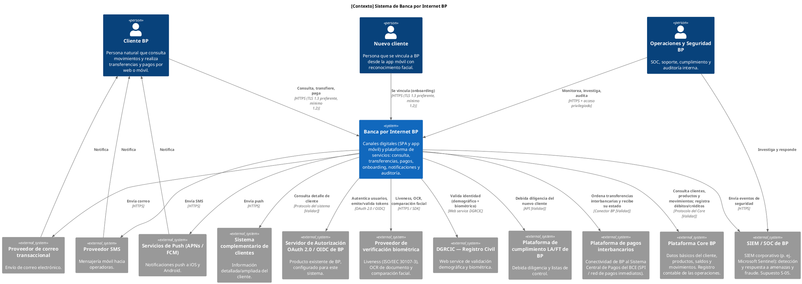

#### 3.1.2 Descripción de elementos

| Elemento | Tipo | Responsabilidad | Justificación de su presencia |
|---|---|---|---|
| Cliente BP | Persona | Usa SPA y app | Ejercicio Práctico, sección 3 |
| Nuevo cliente | Persona | Onboarding móvil | Ejercicio Práctico RF-07 |
| Operaciones y Seguridad BP | Persona | Monitoreo, investigación, auditoría | Ejercicio Práctico RNF-04 y sección 3. **[Norma]** monitoreo de canales electrónicos |
| Banca por Internet BP | Sistema (alcance) | Todo lo diseñado en este documento | — |
| Plataforma Core | Externo (BP) | Fuente de verdad de clientes, productos y movimientos | Ejercicio Práctico RF-01/03 y restricciones (Ejercicio Práctico, sección 7) |
| Sistema complementario | Externo (BP) | Detalle ampliado del cliente | Ejercicio Práctico RF-03 |
| Servidor OAuth 2.0 | Externo (BP) | Autenticación y emisión de tokens | Ejercicio Práctico RF-06 |
| Proveedor biométrico | Externo (tercero) | Liveness, OCR y comparación facial | Ejercicio Práctico RF-07. El Ejercicio Práctico excluye construir el motor (Ejercicio Práctico, sección 2.3) |
| DGRCIC | Externo (Estado) | Fuente oficial de identidad | §2.2.1. Supuesto S-02 (§2.3) |
| Plataforma LA/FT | Externo (BP) | Debida diligencia | **[Norma]** LA/FT. Supuesto S-03 (§2.3) |
| Plataforma de pagos interbancarios | Externo | SPI / pagos inmediatos del BCE | Ejercicio Práctico RF-02. Supuesto S-01 (§2.3) |
| Push / SMS / Email | Externos | Entrega de notificaciones | Ejercicio Práctico RF-04 (≥ 2) |
| SIEM / SOC de BP | Externo (BP) | Detección y respuesta ante amenazas y fraude. El SIEM es la herramienta que correlaciona eventos y genera alertas; el SOC, el equipo que las investiga y responde | Ejercicio Práctico RNF-04. Recibe los eventos de seguridad de la auditoría (§8.5.4) y de la telemetría (§8.9). Supuesto S-05 (§2.3) |

#### 3.1.3 Justificación del límite del sistema

- El **IdP, el Core, el sistema complementario y la conectividad de pagos** quedan **fuera** del límite porque el Ejercicio Práctico establece que existen y no se construyen. El sistema solo se integra con ellos mediante adaptadores.
- **Antifraude transaccional, límites y beneficiarios** quedan **dentro** del límite. Son exigencias normativas del canal electrónico (monitoreo, bloqueo ante eventos inusuales y segundo factor para destinos no registrados). Además, ninguno de los sistemas existentes descritos en el Ejercicio Práctico los cubre.

---

## 4. Estrategia de solución

### 4.1 Resumen de la solución y decisiones principales

Se propone una plataforma de banca digital **desacoplada, orientada a dominios y guiada por eventos**, desplegada en **Microsoft Azure** sobre el par de regiones sudamericanas **Chile Central ↔ Brazil South**, ambas con 3 zonas de disponibilidad: una opera como **región primaria** y la otra como **región de recuperación**. La región primaria se fija antes de contratar, midiendo la latencia y verificando el catálogo de servicios de cada región (ADR-05). La plataforma se conecta de forma híbrida con los sistemas que BP ya opera (Core, sistema complementario de clientes, servidor OAuth 2.0 y conectividad al sistema de pagos del Banco Central del Ecuador).

**Decisiones principales**

| Tema | Decisión | Justificación central |
|---|---|---|
| Estilo | Microservicios por dominio (DDD) con arquitectura hexagonal interna, conectividad API-led (Experiencia → Proceso → Sistema) y eventos de dominio | Desacoplamiento, despliegue independiente y reutilización de las APIs de proceso por futuros canales (Ejercicio Práctico, RNF-08). |
| Front-end web | **Angular** (alternativa evaluada: React) | Framework completo y opinado que da gobierno y consistencia en un producto regulado de larga vida (§4.3.1). |
| Móvil | **Flutter** (alternativa evaluada: React Native) | Compilación AOT a código nativo, render propio consistente y buen acceso a capacidades seguras del dispositivo (§4.3.2). |
| Autenticación | OAuth 2.0 **Authorization Code + PKCE** en ambos canales; **patrón BFF** en web; cliente nativo con **DPoP** y vinculación de dispositivo en móvil | El estándar vigente desaconseja Implicit y ROPC. Los tokens restringidos al emisor (sender-constrained) reducen el riesgo de que un token robado se reutilice (§8.1). |
| Onboarding | Captura de documento + **liveness** + cotejo 1:1 contra la **DGRCIC (Registro Civil)** + controles LA/FT; luego enrolamiento de dispositivo y credenciales | Hay un servicio oficial de validación demográfica y biométrica para personas jurídicas privadas (§8.2). |
| Transferencias | **Saga orquestada** + **Transactional Outbox** + **idempotencia** | Garantiza consistencia y que no haya doble débito ni pérdida de notificaciones entre Core, pagos interbancarios y notificación (§8.3). |
| Auditoría | Captura transversal (interceptor) + outbox en operaciones que cambian estado → bus de eventos → almacén **append-only** consultable + archivo **WORM** con cadena de hash | Registra todas las acciones de forma inmutable y verificable (§8.5). |
| Clientes frecuentes | **Cache-Aside + Decorator sobre Repository + Strategy de política de frecuencia**, con Redis | Baja latencia y menos carga sobre el Core, sin acoplar el dominio a la caché (§5.3). |
| Notificaciones | 3 canales (Push, SMS, Email) con **Strategy + Chain of Responsibility (fallback)** y entrega *at-least-once* | La norma exige notificar en línea. El Ejercicio Práctico exige al menos 2 sistemas (§8.6). |
| Nube y regiones | **Azure**, par **Chile Central ↔ Brazil South**. La primaria se define con la medición de latencia (alternativa evaluada: AWS) | Hoy es la única de las dos nubes permitidas con **dos regiones en Sudamérica** en disponibilidad general y con 3 zonas: primaria y DR quedan en el continente. |
| HA/DR | Zona-redundante en la región primaria; *warm standby* en la región secundaria; auto-healing en todas las capas | Elimina puntos únicos de falla y permite recuperarse de la pérdida de una región (§8.7). |

### 4.2 Principios y estilo arquitectónico

| # | Principio | Aplicación concreta |
|---|---|---|
| P1 | **Seguridad por diseño y Zero Trust** | Ningún componente confía en la red. Toda llamada lleva identidad verificada (mTLS entre servicios y tokens con audiencia y alcance). |
| P2 | **Desacoplamiento por dominio** | Un *bounded context* por servicio, base de datos propia por servicio y comunicación por contratos (API/eventos). |
| P3 | **Anti-Corruption Layer frente a sistemas legados** | El modelo del Core no se filtra al dominio digital. Los adaptadores traducen protocolos y modelos. |
| P4 | **Asincronía donde no se requiere respuesta inmediata** | Notificaciones, auditoría e invalidación de cachés se procesan por eventos. Así no suman latencia a la transacción del cliente. |
| P5 | **Diseño para la falla** | Timeouts, reintentos con backoff, circuit breakers, bulkheads e idempotencia en toda integración. |
| P6 | **Observabilidad nativa** | OpenTelemetry en todos los componentes y un `traceId` de punta a punta que también se registra en auditoría. |
| P7 | **Todo como código** | Infraestructura (IaC), políticas y despliegues (GitOps) versionados y auditables. |
| P8 | **Portabilidad razonable** | Kubernetes, OpenTelemetry, protocolo Kafka y PostgreSQL facilitan tener un proveedor alterno. **[Norma]** La SB exige mitigar la dependencia de un solo proveedor (§2.2). |
| P9 | **Minimización de datos** | Se almacena solo lo necesario, con cifrado y retención definidos. **[Norma]** LOPDP. |

**Estilo de integración — API-led connectivity (tres capas):**

1. **Experiencia:** BFF Web y BFF Móvil. Adaptan los contratos a cada canal y gestionan sesión y tokens.
2. **Proceso:** servicios de dominio (Clientes, Movimientos, Transferencias, Beneficiarios, Onboarding, etc.). Son reutilizables por cualquier canal futuro.
3. **Sistema:** adaptadores ACL hacia el Core, el sistema complementario, la plataforma de pagos interbancarios y los proveedores externos.

### 4.3 Arquitectura Front-end (SPA) y Móvil

#### 4.3.1 SPA Web — Angular vs. React

| Criterio | **Angular** | React |
|---|---|---|
| Naturaleza | Framework completo: router, formularios, HttpClient, DI, i18n y testing integrados | Biblioteca de UI. Router, estado, formularios y data fetching se eligen aparte |
| Gobierno en un equipo grande y regulado | Estructura y convenciones impuestas por el framework, que reducen la variabilidad entre equipos | La flexibilidad exige definir y vigilar un *stack* propio |
| Seguridad integrada | Sanitización de contexto por defecto (DomSanitizer), soporte de **Trusted Types**, interceptores HTTP y protección XSRF en HttpClient | JSX escapa por defecto. El resto depende de librerías elegidas |
| TypeScript | Nativo y obligatorio | Opcional (muy extendido) |
| Ciclo de vida | Versiones mayores semestrales con calendario público de soporte (LTS) | Depende de cada librería del ecosistema |
| Rendimiento | Signals y control de cambios *zoneless*, carga diferida por ruta | Excelente. Depende de las decisiones del equipo |

**Decisión: Angular.** En un producto bancario de larga vida, con varios equipos y auditorías de seguridad, pesan más **la uniformidad, las capacidades de seguridad integradas y un ciclo de soporte predecible** que la flexibilidad. React es una alternativa técnicamente válida. Se descarta porque obligaría a gobernar un *stack* compuesto de varias librerías independientes.

#### 4.3.2 App móvil multiplataforma — Flutter vs. React Native

| Criterio | **Flutter** | React Native |
|---|---|---|
| Ejecución | Dart compilado **AOT a código máquina ARM** | JavaScript/Hermes (bytecode) sobre la arquitectura nueva (JSI/Fabric) |
| UI | Motor de render propio: misma UI y comportamiento en iOS y Android | Componentes nativos de cada plataforma |
| Superficie frente a ingeniería inversa | Binario nativo, complementado con ofuscación (`--obfuscate`) | El bundle JS/bytecode es más fácil de inspeccionar si no se protege |
| Acceso a capacidades seguras | *Platform channels* hacia Secure Enclave/StrongBox, BiometricPrompt y App Attest/Play Integrity; plugins para biometría y almacenamiento seguro | Equivalente mediante módulos nativos |
| SDKs de terceros (biometría/RASP) | La mayoría de proveedores ofrecen SDK nativo y, en muchos casos, *wrapper* Flutter | La mayoría ofrece *wrapper* RN |
| Coherencia con la web | Lenguaje distinto (Dart) | Comparte JavaScript/TypeScript con la web |

**Decisión: Flutter.** Pesan más la **compilación AOT** (más difícil de manipular), la **consistencia visual y de comportamiento entre plataformas** (menos QA duplicado y menos diferencias de seguridad por plataforma) y el rendimiento predecible en la captura de cámara del onboarding. React Native permitiría compartir lenguaje con la web. Esa ventaja pierde peso porque la web se construye en Angular, no en React.

#### 4.3.3 ¿Por qué un BFF por canal?

| Motivo | Detalle |
|---|---|
| Seguridad | El BFF Web es un **cliente OAuth confidencial** que mantiene los tokens fuera del navegador, como recomienda RFC 10017. El BFF Móvil valida DPoP y atestación. |
| Rendimiento | Agrega varias llamadas en una sola respuesta por pantalla, con menos viajes de red desde redes móviles. |
| Desacoplamiento | Cada canal evoluciona su contrato sin afectar a las APIs de proceso, que se mantienen genéricas y reutilizables. |

---

## 5. Vista de bloques

### 5.1 Nivel 1 — C4 Nivel 2 (Diagrama de Contenedores)

#### 5.1.1 Diagrama

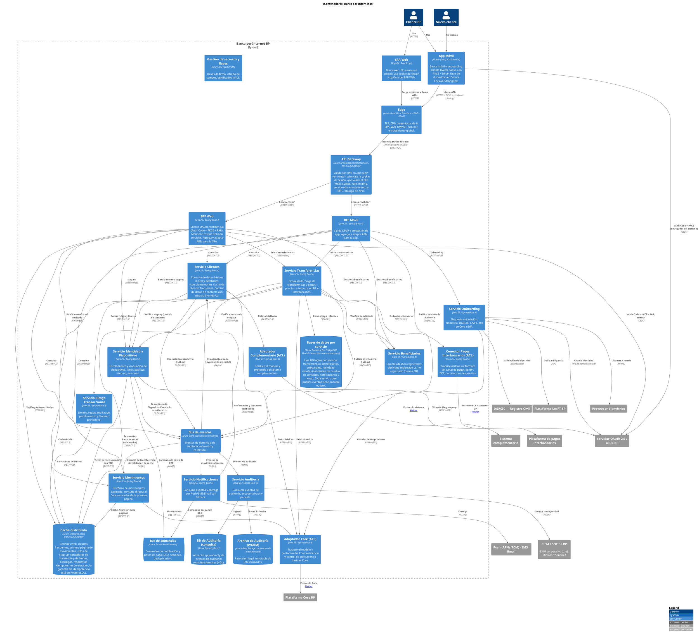

> Para que el diagrama se pueda leer, no se dibujan las relaciones de **todos** los servicios con Event Hubs, Key Vault y PostgreSQL. Todos los servicios de dominio publican eventos de auditoría, leen secretos de Key Vault mediante Workload Identity y tienen su propia base de datos lógica cuando la necesitan (§8.4).

#### 5.1.2 Catálogo de contenedores

| Contenedor | Tecnología | Responsabilidad | Estado | Escalado | Datos que maneja |
|---|---|---|---|---|---|
| SPA Web | Angular | UI web | Sin estado (sesión en cookie) | CDN | Ninguno persistente |
| App Móvil | Flutter | UI móvil y onboarding | Llaves en hardware seguro | — | Tokens y llave de dispositivo (no exportable) |
| Edge | Front Door Premium | Perímetro global, WAF, CDN | Gestionado | Global | — |
| API Gateway | API Management Premium | Seguridad y gobierno de APIs | Gestionado | Unidades, zonas y multi-región | — |
| BFF Web | Spring Boot | Sesión y tokens del lado servidor; agregación | Sesión en Redis | HPA | Sesión cifrada |
| BFF Móvil | Spring Boot | DPoP, atestación, agregación | Sin estado | HPA | — |
| Servicio Clientes | Spring Boot | Datos básicos y detallados; cambio de datos de contacto | Caché + PostgreSQL (solicitudes de cambio y outbox) | HPA | Proyección de cliente en caché; solicitudes de cambio de contacto |
| Servicio Movimientos | Spring Boot | Histórico de movimientos | Sin estado | HPA | Caché de la primera página (Redis) |
| Servicio Transferencias | Spring Boot | Saga, idempotencia | Estado en PostgreSQL | HPA + KEDA | Órdenes, pasos de Saga, outbox |
| Servicio Beneficiarios | Spring Boot | Cuentas destino | PostgreSQL | HPA | Beneficiarios |
| Servicio Riesgo Transaccional | Spring Boot | Límites y antifraude | PostgreSQL + Redis | HPA | Límites, contadores, reglas |
| Servicio Onboarding | Spring Boot | Orquestación de vinculación | PostgreSQL | HPA | Estado del proceso y evidencia (sin biometría en bruto) |
| Servicio Identidad y Dispositivos | Spring Boot | Dispositivos, llaves y step-up | PostgreSQL | HPA | Llaves públicas y metadatos de dispositivo |
| Servicio Notificaciones | Spring Boot | Entrega multicanal | PostgreSQL | KEDA (por cola) | Bitácora de entrega |
| Servicio Auditoría | Spring Boot | Ingesta inmutable | Estado mínimo: último hash de cada partición, guardado junto al checkpoint del consumidor | KEDA (por lag) | Último hash por partición |
| Adaptadores ACL (3) | Spring Boot | Traducción y resiliencia | Sin estado | HPA, con techo de concurrencia | — |
| Event Hubs | Gestionado | Eventos | — | Unidades de procesamiento | Eventos (retención configurada) |
| Service Bus Premium | Gestionado | Comandos y DLQ | — | Unidades de mensajería | Mensajes |
| Managed Redis | Gestionado | Caché | — | Shards | Datos cacheados con TTL |
| PostgreSQL Flexible | Gestionado | OLTP por servicio | — | Vertical + réplicas | Transaccional |
| Data Explorer | Gestionado | Auditoría consultable | — | Nodos | Eventos de auditoría |
| Blob inmutable | Gestionado | Archivo WORM | — | — | Lotes de auditoría |
| Key Vault | Gestionado (HSM) | Llaves y secretos | — | — | Material criptográfico |

**¿Por qué Java 25 / Spring Boot 4 para los servicios?** (alternativa evaluada: .NET 10)
- **Vigencia del soporte:** Java 25 es la versión LTS vigente (sep-2025) y Spring Boot 4 (nov-2025) es la línea con soporte activo. A la fecha del documento, la línea 3.x de Spring Boot ya no recibe soporte de código abierto. Un sistema bancario nuevo no debe nacer sobre versiones sin soporte.
- Los *virtual threads* (estables desde Java 21 y, desde Java 24, sin bloquear el hilo portador en bloques `synchronized`, JEP 491) permiten mucha concurrencia en servicios de integración que pasan casi todo el tiempo esperando I/O (Core, pagos, proveedores) sin programación reactiva compleja.
- Hay un ecosistema maduro para los patrones de esta propuesta: Spring Security (resource server y cliente OAuth 2.0), Resilience4j (circuit breaker, bulkhead, retry), Spring Kafka y el agente Java de OpenTelemetry.
- Es portable entre nubes, en coherencia con P8. .NET 10 (LTS) cumpliría los mismos requisitos técnicos (.NET 8 terminó su soporte el 10-nov-2026). La decisión final debe considerar las capacidades del equipo de BP.

#### 5.1.3 Servicios: los 3 requeridos y los adicionales justificados

| Servicio | Origen | Justificación |
|---|---|---|
| Consulta de datos básicos (**Servicio Clientes**) | Ejercicio Práctico RF-10 (requerido) | Reúne datos básicos y detallados tras una sola API de proceso. También es dueño del **cambio de datos de contacto**, que la norma SB exige con autenticación fuerte (§5.2.2, §8.1.4). |
| Consulta de movimientos (**Servicio Movimientos**) | Ejercicio Práctico RF-10 (requerido) | — |
| Transferencias (**Servicio Transferencias**) | Ejercicio Práctico RF-10 (requerido) | — |
| **Servicio Beneficiarios** | Adicional | **[Norma]** La SB exige segundo factor siempre para cuentas destino no registradas. Hace falta un registro de beneficiarios con estado y fecha de alta. Separarlo evita que Transferencias crezca con lógica ajena a la orquestación. |
| **Servicio Riesgo Transaccional** | Adicional | **[Norma]** Monitoreo y bloqueo de canales ante eventos inusuales. Centraliza límites por cliente, canal y tipo, y las reglas antifraude. Es reutilizable por canales futuros. |
| **Servicio Identidad y Dispositivos** | Adicional | Requerido por RF-07 (métodos de ingreso post-onboarding) y por la vinculación de dispositivo como factor de posesión (§8.1.3). Separa el ciclo de vida del dispositivo del IdP genérico. |
| **Servicio Notificaciones** | Adicional | Requerido por RF-04. Es un servicio genérico y reutilizable (Strategy por canal). |
| **Servicio Auditoría** | Adicional | Requerido por RF-08. Concentra la escritura en la BD de auditoría, que así no recibe escrituras desde N servicios. |
| **Servicio Onboarding** | Adicional | Requerido por RF-07. Orquesta un proceso largo y con pasos externos. |
| **Adaptadores ACL** (Core, Complementario, Pagos) | Adicional (rendimiento y desacoplamiento) | 1) Aíslan los protocolos de sistemas existentes. 2) **Protegen el Core**: limitan la concurrencia (bulkhead) para que un pico digital no lo degrade. 3) Concentran la caché técnica y el *request coalescing* (unir peticiones idénticas en vuelo). |

#### 5.1.4 Estilo de comunicación

| Origen → Destino | Estilo | Protocolo | Justificación |
|---|---|---|---|
| SPA/App → Edge → APIM → BFF | Síncrono | HTTPS (REST/JSON) | Interacción del usuario |
| BFF → servicios de dominio | Síncrono | REST/JSON sobre mTLS (malla de servicios) | Consultas y comandos con respuesta inmediata |
| Servicio → Adaptador ACL | Síncrono | REST/JSON sobre mTLS | Consulta y registro contable |
| Transferencias → eventos | Asíncrono | Kafka (Event Hubs) vía **Transactional Outbox** | Garantiza que se publique el evento si y solo si se confirmó la transacción |
| Eventos → Notificaciones/Auditoría | Asíncrono | Kafka | Desacople y reprocesamiento |
| Notificaciones → canal | Asíncrono | Service Bus (cola por canal) | Reintentos, DLQ y fallback |
| Conector de pagos ↔ plataforma de pagos | Según el conector de BP | **[Validar]** | Lo define BP o el BCE. Queda aislado en el ACL. |

### 5.2 Nivel 2 — C4 Nivel 3 (Diagramas de Componentes)

#### 5.2.1 Servicio Transferencias

**Propósito.** Ejecuta las transferencias y pagos de RF-02 (entre cuentas propias, a terceros en BP e interbancarias) sin duplicados: valida riesgo, límites y segundo factor, coordina el Core y los pagos interbancarios y publica el evento que dispara la notificación obligatoria (RF-04).

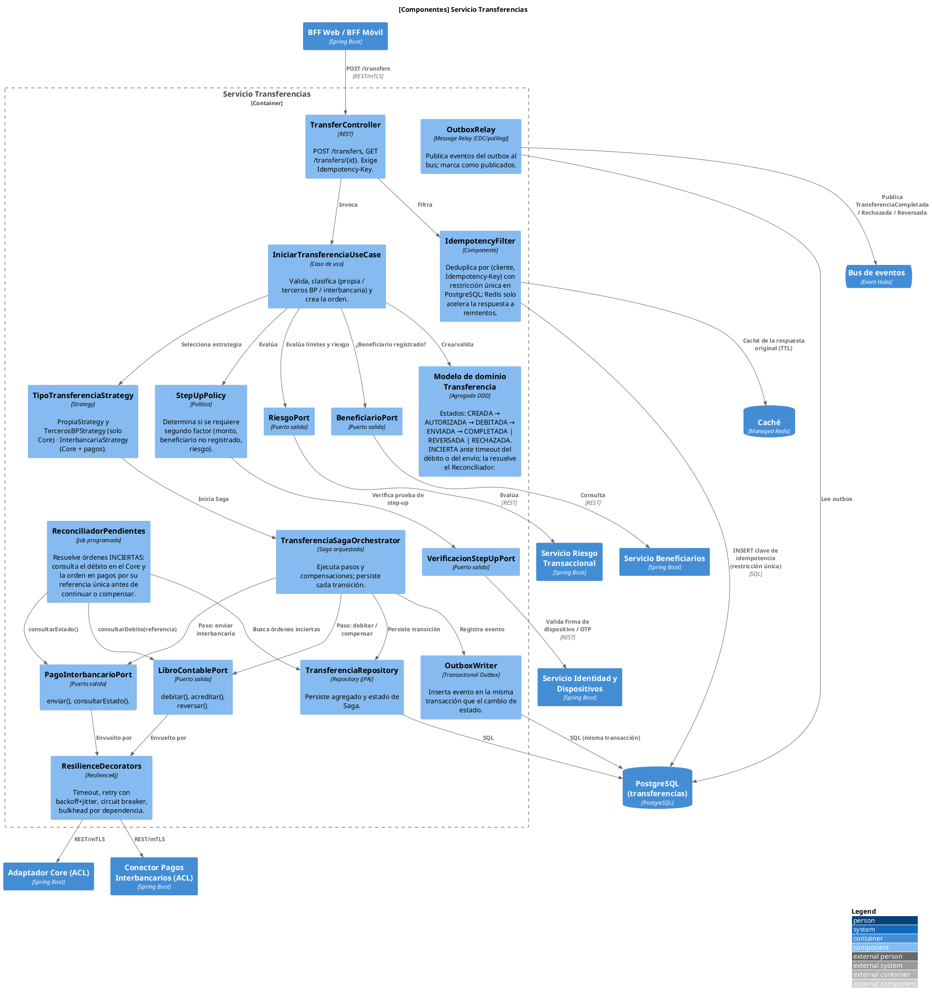

**Componentes**

| Componente | Patrón | Responsabilidad | Justificación |
|---|---|---|---|
| TransferController | Adaptador de entrada (REST) | Expone `POST /transfers` y `GET /transfers/{id}`; exige `Idempotency-Key` | El `GET` permite al cliente consultar una orden "en proceso" (`INCIERTA`) sin volver a ordenarla. |
| IdempotencyFilter | **Idempotent Receiver** | Evita duplicar una transferencia ante reintentos de red o doble clic | Un doble débito es el defecto más grave en banca. El cliente genera un `Idempotency-Key` (UUID) por intención de pago. La garantía es una **restricción única en PostgreSQL**, en la misma transacción que crea la orden: si Redis falla, la protección se mantiene. |
| IniciarTransferenciaUseCase | **Caso de uso** (hexagonal) | Valida la solicitud, clasifica el tipo, consulta beneficiario y riesgo, aplica la política de step-up y crea la orden | Concentra la lógica de aplicación: el controlador y los adaptadores no contienen reglas de negocio. |
| Modelo de dominio Transferencia | **Agregado DDD + máquina de estados** | Define los estados de la orden y sus transiciones válidas | Una transición inválida (p. ej. reversar una orden no debitada) se rechaza en el dominio. Cada estado queda persistido y auditado. |
| StepUpPolicy | **Policy / Specification** | Decide cuándo exigir el segundo factor | **[Norma]** Segundo factor para beneficiarios no registrados y para transacciones monetarias. |
| TipoTransferenciaStrategy | **Strategy** | Encapsula las diferencias entre los tipos de transacción: qué sistemas externos se invocan, qué reglas de beneficiario y step-up aplican y qué pasos de la Saga se ejecutan | Cumple RF-02 ("invocará servicios externos según el tipo de transacción"). Abierto/cerrado: un nuevo tipo (p. ej. pago de servicios) es una nueva estrategia sin tocar la Saga. |
| TransferenciaSagaOrchestrator | **Saga orquestada** | Coordina Core y pagos con compensaciones | No hay transacción distribuida (2PC) posible con el Core y el BCE. Se elige orquestación (no coreografía) porque el flujo es secuencial, tiene pocos participantes y requiere un estado auditable en un solo lugar. |
| RiesgoPort, BeneficiarioPort, VerificacionStepUpPort, LibroContablePort, PagoInterbancarioPort | **Puertos de salida** (hexagonal) | Contratos hacia los servicios Riesgo, Beneficiarios e Identidad, el Core y el conector de pagos | El dominio no depende de protocolos ni de proveedores. `LibroContablePort` admite los modos retención/captura o débito/reverso del Core. |
| ResilienceDecorators | **Circuit Breaker, Bulkhead, Retry con backoff y jitter, Timeout** | Contiene fallas de dependencias | Un Core lento no debe agotar los hilos ni afectar las consultas (bulkhead por dependencia). |
| TransferenciaRepository | **Repository** | Persiste el agregado y el estado de la Saga | Tras un reinicio, la Saga se retoma desde el último estado persistido: ninguna orden queda a medias sin registro. |
| OutboxWriter / OutboxRelay | **Transactional Outbox + Message Relay** | Garantiza la publicación del evento que dispara la notificación | **[Norma]** La notificación es obligatoria. Sin outbox, un fallo entre el commit y la publicación dejaría una transacción sin notificar. |
| ReconciliadorPendientes | **Reconciliation / Scheduler Agent Supervisor** | Cierra estados inciertos (timeout del débito en el Core o del envío a pagos) | Un timeout no equivale a un rechazo: el débito o la orden pueden haberse aplicado. Hay que consultar el estado antes de compensar o de informar un rechazo. |

**Tipos de transacción.** "Entre cuentas propias" puede leerse como cuentas del mismo cliente o como cualquier cuenta dentro de BP. La propuesta separa ambos casos porque sus reglas de seguridad son distintas:

| Tipo | Estrategia | Sistemas invocados | Pasos de la Saga | Beneficiario | Segundo factor en la transacción |
|---|---|---|---|---|---|
| Entre cuentas del mismo cliente | `PropiaStrategy` | Core | Riesgo → débito y crédito en el Core (una sola operación de transferencia si el Core la ofrece) | No aplica | No; basta la autenticación de 2 factores vigente de la sesión (§8.1.4) |
| A terceros en BP | `TercerosBPStrategy` | Core | Igual que la propia | Registrado o no (Servicio Beneficiarios) | Sí, si el beneficiario no está registrado **[Norma]** |
| Interbancaria | `InterbancariaStrategy` | Core + conector de pagos | Pasos 1 a 5 de la tabla anterior | Registrado o no | Sí, si el beneficiario no está registrado **[Norma]** |

En las transferencias dentro de BP no hay paso 3: el Core aplica débito y crédito y la orden pasa directamente a `COMPLETADA`. Por eso siguen operando aunque el conector de pagos esté caído (§8.7.4).

#### 5.2.2 Servicio Clientes (incluye la persistencia para clientes frecuentes)

**Propósito.** Entrega los datos del cliente de RF-03 —básicos desde el Core y detallados desde el sistema complementario— e implementa la persistencia para clientes frecuentes de RF-09. También es dueño del cambio de datos de contacto, que la norma SB exige una autenticación fuerte.

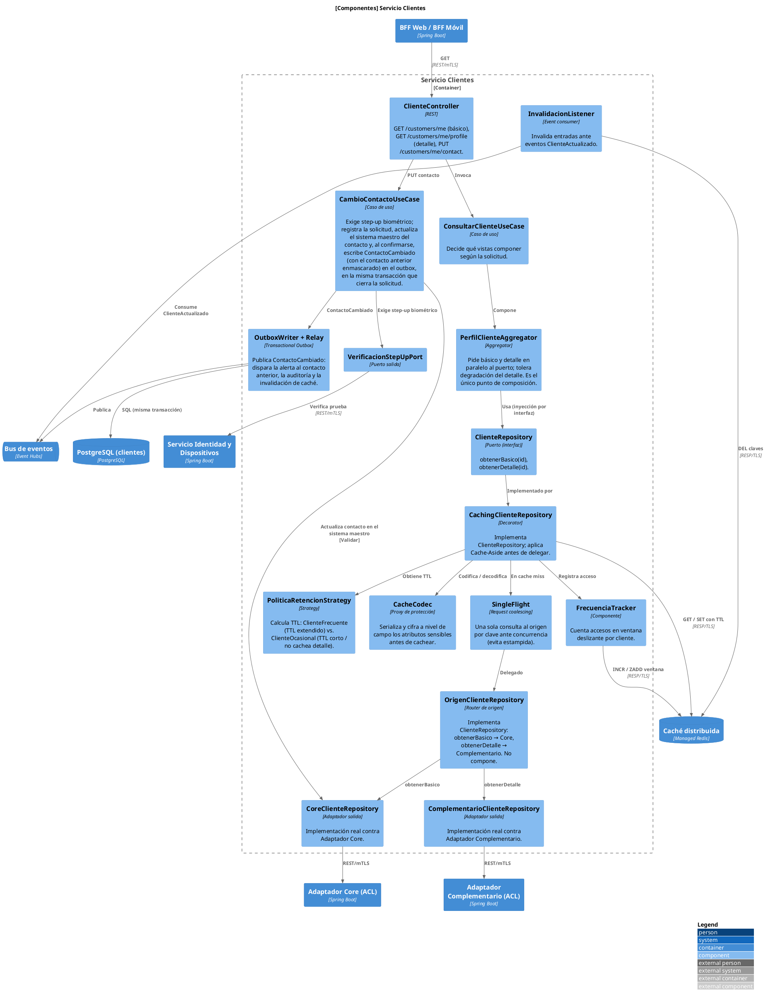

**Componentes**

| Componente | Patrón | Responsabilidad | Justificación |
|---|---|---|---|
| ClienteController | Adaptador de entrada (REST) | Expone `GET /customers/me` (básico), `GET /customers/me/profile` (detalle) y `PUT /customers/me/contact` | Separar básico y detalle evita consultar el sistema complementario en las pantallas que solo necesitan los datos básicos. |
| ConsultarClienteUseCase | **Caso de uso** (hexagonal) | Decide qué vistas componer según la solicitud | Mantiene la lógica de aplicación fuera del controlador. |
| PerfilClienteAggregator | **Aggregator** | Pide el básico y el detalle en paralelo y los compone | Es el único punto de composición. Si el sistema complementario falla, devuelve el básico en lugar de un error (degradación controlada). |
| ClienteRepository | **Repository** (puerto) | Interfaz `obtenerBasico(id)` / `obtenerDetalle(id)` que usa el dominio | El dominio no sabe si los datos vienen del origen o de la caché. |
| CachingClienteRepository | **Decorator + Cache-Aside** | Envuelve al repositorio de origen: busca en Redis y, en un *miss*, consulta el origen y guarda con TTL | Agrega la caché sin modificar el dominio ni el origen (abierto/cerrado). Si Redis falla, degrada a llamada directa. |
| FrecuenciaTracker | **Ventana deslizante** | Cuenta los accesos de cada cliente en Redis y lo clasifica como frecuente u ocasional | El umbral es configurable y se calibra con los datos de uso de BP. |
| PoliticaRetencionStrategy | **Strategy** | Decide el TTL y qué atributos se cachean según el perfil de frecuencia | Cambiar o agregar una política no toca el Decorator. Concentra la caché en quien más usa el canal y minimiza los datos de los clientes ocasionales (LOPDP). |
| CacheCodec | **Proxy de protección** | Serializa y cifra a nivel de campo los atributos sensibles antes de cachearlos | Un acceso indebido a Redis no expone datos personales en claro. |
| SingleFlight | **Request coalescing** | Ante *misses* concurrentes, hace una sola consulta al origen por clave | Evita la estampida sobre el Core cuando expira una entrada muy consultada. |
| OrigenClienteRepository | **Router de origen** | Dirige `obtenerBasico` al Core y `obtenerDetalle` al sistema complementario | Cada dato se lee de su fuente de verdad. No compone: eso lo hace solo el Aggregator. |
| CoreClienteRepository, ComplementarioClienteRepository | **Adaptadores de salida** | Implementan las consultas contra el Adaptador Core y el Adaptador Complementario | Los cambios de protocolo de los sistemas de BP quedan aislados en los ACL. |
| InvalidacionListener | **Observer** (consumidor de eventos) | Borra las entradas de caché ante `ClienteActualizado` o cambios de contacto | Reduce a segundos la antigüedad del dato en caché cuando hay eventos de cambio. |
| CambioContactoUseCase | **Caso de uso** | Gestiona el cambio de teléfono o correo: exige step-up biométrico, actualiza el sistema maestro y registra el evento | **[Norma]** SB: el cambio solo es presencial o con autenticación fuerte. |
| VerificacionStepUpPort | **Puerto de salida** | Verifica la prueba de step-up con el Servicio Identidad | El caso de uso no depende de cómo se implementa el segundo factor. |
| OutboxWriter + Relay | **Transactional Outbox** | Publica `ContactoCambiado` en la misma transacción que cierra la solicitud | Garantiza la alerta al contacto anterior, la auditoría y la invalidación de caché aunque el servicio falle después del commit. |

#### 5.2.3 Servicio Movimientos

**Propósito.** Entrega el histórico de movimientos de RF-01, paginado y filtrado, consultando directamente al Core a través del adaptador ACL.

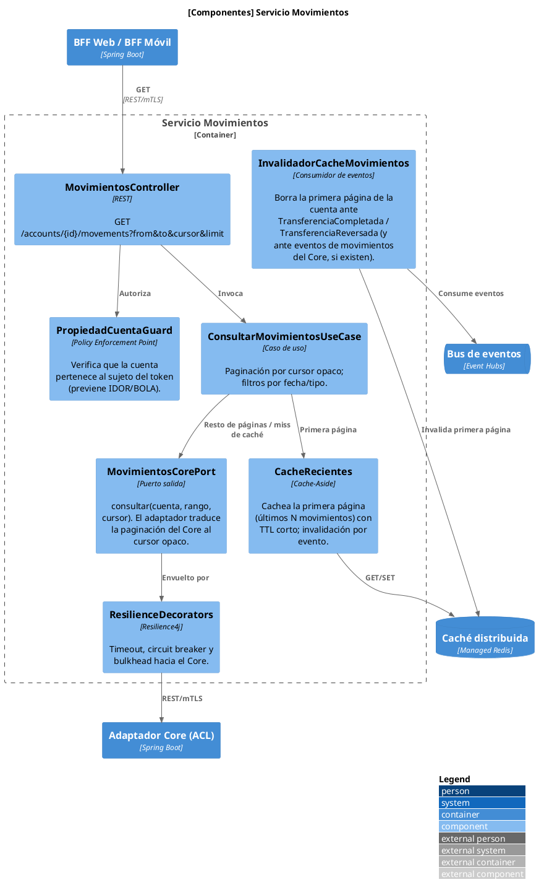

**Componentes**

| Componente | Patrón | Responsabilidad | Justificación |
|---|---|---|---|
| MovimientosController | Adaptador de entrada (REST) | Expone `GET /accounts/{id}/movements` con filtros de fecha y paginación (`cursor`, `limit`) | Contrato estable para web y móvil, independiente de cómo pagina el Core. |
| PropiedadCuentaGuard | **Policy Enforcement Point** | Verifica que la cuenta pertenezca al sujeto del token | *Broken Object Level Authorization* es el riesgo n.º 1 del OWASP API Security Top 10. Nunca se confía en el `accountId` que envía el cliente. |
| ConsultarMovimientosUseCase | **Caso de uso** (hexagonal) | Aplica filtros y paginación por cursor opaco; decide si la página sale de la caché o del Core | El cursor opaco evita que el cliente dependa del mecanismo de paginación del Core y es estable aunque lleguen movimientos nuevos. |
| CacheRecientes | **Cache-Aside** | Cachea la primera página (últimos N movimientos) con TTL corto | La primera página es la consulta más frecuente: servirla desde caché reduce la latencia (Q-05) y la carga sobre el Core (R-04). |
| MovimientosCorePort | **Puerto de salida** | `consultar(cuenta, rango, cursor)` | El adaptador traduce la paginación del Core al cursor opaco: el servicio no cambia si cambia el mecanismo del Core. |
| ResilienceDecorators | **Circuit Breaker, Bulkhead, Timeout** | Contiene las fallas del Core | Un Core lento no agota los recursos del servicio ni afecta a otros flujos. |
| InvalidadorCacheMovimientos | **Observer** (consumidor de eventos) | Borra la primera página de la cuenta ante `TransferenciaCompletada` o `TransferenciaReversada` | El cliente ve su transferencia en el histórico sin esperar a que venza el TTL. |

#### 5.2.4 Servicio Onboarding

**Propósito.** Vincula a un nuevo cliente desde la app móvil con reconocimiento facial (RF-07): consentimiento, verificación de identidad, debida diligencia, alta en el Core y en el IdP, y vinculación del dispositivo.

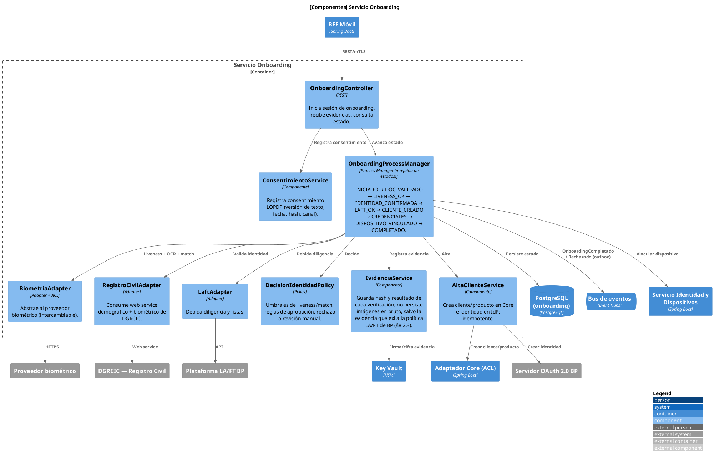

**Componentes**

| Componente | Patrón | Responsabilidad | Justificación |
|---|---|---|---|
| OnboardingController | Adaptador de entrada (REST) | Inicia la sesión de onboarding, recibe las evidencias y expone el estado | Solo lo consume el BFF Móvil: el onboarding es exclusivo de la app (RF-07). |
| ConsentimientoService | Componente | Registra el consentimiento: versión del texto, fecha, hash y canal | **[Norma]** LOPDP: los datos biométricos son categoría especial y exigen consentimiento explícito y demostrable. |
| OnboardingProcessManager | **Process Manager** (máquina de estados persistida) | Conduce el proceso por sus estados, de `INICIADO` a `COMPLETADO` | Es un proceso largo, con pasos externos y decisiones: puede reanudarse si el usuario se interrumpe, y cada paso es idempotente. |
| BiometriaAdapter | **Adapter + ACL** | Abstrae al proveedor biométrico: liveness, OCR y comparación facial | El proveedor es intercambiable sin tocar el proceso. |
| RegistroCivilAdapter | **Adapter** | Consume el web service demográfico y biométrico de la DGRCIC | Coteja la identidad con la fuente oficial (§2.2.1). |
| LaftAdapter | **Adapter** | Debida diligencia y consulta de listas de control | **[Norma]** LA/FT. Funciona con la plataforma LA/FT de BP o con las listas que BP contrate (S-03). |
| DecisionIdentidadPolicy | **Policy** | Aplica umbrales de liveness y coincidencia: aprueba, rechaza o envía a revisión manual | Los umbrales se configuran sin redeploy y quedan auditados. |
| EvidenciaService | Componente | Guarda hash, resultado y puntajes de cada verificación, firmados con llave del HSM | Evidencia verificable sin conservar imágenes biométricas en bruto (LOPDP, §8.2.3). |
| AltaClienteService | Componente **idempotente** | Crea el cliente y el producto en el Core y la identidad en el IdP | Idempotente por número de identificación + id de proceso: un reintento no crea clientes duplicados. |

#### 5.2.5 Servicio Identidad y Dispositivos

**Propósito.** Gestiona los factores de autenticación propios del canal: vincula el dispositivo del cliente como factor de posesión, ejecuta el step-up por transacción (firma biométrica u OTP) y aplica las políticas de sesión. Cubre RF-06 y RF-07 y las exigencias SB de autenticación de dos factores y notificación del acceso.

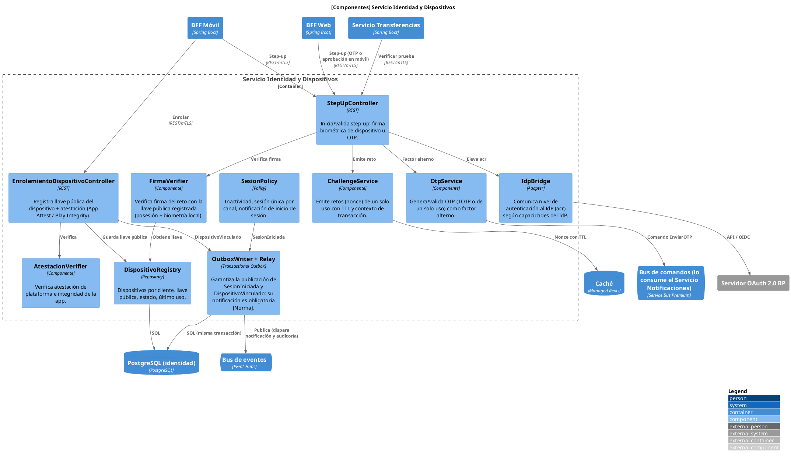

**Componentes**

| Componente | Patrón | Responsabilidad | Justificación |
|---|---|---|---|
| EnrolamientoDispositivoController | Adaptador de entrada (REST) | Registra la llave pública del dispositivo con su atestación | La llave privada nunca sale del hardware seguro del teléfono: BP solo guarda la pública. |
| AtestacionVerifier | Componente | Verifica la atestación de plataforma (App Attest / Play Integrity) y la integridad de la app | Impide vincular un emulador o una app modificada. |
| DispositivoRegistry | **Repository** | Guarda los dispositivos de cada cliente: llave pública, estado y último uso | Permite revocar un dispositivo perdido y detectar uno nuevo, cuya vinculación se notifica. |
| ChallengeService | Componente | Emite retos (nonce) de un solo uso, con TTL y ligados al contexto de la transacción | Un reto firmado no puede reutilizarse ni servir para otra transacción (*dynamic linking*). |
| FirmaVerifier | Componente | Verifica la firma del reto con la llave pública registrada | Prueba en una sola operación la posesión del dispositivo y la biometría local. |
| StepUpController | Adaptador de entrada (REST) | Inicia y valida el step-up para el BFF Móvil, el BFF Web y el Servicio Transferencias | Un único punto de segundo factor para todos los canales y transacciones. |
| OtpService | Componente | Genera y valida OTP como factor alterno; su envío se pide con el comando `EnviarOTP` | Solo para clientes sin la app o como respaldo. Es el factor más débil (SIM swap), por eso el Servicio Riesgo aplica límites menores (§8.1). |
| IdpBridge | **Adapter** | Comunica al IdP el nivel de autenticación alcanzado (`acr`) | Se adapta a las capacidades del IdP de BP (§8.1.5). |
| SesionPolicy | **Policy** | Aplica inactividad, sesión única por canal y aviso de inicio de sesión | **[Norma]** SB: cierre de sesión por inactividad y notificación del acceso. |
| OutboxWriter + Relay | **Transactional Outbox** | Publica `SesionIniciada` y `DispositivoVinculado` | **[Norma]** Su notificación es obligatoria: el evento no puede perderse. |

#### 5.2.6 Servicio Notificaciones

**Propósito.** Notifica al cliente cada movimiento realizado y cada acceso (RF-04, **[Norma]**) por al menos dos canales —push, SMS y correo—, con respaldo entre canales y evidencia de cada entrega.

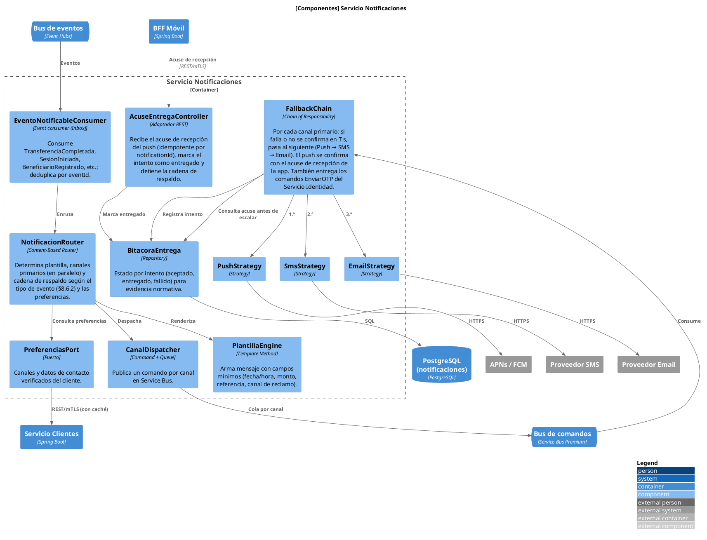

**Componentes**

| Componente | Patrón | Responsabilidad | Justificación |
|---|---|---|---|
| EventoNotificableConsumer | **Consumidor de eventos + Inbox** | Consume los eventos notificables y descarta duplicados por `eventId` | El bus entrega al menos una vez: el Inbox evita que el cliente reciba dos avisos por la misma operación. |
| NotificacionRouter | **Content-Based Router** | Elige plantilla, canales primarios y cadena de respaldo según el tipo de evento y las preferencias | Las reglas de entrega (§8.6.2) cambian por configuración, sin tocar a los productores de eventos. |
| PreferenciasPort | **Puerto de salida** | Obtiene los canales y datos de contacto verificados del Servicio Clientes (con caché) | Solo se usan datos verificados; el dueño del contacto es el Servicio Clientes. |
| PlantillaEngine | **Template Method** | Arma el mensaje con el contenido mínimo: fecha y hora, monto, referencia, cuenta enmascarada y canal de reclamo | Contenido homogéneo en todos los canales. |
| CanalDispatcher | **Command + Queue** | Publica un comando por canal en Service Bus | Cada canal tiene su cola, con reintentos y DLQ propios: la caída de un proveedor no frena a los demás. |
| FallbackChain | **Chain of Responsibility** | Si un canal falla o no se confirma en *T* s, pasa al siguiente (Push → SMS → Email). También entrega los OTP del Servicio Identidad | El push solo se da por entregado con el acuse de recepción de la app. |
| PushStrategy, SmsStrategy, EmailStrategy | **Strategy** | Envían por APNs/FCM, el proveedor de SMS y el proveedor de correo | Proveedores intercambiables; se puede tener dos proveedores de SMS con conmutación por circuit breaker. |
| BitacoraEntrega | **Repository** | Registra cada intento con su estado (aceptado, entregado, fallido) | Evidencia ante un reclamo de "no fui notificado". |
| AcuseEntregaController | **Adaptador de entrada (REST)** | Recibe del BFF Móvil el acuse de recepción del push y marca el intento como entregado en la BitacoraEntrega. Es idempotente por `notificationId` | Cierra el ciclo de entrega: si el acuse llega antes de *T* s, la FallbackChain no escala a SMS; si llega tarde, solo queda registrado. |

#### 5.2.7 Servicio Auditoría

**Propósito.** Registra de forma inmutable y verificable todas las acciones del cliente (RF-08) y reenvía los eventos de seguridad al SIEM (RNF-04).

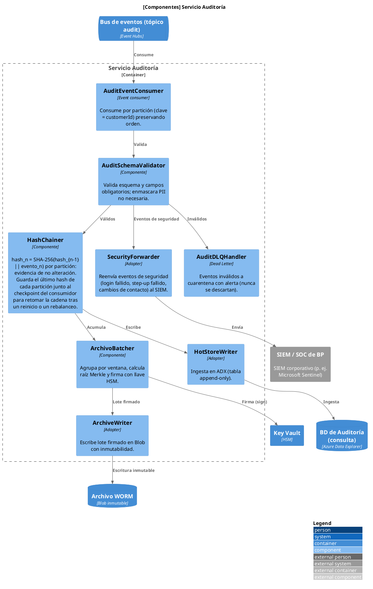

**Componentes**

| Componente | Patrón | Responsabilidad | Justificación |
|---|---|---|---|
| AuditEventConsumer | **Consumidor de eventos** | Consume el tópico de auditoría por partición, con `customerId` como clave | Conserva el orden de los eventos de cada cliente, necesario para la cadena de hash. |
| AuditSchemaValidator | Componente | Valida el esquema y los campos obligatorios; enmascara la PII no necesaria | Un evento incompleto no sirve como evidencia; minimización de datos (LOPDP). |
| AuditDLQHandler | **Dead Letter Channel** | Envía los eventos inválidos a cuarentena con alerta | Un evento de auditoría nunca se descarta en silencio. |
| HashChainer | **Cadena de hash** | Encadena cada evento con el hash del anterior, por partición | Cualquier alteración o borrado rompe la cadena y se detecta. Guarda el último hash junto al checkpoint para retomar tras un reinicio o un rebalanceo. |
| HotStoreWriter | **Adapter** | Ingesta los eventos en Azure Data Explorer (tabla *append-only*) | Consulta forense y operativa rápida sobre los eventos recientes. |
| ArchivoBatcher | Componente | Agrupa eventos por ventana, calcula la raíz Merkle y la firma con llave del HSM | La firma prueba la integridad y el origen de cada lote sin firmar evento por evento. |
| ArchiveWriter | **Adapter** | Escribe los lotes firmados en Blob Storage inmutable (WORM) | Retención legal de largo plazo: nadie puede modificar ni borrar los lotes durante el periodo de retención. |
| SecurityForwarder | **Adapter** | Reenvía los eventos de seguridad al SIEM | El SOC detecta y responde sin recibir todo el volumen de auditoría. |

#### 5.2.8 BFF Web

**Propósito.** Es el backend dedicado de la SPA (RF-05, RF-06). Actúa como cliente OAuth confidencial: los tokens nunca llegan al navegador, que solo recibe una cookie de sesión. También compone las respuestas que necesita cada pantalla.

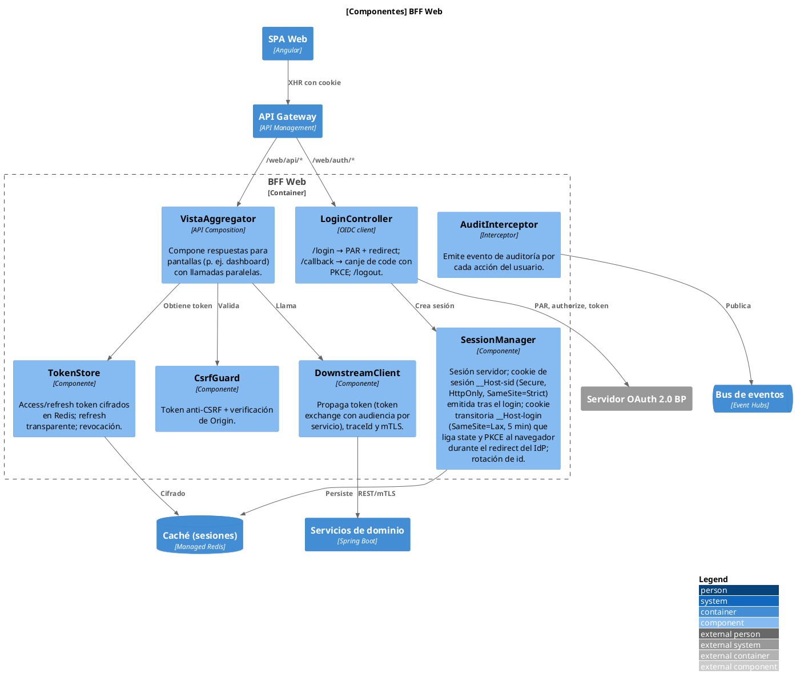

**Componentes**

| Componente | Patrón | Responsabilidad | Justificación |
|---|---|---|---|
| LoginController | **Cliente OIDC confidencial** | `/login` (PAR y redirección), `/callback` (canje del código con PKCE) y `/logout` | El flujo Authorization Code + PKCE + PAR lo ejecuta el servidor, no el navegador. |
| SessionManager | Componente | Crea y rota la sesión del servidor; emite la cookie `__Host-sid` (Secure, HttpOnly, SameSite=Strict) y la cookie transitoria del login | Un script malicioso (XSS) no puede leer la cookie ni obtener tokens. |
| TokenStore | Componente | Guarda los tokens cifrados en Redis, los renueva y los revoca | Los tokens nunca salen del servidor; la renovación es transparente para el usuario. |
| CsrfGuard | Componente | Verifica el token anti-CSRF y el encabezado `Origin` | Toda sesión basada en cookies necesita protección contra CSRF. |
| VistaAggregator | **API Composition** | Compone la respuesta de cada pantalla con llamadas paralelas | Menos idas y vueltas desde el navegador: menor latencia (RNF-07). |
| DownstreamClient | Componente | Llama a los servicios con un token de audiencia específica (*token exchange*), `traceId` y mTLS | Cada servicio recibe un token válido solo para él: un token filtrado no sirve contra otro servicio. |
| AuditInterceptor | **Interceptor** | Emite un evento de auditoría por cada acción del usuario | Cumple RF-08 sin que cada endpoint tenga que implementarlo. |

#### 5.2.9 BFF Móvil

**Propósito.** Es el backend dedicado de la app móvil (RF-05, RF-07). Comprueba que cada solicitud venga de un dispositivo vinculado y de una app íntegra, y adapta las respuestas a las pantallas móviles. Es la única entrada al onboarding y recibe el acuse de recepción del push (§5.2.6).

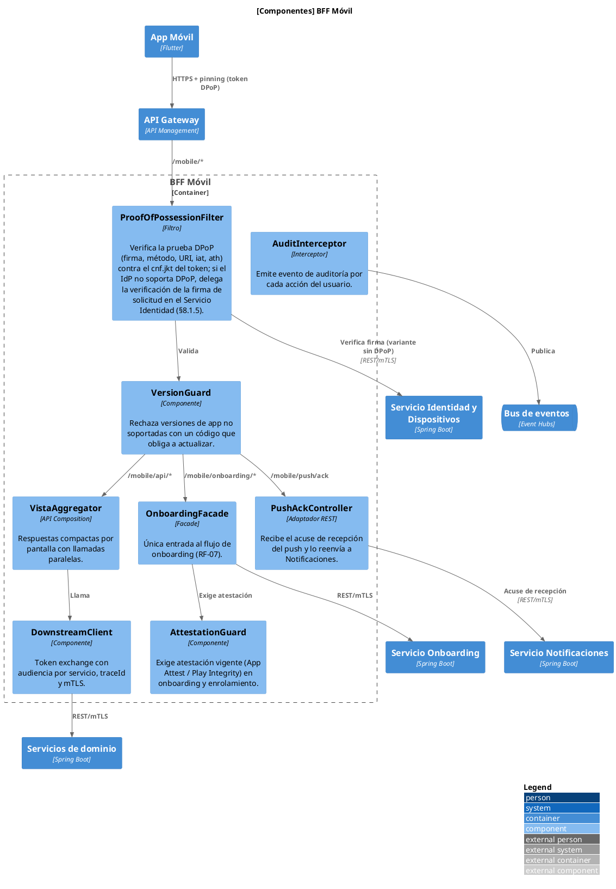

**Componentes**

| Componente | Patrón | Responsabilidad | Justificación |
|---|---|---|---|
| ProofOfPossessionFilter | **Filtro** (Chain of Responsibility) | Verifica la prueba DPoP de cada solicitud: firma con la llave del dispositivo, método, URI, vigencia y vínculo con el token (`cnf.jkt`). Si el IdP no soporta DPoP, delega en el Servicio Identidad la verificación de la firma de solicitud (§8.1.5) | Un token robado no sirve sin la llave privada, que nunca sale del hardware seguro del teléfono. |
| AttestationGuard | Componente | Exige una atestación de plataforma vigente (App Attest / Play Integrity) en onboarding y enrolamiento | Impide que un emulador o una app modificada abra una cuenta o vincule un dispositivo. |
| VersionGuard | Componente | Rechaza versiones de la app por debajo de la mínima soportada con un código que obliga a actualizar | Permite retirar versiones con vulnerabilidades sin depender de que el usuario actualice. |
| VistaAggregator | **API Composition** | Compone respuestas compactas por pantalla con llamadas paralelas | Menos idas y vueltas y menos datos en redes móviles: menor latencia (RNF-07). |
| OnboardingFacade | **Facade** | Única entrada al flujo de onboarding y orquestación de sus pasos desde el canal | El onboarding es exclusivo de la app (RF-07); el BFF Web no lo expone. |
| PushAckController | Adaptador de entrada (REST) | Recibe el acuse de recepción del push y lo reenvía al Servicio Notificaciones | APNs y FCM solo confirman que aceptaron el mensaje; el acuse confirma la entrega y evita reenvíos innecesarios por SMS (§5.2.6). |
| DownstreamClient | Componente | Llama a los servicios con un token de audiencia específica (*token exchange*), `traceId` y mTLS | Cada servicio recibe un token válido solo para él: un token filtrado no sirve contra otro servicio. |
| AuditInterceptor | **Interceptor** | Emite un evento de auditoría por cada acción del usuario | Cumple RF-08 sin que cada endpoint tenga que implementarlo. |

#### 5.2.10 App Móvil (Flutter)

**Propósito.** App Flutter para iOS y Android (RF-05) que incluye el onboarding con reconocimiento facial (RF-07). Usa el teléfono como factor de posesión: llaves en hardware seguro, biometría local y tokens ligados al dispositivo (DPoP).

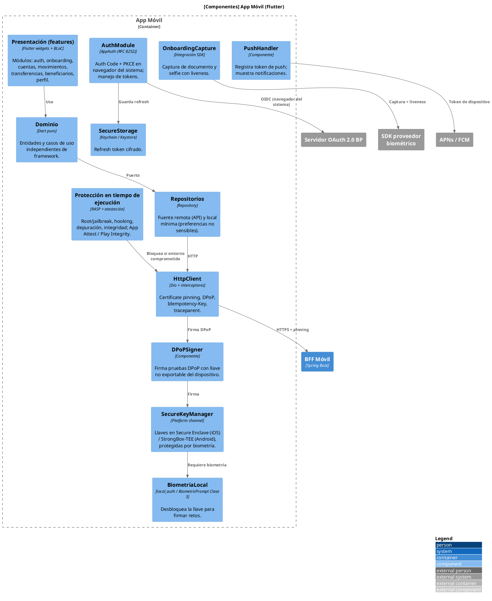

**Componentes**

| Componente | Patrón | Responsabilidad | Justificación |
|---|---|---|---|
| Presentación (features) | **Flutter widgets + BLoC** | Pantallas por módulo: auth, onboarding, cuentas, movimientos, transferencias, beneficiarios y perfil | BLoC separa el estado de la interfaz; cada módulo evoluciona por separado. |
| Dominio | **Clean Architecture** (Dart puro) | Entidades y casos de uso sin dependencia del framework | Se prueba sin dispositivo ni interfaz. |
| Repositorios | **Repository** | Acceden a la API remota y a un almacenamiento local mínimo (preferencias no sensibles) | No se guardan datos financieros en el teléfono. |
| AuthModule | **AppAuth** (RFC 8252) | Authorization Code + PKCE en el navegador del sistema; gestiona los tokens | La app nunca ve la clave del usuario: es la práctica recomendada para apps nativas. |
| DPoPSigner | Componente (RFC 9449) | Firma una prueba DPoP en cada llamada con una llave no exportable | Un token robado no sirve desde otro dispositivo (E-04). |
| SecureKeyManager | **Platform channel** | Crea y usa llaves en Secure Enclave (iOS) o StrongBox/TEE (Android), protegidas por biometría | La llave privada nunca sale del hardware. |
| BiometriaLocal | local_auth / BiometricPrompt Clase 3 | Desbloquea la llave para firmar los retos de ingreso y de step-up | La biometría se valida en el teléfono: la cara o la huella nunca se envían a BP. |
| SecureStorage | Keychain / Keystore | Guarda el refresh token cifrado | Protección del sistema operativo, ligada al dispositivo. |
| HttpClient | **Dio + interceptores** | Aplica certificate pinning y agrega DPoP, `Idempotency-Key` y `traceparent` | Concentra en un solo punto los controles de cada llamada. |
| Protección en tiempo de ejecución | **RASP + atestación** | Detecta root/jailbreak, hooking, depuración y alteración de la app | Si el entorno está comprometido, bloquea las operaciones (OWASP MASVS). |
| OnboardingCapture | **Integración de SDK** | Captura documento y selfie con liveness usando el SDK del proveedor | La captura y el liveness los resuelve un proveedor certificado (ISO/IEC 30107-3). |
| PushHandler | Componente | Registra el token de push, muestra las notificaciones y envía el acuse de recepción | El acuse permite confirmar la entrega del push (§5.2.6). |

#### 5.2.11 SPA Web (Angular)

**Propósito.** Aplicación web Angular para los clientes (RF-05). No maneja tokens: se autentica con la cookie de sesión del BFF Web.

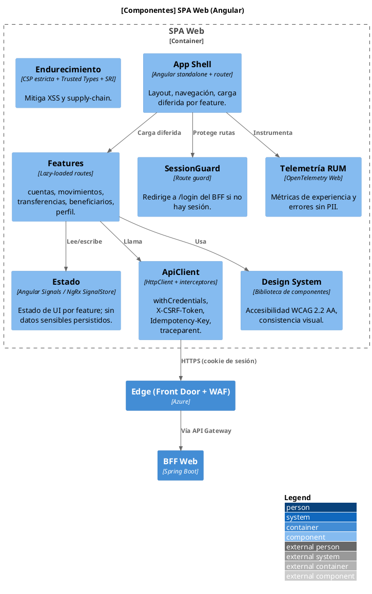

**Componentes**

| Componente | Patrón | Responsabilidad | Justificación |
|---|---|---|---|
| App Shell | **Angular standalone + router** | Layout, navegación y carga diferida por funcionalidad | Carga inicial más liviana (RNF-07). |
| Features | **Rutas con carga diferida** | Cuentas, movimientos, transferencias, beneficiarios y perfil | Módulos independientes que evolucionan por separado. |
| Estado | **Angular Signals / NgRx SignalStore** | Estado de la interfaz por funcionalidad | No persiste datos sensibles en el navegador. |
| ApiClient | **HttpClient + interceptores** | Envía la cookie de sesión, el token anti-CSRF, `Idempotency-Key` y `traceparent` | Concentra en un solo punto los controles de cada llamada. |
| SessionGuard | **Route guard** | Redirige al `/login` del BFF si no hay sesión | Protege la navegación; la autorización real se aplica en el backend. |
| Design System | Biblioteca de componentes | Componentes reutilizables con accesibilidad WCAG 2.2 AA | Consistencia visual y accesibilidad. |
| Telemetría RUM | **OpenTelemetry Web** | Mide la experiencia real del usuario y los errores, sin PII | La traza empieza en el navegador (§8.9). |
| Endurecimiento | **CSP estricta + Trusted Types + SRI** | Mitiga XSS y ataques a la cadena de suministro | Aunque no haya tokens en el navegador, un XSS podría operar en nombre del usuario dentro de su sesión. |

### 5.3 Nivel 3 — Persistencia para clientes frecuentes

#### 5.3.1 Problema

Los clientes que ingresan con frecuencia consultan repetidamente los mismos datos (perfil básico y detalle). Ir al Core y al sistema complementario en cada sesión **agrega latencia y carga** a sistemas que no escalan como la nube.

#### 5.3.2 Alternativa basada en patrones

| Patrón | Componente | Rol |
|---|---|---|
| **Repository** | `ClienteRepository` (interfaz) | Abstracción de acceso a datos que usa el dominio |
| **Decorator** | `CachingClienteRepository` | Envuelve al repositorio real y agrega la caché **sin modificar** al dominio ni al repositorio de origen (abierto/cerrado) |
| **Cache-Aside** | Dentro del Decorator | Lee la caché. En un *miss* consulta el origen y guarda con TTL |
| **Strategy** | `PoliticaRetencionStrategy` | Decide **cuánto tiempo y qué** se retiene según el perfil de frecuencia (frecuente / ocasional) |
| **Observer (eventos)** | `InvalidacionListener` | Invalida la entrada ante `ClienteActualizado` o cambios de contacto |
| **Single-flight** | `SingleFlight` | Una sola consulta al origen por clave ante concurrencia |
| **Proxy de protección** | `CacheCodec` | Cifra los atributos sensibles antes de cachear |
| **Router de origen** | `OrigenClienteRepository` | Dirige cada método a su sistema (básico → Core, detalle → Complementario). La composición la hace solo `PerfilClienteAggregator` |

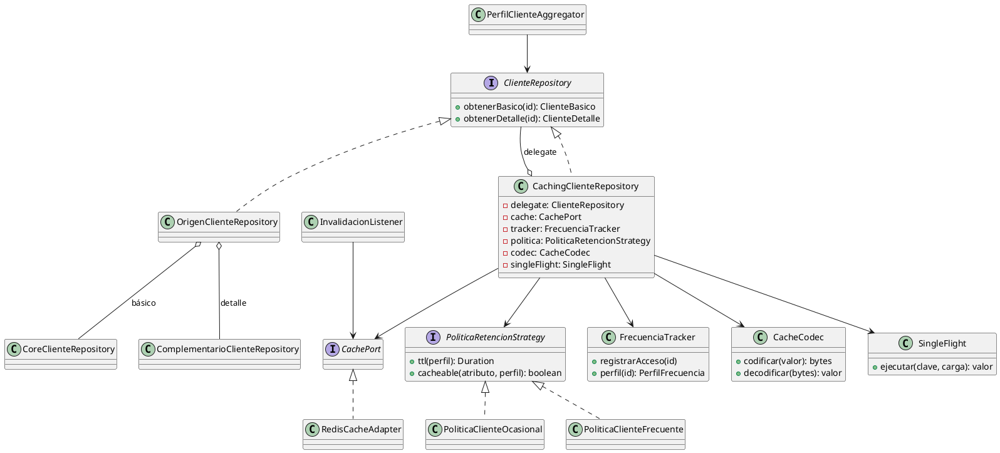

#### 5.3.3 Funcionamiento

1. `FrecuenciaTracker` cuenta los accesos por cliente en una **ventana deslizante** (Redis `ZADD`/`ZCOUNT`). El umbral de "frecuente" (p. ej. N sesiones en M días) es **configurable** y se calibra con datos reales de uso de BP. **[Validar]** Patrones de uso.
2. `PoliticaClienteFrecuente`: TTL extendido para el perfil básico y el detalle. Además, **precalienta** (*warm-up*) la caché al iniciar sesión de forma asíncrona, para que la primera pantalla no espere al Core.
3. `PoliticaClienteOcasional`: TTL corto. No cachea el detalle del sistema complementario.
4. **Qué nunca se cachea:** saldos, credenciales y datos de autenticación.
5. **Consistencia:** el TTL acota la antigüedad máxima. La invalidación por evento la reduce a segundos cuando hay eventos de cambio. **[Validar]** Si el Core no emite eventos de cambio de cliente, la antigüedad máxima la define solo el TTL.
6. **Seguridad:** valores cifrados a nivel de campo (llave en Key Vault), claves no derivables del número de cédula (hash con sal del `sub` opaco) y Redis accesible solo por Private Endpoint con TLS.
7. **Resiliencia:** si Redis falla, el Decorator **degrada** a llamada directa (con circuit breaker) y la funcionalidad no se interrumpe.

#### 5.3.4 Beneficio

- Menos latencia en las pantallas de mayor tráfico para el segmento que más usa el canal.
- Menos carga sobre el Core y el sistema complementario.
- Desacople: el dominio no sabe que existe una caché. Cambiar Redis por otro motor solo cambia un adaptador.

---

## 6. Vista de ejecución

### 6.1 Secuencia — inicio de sesión web (BFF)

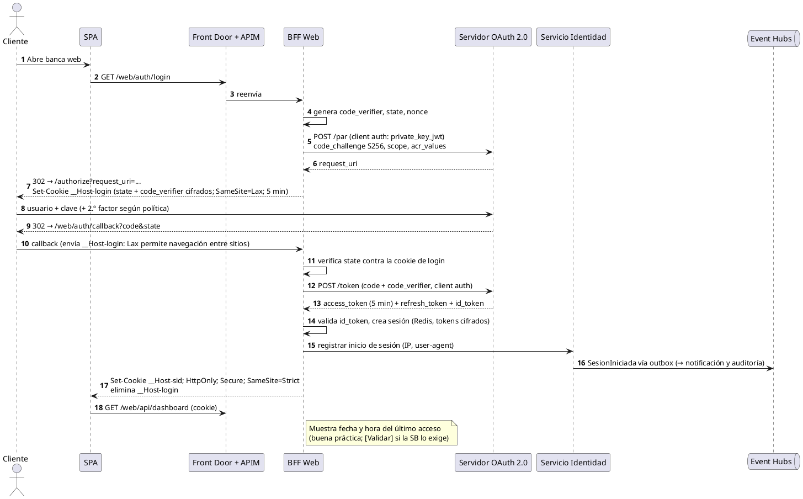

### 6.2 Secuencia — onboarding móvil

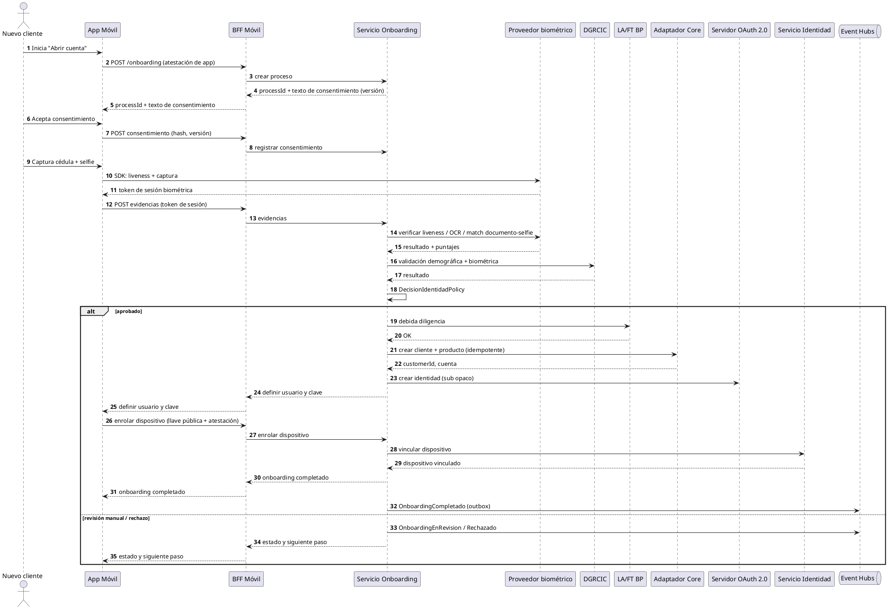

### 6.3 Secuencia — transferencia interbancaria

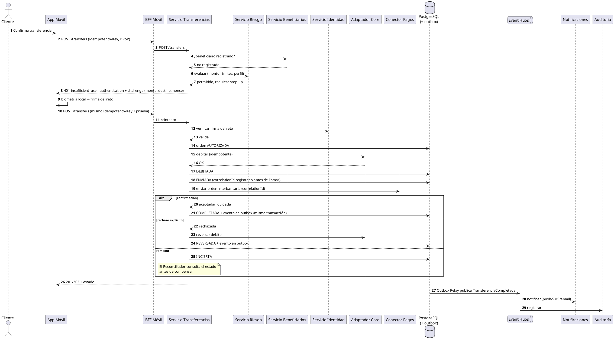

### 6.4 Secuencia — falla y compensación de una transferencia

Esta secuencia muestra el camino de error de la transferencia interbancaria de la §6.3, en sus dos puntos críticos: el **débito en el Core** (paso 2 de la Saga) y el **envío a pagos interbancarios** (paso 3). Aplica la Saga de la §5.2.1 y la decisión ADR-08 (§9.1), y es la que verifica el escenario de calidad E-08 (§10.2.1).

**Principio:** un *timeout* no es un rechazo. El débito o la orden pueden haberse aplicado, así que nunca se compensa ni se informa un rechazo sin antes consultar el estado real por la referencia única de la operación.

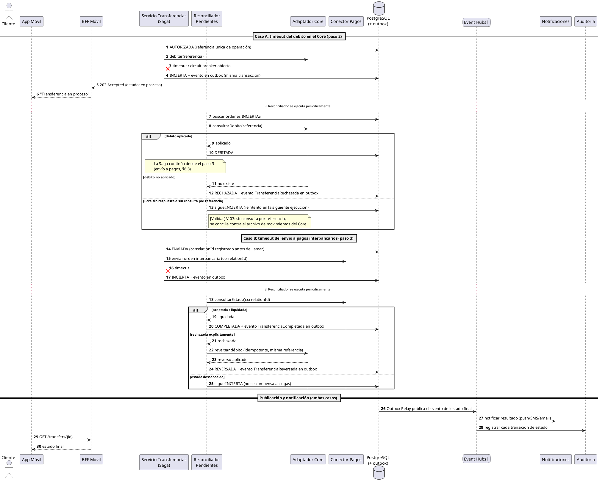

| Punto de falla | Estado intermedio | Resultado tras la consulta del Reconciliador | Qué ve el cliente |
|---|---|---|---|
| Timeout del débito en el Core | `INCIERTA` | Débito aplicado → la Saga continúa. No aplicado → `RECHAZADA`, sin efectos | "En proceso" hasta el resultado; luego la notificación |
| Rechazo explícito del Core | — | `RECHAZADA` de inmediato, sin efectos | Rechazo inmediato |
| Timeout del envío a pagos | `INCIERTA` | Liquidada → `COMPLETADA`. Rechazada → reverso del débito → `REVERSADA` | "En proceso" hasta el resultado; luego la notificación |
| Rechazo explícito de pagos | — | Reverso del débito → `REVERSADA` (secuencia de la §6.3) | Rechazo con reverso informado |
| Estado no determinable | `INCIERTA` | Se reintenta la consulta; nunca se compensa a ciegas | "En proceso" |

**Garantías:** el reverso usa la misma referencia única y es idempotente, así que un reintento no puede reversar dos veces; cada transición se persiste junto con su evento en el outbox, de modo que el cliente siempre recibe la notificación del resultado final y la auditoría registra todo el recorrido.

---

## 7. Vista de despliegue

### 7.1 Diagrama de despliegue

> El diagrama ilustra Chile Central como primaria y Brazil South como recuperación. Si se elige Brazil South como primaria (ADR-05), solo se intercambian los roles de las regiones.

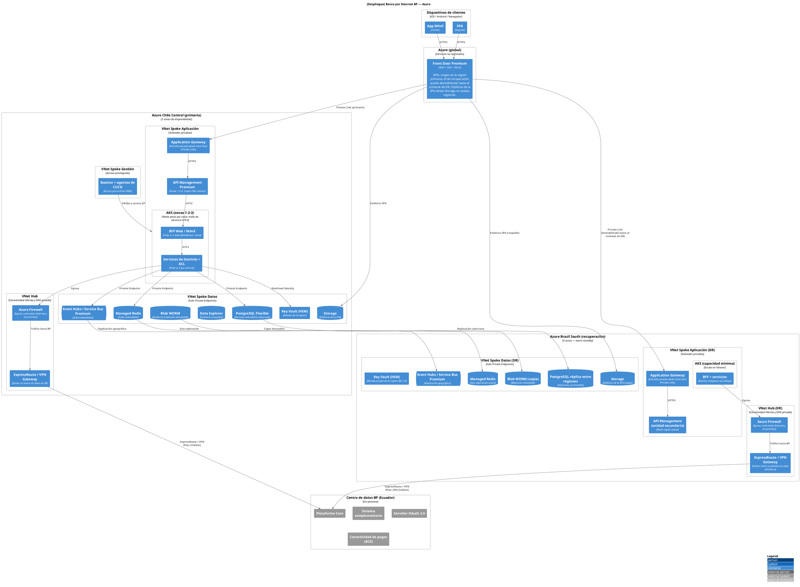

### 7.2 Topología de red

- **Hub-and-spoke**: el Hub concentra la conectividad híbrida, el firewall de salida y el DNS privado. Los *spokes* separan **aplicación**, **datos** y **gestión**. 
- **Sin IPs públicas** en servicios de backend. La única entrada pública es Front Door.
- **Entrada privada Front Door → APIM:** APIM Premium opera en **modo VNet interno**. Un APIM inyectado en una VNet no admite un *private endpoint* de entrada, así que Front Door Premium llega por **Private Link a un Application Gateway** del spoke de aplicación, y este reenvía a APIM. 
- **Cada región tiene su propio Hub** con firewall y enlace híbrido hacia el centro de datos de BP. La región de recuperación no depende del Hub de la primaria.
- **Private Endpoints** para PostgreSQL, Redis, Event Hubs, Service Bus, Key Vault, Storage y ADX.
- **Egress controlado**: toda salida a Internet (proveedores SMS/Email/biometría/push) sale por Azure Firewall con lista de destinos permitidos (FQDN).

### 7.3 Estrategia de baja latencia

| Táctica | Efecto |
|---|---|
| CDN (Front Door) para los estáticos de la SPA | Carga inicial servida desde el borde |
| Terminación TLS en el borde + conexiones persistentes (HTTP/2) hacia el origen | Menos *handshakes* sobre el enlace largo |
| BFF con composición paralela | Una solicitud por pantalla |
| Caché de clientes frecuentes y primera página de movimientos | Evita el viaje al Core en las lecturas más frecuentes |
| Asincronía en notificación y auditoría | No suman al tiempo de respuesta |
| Pool de conexiones y *keep-alive* hacia el Core por el enlace privado | Menos latencia de establecimiento |

### 7.4 Consideración de datos personales

La plataforma **no replica como maestro** ningún dato del Core (§8.4.1). Sin embargo, **sí persiste en la nube datos personales propios de la plataforma**:

| Dato persistido en la nube | Servicio | Datos personales que contiene |
|---|---|---|
| Órdenes de transferencia y estado de Saga | Transferencias | Cuentas de origen y destino, montos, identificador del cliente |
| Beneficiarios | Beneficiarios | Nombre, identificación y cuenta de terceros |
| Proceso de onboarding y consentimientos | Onboarding | Estado, consentimiento LOPDP, resultados de verificación y hash de evidencias (sin biometría en bruto, §8.2.3) |
| Dispositivos vinculados | Identidad y Dispositivos | Llaves públicas y metadatos del dispositivo |
| Bitácora de entrega de notificaciones | Notificaciones | Canal y destino enmascarado, contenido resumido |
| Cachés | Clientes, Movimientos | Perfil y primera página de movimientos, cifrados a nivel de campo y con TTL |
| Auditoría | Auditoría | Actor seudonimizado (`sub` opaco), IP, dispositivo, geolocalización aproximada |

**Base legal:** la LOPDP indica que no se configura una transferencia cuando el **encargado** accede a los datos para prestar un servicio al responsable. Por eso el contrato con el proveedor de nube debe instrumentarse **como encargo de tratamiento**. 

---

## 8. Conceptos transversales

### 8.1 Arquitectura de Autenticación y Autorización

#### 8.1.1 Flujos recomendados según el estándar

| Cliente | Flujo | Detalles | Fundamento |
|---|---|---|---|
| **SPA (vía BFF Web)** | **Authorization Code + PKCE (S256) + PAR**, ejecutado por el **BFF** como cliente confidencial (`private_key_jwt` o mTLS) | Los tokens no llegan al navegador. Sesión con cookie `__Host-`. Refresh token rotado y guardado cifrado en el servidor. | RFC 9700 (PKCE y desuso de Implicit/ROPC). RFC 10017 §5.1.1 (BFF como patrón recomendado). FAPI 2.0 (PAR, clientes confidenciales, tokens restringidos al emisor). |
| **App móvil** | **Authorization Code + PKCE (S256)** como cliente **público nativo** en el navegador del sistema, con **DPoP** (RFC 9449) | La prueba DPoP se firma con la llave no exportable del dispositivo. Access token de vida corta. Refresh token **restringido por DPoP** y con rotación. | RFC 8252 (apps nativas). RFC 9449 (DPoP). FAPI 2.0 deja fuera a los clientes públicos, por lo que se compensa con DPoP, atestación y vinculación de dispositivo. |
| **Servicio a servicio** | **Client Credentials** con autenticación mTLS / `private_key_jwt` + **Token Exchange** (RFC 8693) para propagar la identidad del usuario con audiencia restringida | Cada servicio recibe un token con la audiencia de ese servicio y no un token comodín. | Mínimo privilegio. Evita la reutilización de tokens entre servicios. |

**Flujos descartados**

| Flujo | Motivo |
|---|---|
| Implicit | RFC 9700 lo desaconseja por fuga y repetición del access token. |
| Resource Owner Password Credentials (ROPC) | RFC 9700 lo prohíbe. Expone la clave al cliente e impide MFA y SSO correctos. FAPI 2.0 exige rechazarlo. |
| Authorization Code sin PKCE | Vulnerable a la inyección del código de autorización. |
| Tokens en `localStorage` de la SPA | Cualquier XSS los extrae. RFC 10017 lo desaconseja frente al BFF. |

#### 8.1.2 Gestión de tokens

| Aspecto | Decisión | Justificación |
|---|---|---|
| Access token | JWT firmado (**PS256/ES256**, algoritmos admitidos por FAPI 2.0; RS256 no se admite), vida **5 min**, audiencia por API, `cnf` (DPoP/mTLS) | Vida corta para limitar la exposición. La validación local en APIM y en los servicios evita consultar al IdP en cada llamada. |
| Refresh token | Rotación en cada uso y detección de reutilización (revoca toda la familia). Web: en el servidor (BFF). Móvil: restringido por DPoP, en Keychain/Keystore | Recomendación de RFC 9700. |
| Sesión web | Inactividad **[Objetivo propuesto]** 5 min con aviso previo; vida absoluta 30 min | **[Norma]** Cierre de sesión y reautenticación. |
| Revocación | Logout → revocación en el IdP (RFC 7009) + borrado de la sesión en Redis + evento `SesionCerrada` | Cierre efectivo e inmediato. |
| Claims mínimos | `sub` (identificador opaco, **no** la cédula), `acr`, `amr`, `auth_time`, `scope`, `cnf` | Minimización (LOPDP) y soporte de step-up. |

#### 8.1.3 Métodos de ingreso después del onboarding

El Ejercicio Práctico pide especificar los métodos soportados. Se soportan dos:

| Método | Canal | Factores (SB: 2 de 3) | Uso |
|---|---|---|---|
| **Usuario + clave** | Web y móvil | Conocimiento (clave) + **posesión**: en móvil, el dispositivo vinculado; en web, la **aprobación en el móvil vinculado** (§8.1.4) o, si el cliente no tiene la app, un **OTP** | Ingreso principal en web. Respaldo en móvil. **[Norma]** Usuario distinto de la cédula y renovación anual de la clave. |
| **Biometría del dispositivo (huella / rostro)** con llave vinculada | Móvil | **Inherencia** (biometría local que desbloquea la llave) + **posesión** (llave no exportable en hardware seguro) | Ingreso rápido y *step-up* de transacciones en móvil. |

**Cómo funciona la biometría local (modelo FIDO2):** en el onboarding la app genera una llave no exportable en Secure Enclave/StrongBox, que solo se desbloquea con biometría, y la registra con su atestación en el Servicio Identidad (§8.2.2). En cada ingreso o *step-up*, esa llave firma un reto del servidor ligado al contexto (§8.1.4).

**La biometría nunca sale del dispositivo.** El servidor solo verifica una firma criptográfica. Así se cumple la minimización de la LOPDP y no se crea una base biométrica central.

**Rol del OTP.** El factor de posesión preferente es siempre el dispositivo vinculado. El OTP se usa solo en dos casos: (1) clientes **sin la app** que operan en web y (2) **respaldo** ante dispositivo perdido o reenrolamiento. El OTP por SMS es el factor más débil frente a fraude por SIM swap. Por eso el Servicio Riesgo Transaccional aplica **límites menores** a las operaciones autenticadas con OTP por SMS **[Objetivo propuesto]**, y la app incentiva la vinculación del dispositivo.

#### 8.1.4 Autenticación reforzada (*step-up*) por transacción

| Disparador | Exigencia | Fundamento |
|---|---|---|
| Toda transacción monetaria | Autenticación de 2 factores vigente (`acr` ≥ nivel 2) | **[Norma]** SB |
| Beneficiario **no registrado** | **Siempre** segundo factor en la transacción (firma biométrica u OTP) | **[Norma]** SB |
| Registro de un nuevo beneficiario | Step-up + notificación al cliente | Prevención de fraude |
| Cambio de teléfono o correo de notificación | Step-up **biométrico** (no OTP al mismo canal que se cambia) | **[Norma]** SB: cambio solo presencial o con autenticación fuerte (biometría facial o dactilar) |
| Riesgo alto (Servicio Riesgo) | Step-up, retención o bloqueo preventivo | **[Norma]** Monitoreo y bloqueo ante eventos inusuales |

**Mecanismo:** el servicio responde `401` con `WWW-Authenticate: Bearer error="insufficient_user_authentication", acr_values="..."` según **RFC 9470**. El cliente obtiene la prueba (firma de reto u OTP) y reintenta con el mismo `Idempotency-Key`. La firma del reto incluye **monto, destino y nonce** (*dynamic linking*), así que un atacante no puede reutilizar la aprobación para otra transacción.

**Aprobación en el móvil (step-up de la web).** Cuando el cliente opera en la web y la transacción exige segundo factor, el Servicio Identidad envía, a través del Servicio Notificaciones, un push a la app vinculada con el detalle de la operación. El cliente la aprueba con biometría y la llave del dispositivo firma el reto (posesión + inherencia). Evita el OTP por SMS en la web; si el cliente no tiene la app, se usa OTP con los límites menores de la §8.1.3.

#### 8.1.5 Variantes según las capacidades del IdP de BP (sin asumir)

| Capacidad del IdP **[Validar]** | Si la tiene | Si no la tiene |
|---|---|---|
| PAR (RFC 9126) | Se usa en el BFF Web | Authorization Code + PKCE con parámetros en el front channel (sigue siendo conforme a RFC 9700) |
| DPoP (RFC 9449) | Tokens del móvil restringidos por DPoP | El BFF Móvil exige una **firma de solicitud con la llave de dispositivo** (cabecera propia verificada por el Servicio Identidad), con la misma garantía de posesión |
| FIDO2/WebAuthn nativo | Se delega en el IdP el registro y la verificación de la llave | El **Servicio Identidad y Dispositivos** gestiona llaves y retos y comunica el resultado al IdP (*JWT bearer assertion*, RFC 7523, o API de autenticador externo) |
| Step-up por `acr_values` | Se usa directamente | El Servicio Identidad emite un **token de transacción** de un solo uso que Transferencias verifica |
| Token Exchange (RFC 8693) | Tokens de audiencia por servicio | Tokens de servicio (Client Credentials) + contexto del usuario firmado por el BFF |

### 8.2 Arquitectura de Onboarding con reconocimiento facial

#### 8.2.1 Diseño

El onboarding es un **proceso largo con pasos externos y decisiones**. Se modela como un **Process Manager** (máquina de estados persistida) dentro del Servicio Onboarding. Puede reanudarse si el usuario se interrumpe, y cada paso es idempotente.

| Paso | Componente | Detalle | Control |
|---|---|---|---|
| 1. Consentimiento | ConsentimientoService | Texto versionado del tratamiento (incluye biometría), aceptación explícita y hash del texto aceptado | **[Norma]** LOPDP. Los datos biométricos son categoría especial y exigen consentimiento explícito |
| 2. Captura del documento | App (SDK) → BiometriaAdapter | OCR de la cédula y validación de elementos de seguridad | — |
| 3. Selfie con *liveness* | App (SDK) → proveedor | Detección de ataques de presentación | Proveedor evaluado según **ISO/IEC 30107-3**. **[Validar]** Certificación del proveedor |
| 4. Validación oficial | RegistroCivilAdapter → **DGRCIC** | Consulta demográfica + biométrica: coteja la identidad con la fuente oficial | Servicio oficial con contrato de adhesión (§2.2.1) |
| 5. Decisión de identidad | DecisionIdentidadPolicy | Umbrales de liveness y match. Aprobado / rechazado / **revisión manual** | Los umbrales se configuran sin redeploy y quedan auditados |
| 6. Debida diligencia | LaftAdapter | Listas y perfil de riesgo | **[Norma]** LA/FT |
| 7. Alta | AltaClienteService | Cliente y producto en el Core (vía ACL) + identidad en el IdP | Idempotente (clave = número de identificación + id de proceso) |
| 8. Credenciales | IdP | Usuario (≠ cédula) y clave | **[Norma]** SB |
| 9. Vinculación del dispositivo | Servicio Identidad | Llave de dispositivo + atestación + biometría local | Habilita el ingreso biométrico (§8.1.3) |
| 10. Cierre | Process Manager | Evento `OnboardingCompletado` → notificación de bienvenida y auditoría | — |

#### 8.2.2 Relación del onboarding con la autenticación y la autorización

- El onboarding termina con **tres anclas de confianza**: identidad verificada (DGRCIC + liveness), credencial de conocimiento (clave) y **dispositivo vinculado** (llave en hardware con biometría local).
- El dispositivo vinculado es el **factor de posesión** de todos los ingresos y *step-ups* posteriores. Por eso el onboarding forma parte del flujo de autenticación, como pide el Ejercicio Práctico.
- **Reenrolamiento** (cambio o pérdida de teléfono): repite liveness + match contra la DGRCIC y revoca el dispositivo anterior. Se notifica al cliente por todos los canales.

#### 8.2.3 Protección de datos biométricos

| Dato | Tratamiento |
|---|---|
| Imágenes de selfie y documento | Las procesa el proveedor. **No se persisten en BP** después de decidir, salvo la evidencia exigida por la política LA/FT de BP. |
| Plantillas biométricas | **No se crean ni se guardan en BP.** El match con la DGRCIC lo resuelve el servicio oficial y la biometría de ingreso es local al dispositivo |
| Evidencia | Hash de las evidencias + resultado + puntajes + ids de transacción del proveedor y de la DGRCIC, firmados con llave HSM |
| Contrato con el proveedor | Encargado del tratamiento, con cláusulas LOPDP, prohibición de usos secundarios y borrado verificable |

### 8.3 Arquitectura de Integración

#### 8.3.1 API Gateway (Azure API Management)

| Función | Configuración |
|---|---|
| Enrutamiento | `/web/*` → BFF Web y `/mobile/*` → BFF Móvil. Los servicios de dominio **no** se exponen a Internet (solo por red privada) |
| Seguridad | `/mobile/*`: validación JWT (firma por JWKS, `iss`, `aud`, `exp`, `scope`) y presencia de la prueba DPoP. `/web/*`: la SPA no tiene tokens; solo viaja la cookie de sesión, que valida el BFF Web, y APIM aplica verificación de `Origin`, rate limiting y esquemas. En ambos casos: mTLS hacia el backend e IP filtering de administración |
| Protección | Rate limiting por cliente y por IP, cuotas, tamaño máximo de payload y validación de esquema OpenAPI |
| Versionado | Por ruta (`/v1`, `/v2`) con política de *deprecation* publicada |
| Observabilidad | Propagación de `traceparent` (W3C) y métricas por API |
| Despliegue | Tier Premium **zona-redundante** en la región primaria + **unidad en la región secundaria** (multi-región nativo) |

#### 8.3.2 Integración con sistemas externos

| Sistema | Patrón | Protocolo | Resiliencia | Observaciones |
|---|---|---|---|---|
| Core | **ACL + Adapter + Bulkhead** | **[Validar]** (REST/SOAP/MQ/ISO 8583/propietario) | Timeout por operación, circuit breaker, **techo de concurrencia** pactado con el Core, retry solo en operaciones idempotentes | La interfaz hacia el dominio no cambia aunque cambie el protocolo |
| Sistema complementario | ACL + Adapter + caché | **[Validar]** | Circuit breaker. Si falla, se degrada (el perfil básico se muestra sin el detalle) | Composición tolerante a fallos en el Servicio Clientes |
| Pagos interbancarios | **ACL + Messaging Gateway + Correlation Identifier** | Formato y canal definidos por BP/BCE **[Validar]** | Envío idempotente, consulta de estado y reconciliación | Aísla cambios normativos de formato (p. ej. Norma Técnica SPI v2) |
| Proveedor biométrico | Adapter (intercambiable) | HTTPS + SDK | Timeout + retry | Permite cambiar de proveedor |
| DGRCIC | Adapter | Web service oficial | Circuit breaker. Si cae, el onboarding queda en estado "pendiente de validación" y se reanuda | No se aprueba ninguna identidad sin validación |
| Push/SMS/Email | Strategy + Chain of Responsibility | HTTPS | Fallback entre canales | §8.6 |

#### 8.3.3 Patrones de integración aplicados

| Patrón | Dónde | Justificación |
|---|---|---|
| **API Gateway** | APIM | Punto único de control de seguridad y gobierno |
| **Backend for Frontend** | BFF Web / Móvil | §4.3.3 |
| **Anti-Corruption Layer** | Adaptadores Core, Complementario y Pagos | P3 |
| **Saga (orquestación)** | Transferencias | §5.2.1 |
| **Transactional Outbox + Message Relay** | Transferencias, Onboarding, Beneficiarios, Identidad y Dispositivos (inicio de sesión, vinculación) y Clientes (cambio de contacto) | Publicación garantizada de eventos. Incluye todos los eventos cuya notificación es obligatoria **[Norma]** |
| **Idempotent Receiver / Inbox** | Transferencias (API), Notificaciones y Auditoría (consumidores) | Entrega *at-least-once* sin efectos duplicados |
| **Publish-Subscribe** | Event Hubs | Notificaciones, auditoría e invalidación de cachés desacopladas del productor |
| **Competing Consumers** | Notificaciones por canal | Escalado horizontal |
| **Dead Letter Channel** | Service Bus y Event Hubs (tópicos `.dlq`) | Ningún mensaje se pierde: se aísla y se alerta |
| **Circuit Breaker / Bulkhead / Retry / Timeout** | Todos los clientes salientes | P5 |
| **Request Coalescing / Single-flight** | Servicio Clientes y adaptadores | Evita estampidas sobre el Core |
| **Correlation Identifier** | Pagos y trazas | Une solicitud, respuesta asíncrona y auditoría |

### 8.4 Arquitectura de Acceso a Datos

#### 8.4.1 Principios

1. **Base de datos por servicio** (*Database per Service*): ningún servicio lee tablas de otro. La integración es por API o eventos.
2. **El Core y el sistema complementario son la fuente de verdad** de clientes, productos y movimientos. La plataforma digital **no los replica como maestros**. Solo cachea datos con TTL corto e invalidación por evento (§5.2.3).
3. **Repository** como puerto de dominio: el dominio no conoce SQL, Redis ni el protocolo del Core.

#### 8.4.2 Fuentes y estrategias

| Fuente | Acceso | Caché | Consistencia | Justificación |
|---|---|---|---|---|
| Core (básico de cliente) | Adaptador ACL | Cache-Aside + política de frecuencia (§5.3) | Eventual acotada por TTL + invalidación por evento | Dato muy leído y poco cambiante |
| Core (movimientos) | Adaptador ACL | Primera página, TTL corto | Fuerte en consulta directa; la primera página, eventual acotada por TTL + invalidación por evento | §5.2.3 |
| Core (saldos) | Adaptador ACL | **Sin caché** | Fuerte | El saldo debe ser exacto al transferir |
| Sistema complementario | Adaptador ACL | Cache-Aside, TTL medio | Eventual | Detalle poco cambiante |
| Transferencias, beneficiarios, onboarding, identidad, notificaciones, riesgo | PostgreSQL por servicio | — | Fuerte (ACID local) | Estado propio de la plataforma |
| Auditoría | Data Explorer + Blob WORM | — | Append-only | §8.5 |

#### 8.4.3 Motor de base de datos — PostgreSQL Flexible Server

- **Por qué PostgreSQL:** ACID, JSONB para payloads semiestructurados (p. ej. evidencias), particionamiento nativo, *row-level security* y portabilidad entre nubes (P8).
- **Alta disponibilidad:** HA **zona-redundante** con réplica en espera **síncrona** en otra zona y failover automático (RPO 0 ante la pérdida de una zona).
- **DR:** réplica de lectura **entre regiones** (asíncrona), promovible en caso de desastre.
- **Seguridad:** acceso solo por Private Endpoint, autenticación con identidad administrada (sin contraseñas), TDE + **cifrado a nivel de campo** para PII sensible (llaves en Key Vault).

#### 8.4.4 Clasificación de datos

| Clase | Ejemplos | Controles |
|---|---|---|
| Restringido | Credenciales, llaves, evidencia biométrica (hash), tokens | HSM, nunca en logs, acceso solo por servicio dueño |
| Confidencial (sigilo bancario) | Saldos, movimientos, beneficiarios, datos de contacto | Cifrado en reposo y en tránsito, enmascarado en logs, acceso auditado |
| Interno | Catálogos, configuración | Control de acceso estándar |
| Público | Textos legales, contenido de la SPA | — |

### 8.5 Solución de Auditoría

#### 8.5.1 Objetivo

Registrar **todas las acciones del cliente** (Ejercicio Práctico RF-08) de forma **completa, inmutable, verificable y consultable**, sin agregar latencia a la operación del cliente.

#### 8.5.2 Diseño (patrones)

| Capa | Patrón | Componente |
|---|---|---|
| Captura | **Interceptor / Aspect (AOP)** | `AuditInterceptor` en BFFs y servicios: toda acción (consulta, transferencia, login, cambio de datos, step-up) emite un `AuditEvent`. La librería es común (*cross-cutting*) para que ningún equipo la omita |
| Captura garantizada en comandos | **Transactional Outbox** | En operaciones que cambian estado, el evento de auditoría se escribe en la **misma transacción** del cambio |
| Transporte | **Publish-Subscribe** | Tópico `audit` en Event Hubs con partición por `customerId` (orden por cliente) |
| Procesamiento | **Pipes and Filters** | Validar esquema → enmascarar → encadenar hash → escribir |
| Integridad | **Hash chain + árbol de Merkle firmado** | `hash_n = SHA-256(hash_{n-1} ‖ evento_n)` por partición. Cada lote tiene raíz Merkle firmada con llave HSM. Un verificador independiente recalcula la cadena periódicamente y alerta ante cualquier discrepancia |
| Persistencia | **Event Log (append-only)** + **archivo WORM** | ADX para consulta y Blob con política de inmutabilidad para retención legal |

#### 8.5.3 Esquema del evento de auditoría

| Campo | Descripción |
|---|---|
| `eventId` | UUID (deduplicación) |
| `timestamp` | UTC, sincronizado por NTP |
| `actor` | `sub` opaco del cliente (o id de operador) |
| `action` | p. ej. `TRANSFER_CREATE`, `MOVEMENTS_VIEW`, `LOGIN_SUCCESS`, `CONTACT_CHANGE` |
| `resource` | Tipo e id del recurso (enmascarado) |
| `result` | Éxito / fallo + código |
| `channel` | WEB / MOBILE |
| `ip`, `userAgent`, `deviceId`, `geo` (aprox.) | **[Norma]** Registro de IP en transacciones por Internet |
| `authContext` | `acr`, `amr`, método de step-up |
| `traceId` | Correlación con la telemetría (§8.9) |
| `amount`, `currency`, `counterpartyMasked` | En transacciones |
| `prevHash`, `hash` | Cadena de integridad |

#### 8.5.4 Almacenes

| Almacén | Rol | Por qué |
|---|---|---|
| **Azure Data Explorer** | Consulta forense y operativa (KQL) sobre eventos recientes | Motor optimizado para ingesta masiva *append-only* y consultas por tiempo. Integración nativa con Sentinel. Sin permisos de borrado o modificación para roles de aplicación |
| **Blob Storage con inmutabilidad (WORM)** | Retención legal de largo plazo | Ni siquiera un administrador puede modificar o borrar dentro del período de retención |
| **SIEM** (corporativo de BP o Sentinel, S-05) | Detección de amenazas | Solo eventos de seguridad, sin duplicar todo el volumen |

**Segregación:** el equipo que opera la plataforma no tiene permisos de escritura ni borrado sobre la auditoría.

#### 8.5.5 Retención

 Los períodos de retención los define el área de Cumplimiento de BP según el COMF, las normas SB y la política documental de la entidad. El diseño lo resuelve con **políticas de retención configurables por tipo de evento**: *hot* en ADX (meses) y archivo WORM (años), sin cambios de código.

### 8.6 Notificaciones

#### 8.6.1 Canales (mínimo exigido: 2; se proponen 3)

| Canal | Proveedor | Tipo | Uso principal | Justificación |
|---|---|---|---|---|
| **Push** | APNs (iOS) / FCM (Android) | Externo | Notificación inmediata de transacción y acceso. Aprobación de step-up web | Costo marginal bajo e inmediatez |
| **SMS** | Proveedor SMS con conexión a operadoras locales **[Validar]** proveedor contratado | Externo | Respaldo de push. Clientes sin app. Eventos críticos (cambio de contacto, nuevo dispositivo) | **[Norma]** "Mensajería móvil" está nombrada en la norma. Alcance universal |
| **Correo electrónico** | Proveedor de correo transaccional (SPF, DKIM, DMARC) | Externo | Comprobantes, eventos no urgentes, respaldo | **[Norma]** "Correo electrónico" está nombrado en la norma |

#### 8.6.2 Reglas de entrega

| Evento | Canales | Criticidad |
|---|---|---|
| Inicio de sesión | Push (o SMS si no hay app) | Alta. **[Norma]** Notificar el acceso |
| Transferencia o pago realizado por el cliente | Push + Email (comprobante). SMS si el push falla | Alta. **[Norma]** |
| Nuevo beneficiario | Push + SMS | Alta |
| Cambio de teléfono o correo | **SMS al número anterior + Email al correo anterior** + push | Crítica (alerta de posible toma de cuenta) |
| Nuevo dispositivo vinculado | Push al dispositivo anterior + SMS + Email | Crítica |

**Alcance de RF-04:** se notifican los movimientos que el cliente **realiza** en la plataforma. Todos se originan en la Saga del Servicio Transferencias y se publican por el outbox, así que la notificación está garantizada (§5.2.1). Los movimientos que ocurren fuera de la plataforma (transferencias recibidas, cajero, ventanilla) quedan fuera de esta interpretación. Si BP o la SB los exigen, se habilitan cuando el Core emita eventos de movimientos (V-02), sin cambiar el Servicio de Notificaciones.

**Contenido mínimo del mensaje:** fecha y hora, tipo de operación, monto, referencia, cuenta enmascarada y **canal para reportar una transacción no reconocida**. Es la referencia de la norma análoga de la SEPS para el sector popular y solidario, y una buena práctica. **[Validar]** Formato exigido por la SB y política de BP.

**Datos de contacto:** solo se usan datos **verificados** y no se muestran completos en ningún canal electrónico (enmascarado), como prevención de toma de cuenta.

### 8.7 Alta disponibilidad, recuperación ante desastres y auto-healing

#### 8.7.1 Alta disponibilidad (dentro de la región)

| Capa | Mecanismo | Falla tolerada |
|---|---|---|
| Edge | Front Door (global, anycast) | PoP o región |
| API Gateway | APIM Premium zona-redundante | Pérdida de una zona |
| Cómputo | AKS con node pools en 3 zonas, ≥ 3 réplicas por servicio, `topologySpreadConstraints` por zona y `PodDisruptionBudget` | Pérdida de nodo o de zona; mantenimiento |
| Datos OLTP | PostgreSQL HA zona-redundante (réplica síncrona y failover automático) | Pérdida de zona con RPO 0 |
| Caché | Managed Redis zona-redundante | Pérdida de nodo o de zona |
| Mensajería | Event Hubs / Service Bus Premium zona-redundantes | Pérdida de zona |
| Conectividad on-premise | 2 enlaces independientes (ExpressRoute + VPN, o 2 VPN) **en cada región**: la región de recuperación tiene su propio Hub y enlace activo hacia el centro de datos de BP | Pérdida de un enlace |
| Dependencias externas | Circuit breakers + degradación controlada (§8.7.4) | Caída del sistema complementario, de un proveedor de SMS, etc. |

#### 8.7.2 Recuperación ante desastres (entre regiones)

**Estrategia: Warm Standby** en la región de recuperación: Brazil South en la configuración ilustrada, o Chile Central si se elige Brazil South como primaria (ADR-05).

| Opción | RTO | Costo | Decisión |
|---|---|---|---|
| Backup & Restore | Horas | Bajo | Descartada: no compatible con un canal transaccional crítico |
| Pilot Light | ~1–2 h | Bajo-medio | Descartada: arrancar cómputo y APIM en frío alarga el RTO |
| **Warm Standby** | **≤ 60 min** **[Objetivo propuesto]** | Medio | **Elegida**: equilibra RTO/RPO y costo |
| Activo-Activo | Minutos | Alto | No justificada: el Core es único (on-premise), así que activo-activo en la nube no elimina la dependencia principal y duplica el costo |

| Componente | Mecanismo de DR | RPO **[Objetivo propuesto]** |
|---|---|---|
| Código y configuración | GitOps: ambos clústeres sincronizan los mismos manifiestos | 0 |
| Imágenes | Registro con réplica geográfica | 0 |
| PostgreSQL | Réplica de lectura entre regiones, promovible | ≤ 5 min (típicamente segundos) |
| Redis | Geo-replicación activa | Segundos (además, la caché se puede reconstruir) |
| Event Hubs / Service Bus | Replicación geográfica del tier, o reconstrucción desde el outbox (las tablas outbox se replican con PostgreSQL) | ≤ 5 min |
| Auditoría | Blob WORM con copia en la región secundaria. ADX se puede reingestar desde el archivo | Minutos |
| Secretos y llaves | **Una bóveda por región.** Chile Central es no emparejada y los respaldos de Key Vault no se restauran entre geografías, así que no hay réplica automática entre las dos regiones. Las llaves que deben ser idénticas en ambas (p. ej. cifrado de campo, para leer los datos replicados) las genera BP y las importa en las dos bóvedas (BYOK). Los secretos se sincronizan por pipeline. Los certificados mTLS y las llaves de firma de lotes de auditoría son propios de cada región | 0 (sincronización en cada cambio) |
| Conectividad con el Core | Hub propio en la región de recuperación con ExpressRoute/VPN **activo y probado en cada simulacro** | — |

**Activación:** el failover regional es **una sola decisión controlada**, no dos mecanismos independientes. Si Front Door enviara tráfico a la región de recuperación antes de promover la base de datos, las transferencias fallarían contra una réplica de solo lectura. Por eso el origen de la región de recuperación permanece **deshabilitado** en Front Door, y un runbook automatizado, con aprobación de dos personas para evitar un *split-brain* ante fallas parciales, ejecuta en orden:

1. Confirmar la pérdida de la región primaria (health probes + verificación humana).
2. Promover la réplica de PostgreSQL de cada servicio.
3. Escalar AKS y APIM a capacidad productiva.
4. Verificar el enlace hacia el Core desde el Hub de la región de recuperación.
5. Habilitar el origen de la región de recuperación en Front Door.

Los *health probes* automáticos de Front Door se usan para conmutar entre zonas y PoPs y para los estáticos de la SPA, que no dependen de la base de datos.

#### 8.7.3 Auto-healing

| Nivel | Mecanismo |
|---|---|
| Contenedor | *Liveness probes* (reinicio), *readiness probes* (sale del balanceo), *startup probes* |
| Pod / servicio | HPA (CPU, memoria, latencia), **KEDA** (lag de Event Hubs, longitud de colas de Service Bus) |
| Nodo | Cluster Autoscaler + **reparación automática de nodos** de AKS |
| Configuración | **GitOps** (Flux/Argo CD): corrige automáticamente cualquier cambio manual no autorizado |
| Despliegue | **Rollback automático** si fallan los análisis de un *canary* (tasa de error, latencia) |
| Dependencias | Circuit breaker con *half-open* para reintentar recuperación sin saturar |
| Datos | Failover automático de PostgreSQL entre zonas |
| Mensajes | Reintentos con backoff → DLQ → **reprocesamiento** automatizado tras corrección |
| Validación | **Chaos engineering** (Azure Chaos Studio): caída de zona, latencia en el Core, pérdida de Redis, en preproducción y luego en producción controlada |

#### 8.7.4 Degradación controlada

| Falla | Comportamiento |
|---|---|
| Sistema complementario no disponible | Se muestra el perfil básico (Core) y el detalle aparece como "no disponible temporalmente" |
| Core lento | Bulkhead y timeout. Las consultas usan caché. Con el circuit breaker abierto, las transferencias nuevas se **rechazan explícitamente antes de debitar**. Si un débito ya enviado vence por timeout, la orden queda `INCIERTA` y el cliente la ve "en proceso" hasta que el Reconciliador la resuelve: nunca se informa un rechazo sin confirmar (§5.2.1) |
| Canal de pagos interbancarios no disponible | Las transferencias dentro de BP (propias y a terceros) siguen operando. Las interbancarias muestran un aviso al cliente y no se debita |
| Proveedor SMS caído | Se conmuta al proveedor alterno (si existe) o a la cadena Push/Email |
| Redis caído | Lectura directa al origen con circuit breaker. Las sesiones web se reautentican. La idempotencia de transferencias **no se ve afectada** (restricción única en PostgreSQL, §5.2.1). Los retos de *step-up* no se pueden emitir: las operaciones que lo requieren se rechazan (falla segura) hasta que Redis se recupere |

### 8.8 Seguridad

#### 8.8.1 Controles por capa

| Capa | Controles |
|---|---|
| **Perímetro** | Front Door WAF (OWASP CRS + reglas bot), DDoS Protection, *geo-filtering* configurable, TLS 1.2+ (preferente 1.3) y HSTS |
| **API** | Validación JWT, esquemas OpenAPI, rate limiting, protección BOLA en servicios (§5.2.3), tamaño de payload. **OWASP API Security Top 10** |
| **Identidad** | OAuth 2.0/OIDC (§8.1), MFA, step-up, DPoP, vinculación de dispositivo |
| **Servicio a servicio** | mTLS de malla (identidades SPIFFE), *authorization policies* (deny-by-default), Workload Identity (sin secretos en pods) |
| **Red** | Hub-spoke, NSG, Private Endpoints, egress por firewall, sin IP pública en el backend |
| **Datos** | Cifrado en reposo (llaves gestionadas por el cliente en HSM), cifrado de campo para PII sensible, TLS en tránsito, enmascarado en logs |
| **Secretos y llaves** | Key Vault con HSM, rotación automática y acceso por identidad administrada |
| **Cliente web** | BFF (sin tokens en el navegador), CSP estricta, Trusted Types, SRI, cookies `__Host-` |
| **Cliente móvil** | Llaves en hardware, RASP, atestación, pinning, ofuscación, sin datos financieros en caché local. **OWASP MASVS** |
| **Supply chain** | SBOM por imagen, escaneo SCA/SAST/DAST/contenedores en CI, **firma de imágenes** y política de admisión que solo permite imágenes firmadas |
| **Acceso privilegiado** | *Just-in-time* (PIM), MFA resistente a phishing para administradores, *break-glass* auditado y sin acceso permanente a producción |
| **Detección y respuesta** | Defender for Cloud / Containers, SIEM/SOAR (el corporativo de BP o Microsoft Sentinel, S-05), casos de uso de fraude y toma de cuenta |

#### 8.8.2 Gestión de vulnerabilidades y pruebas

- **Modelado de amenazas (STRIDE)** por servicio en cada cambio arquitectónico.
- **Pentest** por tercero independiente: **[Norma]** pruebas de vulnerabilidad y penetración. **[Objetivo propuesto]** Antes de salir a producción y luego al menos una vez al año y ante cambios mayores.
- **SLA de remediación** por severidad (críticas en días, no semanas).
- **Programa de verificación** con **OWASP ASVS** (web/API) y **MASVS/MASTG** (móvil).

#### 8.8.3 Cumplimiento normativo de seguridad (resumen)

| Exigencia **[Norma]** | Dónde se cumple |
|---|---|
| Notificación en línea del acceso y de las transacciones | §8.6 |
| 2 de 3 factores en transacciones monetarias | §8.1.3, §8.1.4 |
| Segundo factor para destinos no registrados | §8.1.4, Servicio Beneficiarios |
| Usuario ≠ cédula; renovación anual de la clave | Política del IdP (§8.1.3) |
| Cierre de sesión y reautenticación | §8.1.2 |
| Registro de IP | §8.5.3 |
| Cambio de contacto solo con autenticación fuerte | §5.2.2, §8.1.4 |
| Bloqueo ante eventos inusuales | Servicio Riesgo Transaccional |
| Segmentación de red; pentest independiente | §7.2, §8.8.2 |
| Nube: informar a la SB, TIER III, ISO 27001, proveedor alterno | §11 (R-01), P8 |
| LOPDP: consentimiento, minimización, seguridad, encargo | §8.2.3, §8.4.4, §7.4 |

### 8.9 Monitoreo y observabilidad

#### 8.9.1 Arquitectura

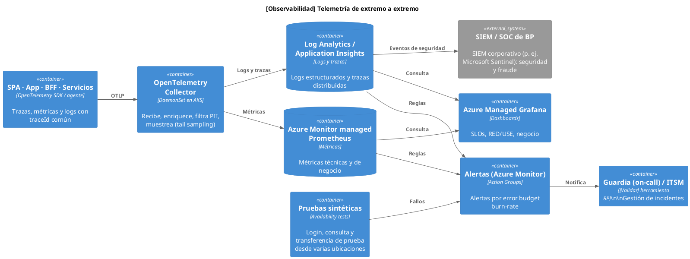

#### 8.9.2 Qué se mide

| Nivel | Indicadores |
|---|---|
| **Experiencia** | RUM web y móvil (tiempo de carga, errores, *crash-free sessions*) |
| **APIs (RED)** | Tasa, errores y duración (p50/p95/p99) por endpoint y canal |
| **Infraestructura (USE)** | Utilización, saturación y errores de nodos, pods, bases de datos, colas y caché |
| **Dependencias** | Latencia y errores hacia el Core, el sistema complementario, pagos, la DGRCIC y los proveedores. Estado de los circuit breakers |
| **Negocio** | Transferencias por minuto, tasa de éxito, tiempo hasta la notificación, onboardings completados/rechazados/en revisión, step-ups fallidos |
| **Seguridad** | Logins fallidos, anomalías de dispositivo, cambios de contacto, alertas WAF, detecciones de RASP |
| **Cumplimiento** | % de transacciones notificadas dentro del objetivo, lag de auditoría, integridad de la cadena de hash |

#### 8.9.3 SLOs y alertas

| SLI | SLO **[Objetivo propuesto]** |
|---|---|
| Disponibilidad de login | 99,95 % |
| Disponibilidad de transferencia (excluye rechazos de negocio) | 99,95 % |
| Latencia p95 de consultas en caché | ≤ 300 ms |
| Notificación de transacción entregada al proveedor | 99 % en ≤ 30 s |
| Lag de auditoría | ≤ 60 s p99 |

- Alertas por **burn-rate del presupuesto de error** (ventanas múltiples) en lugar de umbrales estáticos, para reducir ruido y detectar degradaciones reales.
- **Pruebas sintéticas** cada minuto para login, consulta y transferencia de prueba entre cuentas de prueba.
- **Privacidad en telemetría:** el Collector elimina o enmascara PII. Nunca se registran tokens, claves ni números completos de cuenta.

### 8.10 Excelencia operativa

| Práctica | Implementación |
|---|---|
| **Infraestructura como código** | Terraform (portable entre nubes, coherente con P8) con módulos versionados, revisión obligatoria y `plan` auditado |
| **GitOps** | Flux o Argo CD. Los clústeres reconcilian el estado declarado en Git |
| **CI/CD** | Pipeline con pruebas unitarias, de contrato (consumer-driven), SAST/SCA, escaneo de imagen, firma y despliegue progresivo. **[Validar]** Herramienta corporativa (GitHub Actions / Azure DevOps / otra) |
| **Despliegue progresivo** | *Canary* con análisis automático y *rollback*. *Feature flags* para desacoplar despliegue de lanzamiento |
| **Ambientes** | Desarrollo, QA, preproducción (réplica de producción con datos sintéticos o enmascarados) y producción |
| **Gestión de cambios** | Cambios estándar automatizados. Los cambios mayores se coordinan con el área de Riesgo Operativo de BP |
| **Runbooks** | Por alerta, con pasos automatizables (failover, reprocesamiento de DLQ, rotación de llaves) |
| **Post-mortems** | Sin culpables, con acciones de mejora rastreadas |
| **Gestión de capacidad** | Pruebas de carga antes de campañas o fechas pico (p. ej. días de pago) |

### 8.11 Gestión de costos

Al no disponer de métricas transaccionales de BP, las cifras son **ilustrativas**: muestran el orden de magnitud y dónde se concentra el costo, no son una cotización.

**Control de costos:** etiquetado obligatorio por servicio, ambiente y centro de costo, y presupuestos con alertas por servicio.

#### 8.11.1 Decisiones de infraestructura: costo/beneficio

Costo mensual tomado del escenario de la §8.11.2 (USD, precios de lista).

| Decisión | Costo mensual | Alternativa más barata | Por qué no se elige la alternativa | Palanca de optimización |
|---|---|---|---|---|
| **API Management Premium** (3 unidades en zonas + 1 en la región de recuperación) | ~11 200 (39 %) | APIM Standard clásico (~¼ del costo por unidad) | Standard no tiene zonas de disponibilidad, modo VNet interno ni multi-región: el gateway sería un punto único de falla y quedaría expuesto a Internet (RNF-01, RNF-03) | Ajustar el número de unidades según la medición real; con 2 unidades en 2 zonas se ahorran ~2 800/mes.|
| **DR Warm Standby** en la región de recuperación | ~9 600 (33 %) | Pilot Light o Backup & Restore | Arrancar en frío lleva el RTO a horas, incompatible con un canal transaccional crítico (RNF-02). Activo-activo duplicaría el costo sin eliminar la dependencia del Core único (§8.7.2) | Capacidad mínima y escalado solo en el failover; una sola unidad de APIM |
| **AKS** con SLA de plano de control | ~3 000 | Azure Container Apps | AKS da control de red (políticas, malla mTLS), auto-healing por pod, nodo y zona, y portabilidad entre nubes (P8). Container Apps es más barato a baja escala, pero con menos control | Reservas a 1 año para la base estable (−38 % en nodos, ~1 600/mes), autoescalado para picos, nodos *spot* solo fuera de producción |
| **PostgreSQL con HA zona-redundante** | ~1 600 | Instancia sin HA | La HA duplica el cómputo, pero da RPO 0 ante la pérdida de una zona: sin ella, una caída de zona puede perder transferencias confirmadas | Base de datos por servicio con aislamiento lógico en servidores compartidos (Transferencias en uno propio); capacidad reservada |
| **Service Bus Premium** | ~950 | Service Bus Standard | Standard no admite Private Endpoints: los comandos viajarían por un endpoint público (§7.2) | Unidades de mensajería según la medición |
| **Event Hubs Premium** | ~1 050 (+ ~2 050 en DR) | Event Hubs Standard | Premium aísla recursos y replica los datos entre regiones | Si BP acepta reconstruir el bus desde el outbox en un desastre (§8.7.2), Event Hubs Standard en ambas regiones ahorra ~2 800/mes |
| **Front Door Premium** | ~450 | Front Door Standard | Solo Premium llega al origen por Private Link y tiene WAF con reglas gestionadas y protección contra bots: el backend no expone IP pública | — |
| **Azure Firewall** (uno por región) | ~900 por región | Solo NSG | La salida a Internet (SMS, correo, biometría, push) se limita a una lista de FQDN permitidos, como exige la segmentación de red | Compartir el hub si BP ya tiene uno corporativo en Azure |
| **Auditoría en Data Explorer + Blob WORM** | ~630 | Todo en Log Analytics | Log Analytics cobra ~3,2 USD por GB ingerido; Data Explorer cobra por cómputo y escala mejor con un volumen *append-only* creciente. Blob da la retención inmutable a ~0,02 USD por GB | Mover a Cool o Archive según la antigüedad |
| **Observabilidad** (Log Analytics + Prometheus gestionado) | ~1 000 | — | Requisito de RNF-04 | *Tail sampling* de trazas, tablas Basic para logs verbosos, retención escalonada |
| **Caché Redis** | ~320 | Sin caché | Reduce las llamadas al Core y el ancho de banda del enlace híbrido, y baja la latencia (RNF-07) | — |
| **Push primero, SMS de respaldo** | Variable (fuera de Azure) | SMS para todo | El SMS es el costo unitario más alto de las notificaciones; el push tiene costo marginal casi nulo (§8.6.2) | — |

#### 8.11.2 Estimación de referencia (un escenario)

**Supuestos del escenario [Supuesto]:**

| Parámetro | Valor supuesto |
|---|---|
| Usuarios digitales activos por mes | 300 000 |
| Sesiones concurrentes en el pico | 6 000 |
| Transacciones por segundo en el pico (consultas y transferencias) | 150 |
| Solicitudes de API por mes | ~30 millones |
| Logs y trazas | ~10 GB por día |
| Auditoría acumulada en archivo | ~2 TB |
| Regiones | Chile Central primaria, Brazil South de recuperación |
| Precios | Lista en USD, pago por uso, de la API pública de precios de Azure, consultados el 16-nov-2026 |

**Costo mensual estimado (USD):**

| Capa | Región primaria (Chile Central) | Región de recuperación (Brazil South) | Total | % |
|---|---|---|---|---|
| Entrada: API Management, Front Door, Application Gateway | 9 080 | 2 795 (APIM) | 11 875 | 41 % |
| Cómputo: AKS (3×D4s v5 + 6×D8s v5; en DR 6×D4s v5) | 3 020 | 1 410 | 4 430 | 15 % |
| Mensajería: Event Hubs y Service Bus Premium | 1 995 | 2 180 | 4 175 | 15 % |
| Datos: PostgreSQL (2 servidores GP 4 vCore) y Redis | 1 940 | 1 475 | 3 415 | 12 % |
| Red: Azure Firewall, VPN Gateway (y Application Gateway en DR) | 1 325 | 1 630 | 2 955 | 10 % |
| Observabilidad | 1 015 | — | 1 015 | 4 % |
| Auditoría (Data Explorer + Blob WORM) y Key Vault | 680 | 85 | 765 | 3 % |
| **Total** | **19 055** | **9 575** | **~28 600** | 100 % |

**Lectura:**
- Con reservas a 1 año en los nodos de AKS, el total baja a **~27 000 USD/mes**.
- **API Management** (39 %) y la **región de recuperación** (33 %) concentran juntos ~62 % del costo (la unidad de APIM de la región de recuperación cuenta en ambos). Son las dos primeras decisiones que se revisan con volúmenes reales (§8.11.1).
- El costo por usuario activo es de **~0,10 USD al mes** (~0,09 con reservas). Con volúmenes reales se calcula el KPI de Q-10 (§10.2).

**No incluido:** circuito ExpressRoute y operador; proveedores de SMS, correo y push; proveedor biométrico y consultas a la DGRCIC; Defender for Cloud y SIEM (S-05); ambientes no productivos; soporte de Azure; transferencia de datos entre regiones e impuestos.

#### 8.11.3 Parámetros para ajustar la estimación **[Validar]**

| Parámetro | Determina |
|---|---|
| Usuarios activos mensuales y concurrentes pico | Nodos AKS, unidades de APIM, tamaño de Redis |
| Transacciones por segundo pico (consulta / transferencia) | Cómputo, PostgreSQL, Event Hubs |
| Eventos de auditoría por día y retención | Data Explorer y almacenamiento WORM |
| Notificaciones por mes y por canal | Costo variable de SMS (el más alto por unidad) |
| Onboardings por mes | Costo por transacción del proveedor biométrico y de la DGRCIC (el servicio demográfico tiene tarifa publicada por consulta) |
| Volumen de logs y trazas | Log Analytics (suele ser un costo relevante si no se gobierna) |

---

## 9. Decisiones de diseño

### 9.1 Registro de decisiones de arquitectura (ADR)

| ADR | Decisión | Alternativas consideradas | Motivo principal | Consecuencias |
|---|---|---|---|---|
| ADR-01 | SPA en **Angular** | React | Gobierno, seguridad integrada y ciclo de soporte predecible | Curva de aprendizaje mayor. Uniformidad entre equipos |
| ADR-02 | App en **Flutter** | React Native | AOT nativo, UI consistente y acceso a hardware seguro | Hay que verificar SDKs de terceros (biometría/RASP) |
| ADR-03 | Servicios en **Java 25 (LTS) / Spring Boot 4** | .NET 10 (LTS) | Versiones con soporte vigente, virtual threads para I/O, ecosistema de resiliencia, OAuth y Kafka, portabilidad | Depende de las competencias del equipo **[Validar]** |
| ADR-04 | **Microservicios por dominio + hexagonal + API-led** | Monolito modular | Despliegue independiente, reutilización y aislamiento de fallas | Más complejidad operativa, mitigada con plataforma gestionada y GitOps |
| ADR-05 | **Azure**, par de regiones **Chile Central ↔ Brazil South**. La primaria se define antes de contratar: Chile Central solo si tiene todos los servicios críticos y mide mejor latencia; si no, Brazil South | AWS sa-east-1 + DR fuera de Sudamérica; AWS us-east-1 + Local Zone Lima; AWS Chile (no elegible: sin disponibilidad general) | Única nube permitida con primaria y DR en Sudamérica, ambas regiones con 3 zonas de disponibilidad | Chile Central es no emparejada: el DR entre regiones lo diseña el cliente (§8.7.2). Se reevalúa si AWS Chile entra en disponibilidad general antes de contratar |
| ADR-06 | OAuth **Auth Code + PKCE**; **BFF** en web; **DPoP** en móvil; **PAR**; step-up RFC 9470 | Implicit, ROPC, tokens en el navegador | RFC 9700, RFC 10017, FAPI 2.0 | Requiere capacidades del IdP (variantes en §8.1.5) |
| ADR-07 | **Biometría local + llave de dispositivo** (modelo FIDO2) para ingreso y step-up | Biometría centralizada en el servidor; OTP por SMS como factor principal | Minimización LOPDP, resistencia a phishing y SIM swap | Hace falta un flujo de reenrolamiento robusto (§8.2.2) |
| ADR-08 | **Saga orquestada + Outbox + idempotencia** en transferencias | 2PC; coreografía pura | No hay 2PC con el Core ni con el BCE. Estado auditable centralizado | Hay que construir el reconciliador de estados inciertos |
| ADR-09 | **Event Hubs (Kafka) para eventos + Service Bus para comandos** | Solo uno de los dos | Re-lectura y alto volumen (eventos) frente a DLQ, sesiones y deduplicación (comandos) | Dos tecnologías que operar (ambas gestionadas) |
| ADR-10 | **PostgreSQL Flexible** como base por servicio | Azure SQL, Cosmos DB | ACID, portabilidad y HA zona-redundante | — |
| ADR-11 | Auditoría: **interceptor + outbox → Event Hubs → ADX + Blob WORM**, con hash encadenado y fi*rma HSM | BD relacional única de auditoría | Inmutabilidad verificable, escala y consulta forense | Dos almacenes con propósitos distintos |
| ADR-12 | Clientes frecuentes: **Repository + Decorator + Cache-Aside + Strategy** con Redis | Caché en el BFF; réplica del Core | Desacoplamiento, sin réplica maestra y degradación segura | La consistencia depende del TTL y de los eventos del Core |
| ADR-13 | **3 canales de notificación** con fallback | 2 canales (mínimo del Ejercicio Práctico) | Robustez ante la falla de un proveedor y evidencia normativa | Costo variable de SMS, mitigado con *push-first* |
| ADR-14 | DR **Warm Standby** | Pilot Light, Activo-Activo | Equilibrio entre RTO y costo, con un Core único | RTO en minutos, no en segundos |
| ADR-15 | **Movimientos: consulta directa al Core + caché de la primera página (sin CQRS)** | CQRS con modelo de lectura propio | No depender de eventos o CDC del Core, no replicar el histórico en la nube (LOPDP) y mantener una sola fuente de verdad | La carga de lectura recae en el Core, mitigada con caché y bulkhead |

---

## 10. Requerimientos de calidad

Esta sección recoge **todos** los requerimientos no funcionales del Ejercicio Práctico (RNF-01 a RNF-09), más la auditabilidad (RF-08 y normativa), cada uno con un identificador Q-xx y un objetivo medible. La §1.2 resume y prioriza las cinco metas principales.

### 10.2 Requisitos de calidad medibles

| ID | Atributo | Origen | Objetivo medible | Tácticas |
|---|---|---|---|---|
| Q-01 | Disponibilidad | RNF-01 | **[Objetivo propuesto]** SLO 99,95 % mensual para consulta y transferencia | Zonas de disponibilidad, réplicas ≥ 3, failover de base de datos automático y degradación controlada (§8.7.1, §8.7.4). |
| Q-02 | Recuperación | RNF-02 | **[Objetivo propuesto]** Pérdida de una zona: RPO = 0 y RTO ≤ 2 min (el cómputo sin estado no se interrumpe; el failover automático de la base de datos tarda típicamente 1–2 min). Pérdida de la región: RTO ≤ 60 min y RPO ≤ 5 min | Replicación síncrona entre zonas y asíncrona entre regiones, más runbooks probados (§8.7). |
| Q-03 | Auto-healing | RNF-06 | **[Objetivo propuesto]** Las fallas de contenedor, nodo, zona y dependencia se recuperan sin intervención manual, y esto se verifica periódicamente con *chaos engineering* | Probes, reparación automática de nodos, GitOps, rollback automático de *canary*, circuit breakers y reprocesamiento de DLQ (§8.7.3). |
| Q-04 | Seguridad | RNF-03 | MFA en toda transacción monetaria, tokens restringidos al emisor y cifrado en tránsito y en reposo | §8.1 y §8.8. |
| Q-05 | Latencia | RNF-07 | **[Objetivo propuesto]** p95 ≤ 300 ms en consultas servidas desde caché y p95 ≤ 1,5 s en transferencias dentro de BP (propias y a terceros), medido en el borde de la plataforma (excluye la latencia del Core, que se mide por separado) | CDN, caché, llamadas paralelas en el BFF, asincronía y keep-alive/HTTP/2 (§7.3). |
| Q-06 | Mantenibilidad y reutilización | RNF-08 | Despliegue independiente por servicio sin ventana de mantenimiento. Un canal nuevo consume las APIs de proceso existentes sin modificarlas | Contratos versionados, despliegues *canary*/*blue-green* y capas API-led (§4.2, §5.1). |
| Q-07 | Escalabilidad | Soporte de RNF-01 y RNF-07 | Escalado horizontal automático por CPU, latencia o longitud de cola | HPA/KEDA y servicios sin estado. |
| Q-08 | Monitoreo | RNF-04 | **[Objetivo propuesto]** Pruebas sintéticas cada minuto de login, consulta y transferencia; alertas por *burn-rate* del presupuesto de error; trazabilidad de punta a punta con `traceId` | OpenTelemetry en todos los componentes (§8.9). |
| Q-09 | Excelencia operativa | RNF-05 | Infraestructura y despliegues 100 % desde código versionado; despliegue progresivo con rollback automático | IaC, GitOps, CI/CD con controles de seguridad y runbooks (§8.10). |
| Q-10 | Gestión de costos | RNF-09 | Costo por transacción digital (costo mensual de la plataforma ÷ transacciones del mes), medido y revisado mensualmente junto con el SLO | Matriz costo/beneficio, estimación de referencia y palancas de optimización (§8.11). |
| Q-11 | Auditabilidad | RF-08. **[Norma]** | 100 % de las acciones del cliente con evidencia inmutable y verificable. **[Objetivo propuesto]** Lag de auditoría ≤ 60 s p99 | Interceptor + outbox, cadena de hash y almacenamiento WORM (§8.5). |

#### 10.2.1 Escenarios en formato estímulo–respuesta

| ID | Req. | Fuente → Estímulo | Entorno | Artefacto | Respuesta | Medida |
|---|---|---|---|---|---|---|
| E-01 | Q-01, Q-03 | Falla de infraestructura → se cae un nodo de AKS con réplicas del Servicio Transferencias | Operación normal | Servicio Transferencias (AKS) | Los *readiness probes* sacan las réplicas afectadas del balanceo; las demás réplicas, en otras zonas, siguen atendiendo; AKS repara o reemplaza el nodo y Kubernetes recrea las réplicas | Sin intervención manual; ninguna transferencia aceptada se pierde. Disponibilidad mensual ≥ 99,95 % **[Objetivo propuesto]** |
| E-02 | Q-01, Q-02 | Falla del proveedor de nube → se pierde la zona de disponibilidad 1 | Hora pico | Plataforma en la región primaria (AKS, PostgreSQL, Redis) | El cómputo sin estado sigue en las zonas 2 y 3; PostgreSQL conmuta automáticamente a su réplica síncrona | RPO = 0 y RTO ≤ 2 min **[Objetivo propuesto]** |
| E-03 | Q-02 | Desastre regional → se pierde la región primaria completa | Cualquier momento | Plataforma completa | El equipo de operaciones confirma la pérdida y ejecuta el runbook de failover con aprobación de dos personas: promueve las réplicas de PostgreSQL, escala AKS y APIM, verifica el enlace al Core y habilita el origen secundario en Front Door (§8.7.2) | RTO ≤ 60 min y RPO ≤ 5 min **[Objetivo propuesto]** |
| E-04 | Q-04 | Atacante → reutiliza un *access token* robado del móvil desde otro dispositivo | Producción, token aún vigente | APIM y BFF Móvil | La prueba DPoP no corresponde a la llave ligada al token (`cnf`); la solicitud se rechaza y se registra un evento de seguridad en la auditoría y el SIEM | 0 solicitudes aceptadas sin prueba de posesión válida |
| E-05 | Q-04 | Cliente → ordena una transferencia a un beneficiario no registrado | Sesión autenticada | Servicio Transferencias y Servicio Identidad | Se responde `401 insufficient_user_authentication` (RFC 9470); el cliente firma con biometría un reto que incluye monto, destino y nonce, y reintenta con el mismo `Idempotency-Key` | 100 % de esas transferencias con segundo factor ligado a la transacción; la aprobación no sirve para otra transacción **[Norma]** |
| E-06 | Q-05 | Cliente → consulta su histórico de movimientos | Hora pico, datos en caché | BFF y Servicio Movimientos | La respuesta se sirve desde la caché sin consultar al Core | p95 ≤ 300 ms medido en el borde de la plataforma **[Objetivo propuesto]** |
| E-07 | Q-05 | Cliente → ordena una transferencia entre cuentas propias | Carga normal | BFF, Servicio Transferencias | Se procesa la Saga y se confirma al cliente; notificación y auditoría siguen de forma asíncrona | p95 ≤ 1,5 s medido en el borde, sin contar la latencia del Core **[Objetivo propuesto]** |
| E-08 | Q-03, Q-11 | Core → no responde a un débito ya enviado (timeout) | Core degradado | Servicio Transferencias y Reconciliador | La orden pasa a `INCIERTA` y el cliente la ve "en proceso"; el Reconciliador consulta el débito por su referencia única y completa o compensa la Saga; cada cambio de estado queda en la auditoría | 0 dobles débitos; nunca se informa un rechazo sin confirmar; 100 % de las órdenes inciertas resueltas y auditadas |

---

## 11. Riesgos

### 11.1 Riesgos

| ID | Riesgo | Impacto | Mitigación |
|---|---|---|---|
| **R-01** | **La exigencia SB de TIA-942 / TIER III** en centros de datos de nube podría no estar respaldada por una certificación pública del hiperescalador en el formato que la SB espera | Alto (regulatorio) | Pedir al proveedor sus atestaciones de diseño y operación de centros de datos. Consulta formal previa a la SB. Documentar la equivalencia de controles. Notificar a la SB antes de iniciar el procesamiento |
| R-02 | Servicios no disponibles en Chile Central | Medio | Si son del camino crítico, la primaria pasa a Brazil South (ADR-05). Si no, se despliegan en la otra región. En ambos casos, sin impacto en la aplicación. Si Chile Central es la región de DR, la falta de servicios debe resolverse antes de dar por válido el plan de DR |
| R-03 | Latencia del enlace híbrido hacia el Core | Medio-alto | Medición de latencia antes de contratar, caché, menos llamadas encadenadas y enlace privado |
| R-04 | Capacidad del Core ante el crecimiento digital | Alto | Bulkhead con techo de concurrencia, caché (clientes frecuentes y primera página de movimientos) y pruebas de carga conjuntas |
| R-05 | Dictamen LOPDP restrictivo sobre la región extranjera | Alto | Arquitectura sin réplica maestra de PII y plan escalonado de la §7.4 (seudonimización, cifrado con llaves de BP, reducción de datos y, en último caso, bases con PII on-premise) |
| R-06 | Fraude por ingeniería social (el cliente aprueba una transacción fraudulenta) | Alto | *Dynamic linking* (monto y destino visibles en el step-up), Servicio Riesgo, notificación inmediata y canal de reclamo en cada mensaje |
| R-07 | Dependencia del servicio de la DGRCIC para el onboarding | Medio | Estado "pendiente" reanudable y monitoreo de disponibilidad |
| R-08 | Indisponibilidad de proveedores de notificación | Medio | 3 canales + fallback + proveedor SMS alterno |

### 11.2 Información que BP debe confirmar (el diseño ya contempla cada variante)

| ID | Tema | Variante prevista |
|---|---|---|
| V-01 | Protocolo e interfaz del Core y del sistema complementario (API, SOAP, MQ, ISO 8583, etc.) y API de la plataforma LA/FT | Cualquiera: el ACL o el adaptador lo encapsula (§8.3.2) |
| V-02 | Cómo pagina el Core las consultas de movimientos y si emite eventos de movimientos | El adaptador encapsula la paginación del Core en el cursor opaco. Con eventos → invalidación inmediata de la primera página; sin eventos → por TTL (§5.2.3) |
| V-03 | Si el Core soporta retención y captura, y si permite consultar una operación por referencia única | Hold/capture o débito/reverso. Consulta por referencia o conciliación por archivo (§5.2.1) |
| V-04 | Modelo de conexión de BP a los pagos interbancarios (conector propio, *switch*, participación directa) y modalidad de liquidación (tiempo real o cortes del SPI, con sus horarios) | ACL de pagos (§8.3.2). En cortes: estado `ENVIADA` hasta la liquidación, sin tratarla como incierta |
| V-05 | Si existe una plataforma LA/FT y un motor antifraude corporativo | Antifraude: sí → adaptador; no → Servicio Riesgo Transaccional propio (§3.1.3). LA/FT: sí → `LaftAdapter` hacia la plataforma; no → el `LaftAdapter` consulta directamente las listas de control que BP contrate y los casos dudosos pasan a revisión manual del oficial de cumplimiento (§8.2.1) |
| V-06 | Proveedores contratados (biometría, SMS, email) y sus SDK | Adaptadores intercambiables |
| V-07 | Conectividad privada disponible (ExpressRoute con proveedor en Ecuador) hacia ambas regiones | Sí → ExpressRoute + VPN de respaldo. No → 2 túneles VPN IPsec activos |
| V-08 | Certificación ISO/IEC 30107-3 del proveedor biométrico | Requisito de contratación. Sin ella, se cambia de proveedor (adaptador intercambiable, §8.2.1) |
| V-09 | Sistema maestro de los datos de contacto (Core o complementario), si permite actualizarlos y si emite eventos de cambio de cliente | `CambioContactoUseCase` escribe en el maestro (§5.2.2). Con eventos, la caché se invalida en segundos; sin eventos, solo por TTL (§5.3.3) |
| V-10 | Si "pagos" (RF-02) incluye pago de servicios, tarjetas o recaudaciones, y con qué facturador o red | Sí → `PagoServiciosStrategy` + adaptador ACL, sin cambiar la Saga. No → "pagos" = órdenes interbancarias |
| V-11 | Cálculo y cobro de comisiones de transferencias | Las calcula el Core; la plataforma las muestra y las incluye en el comprobante |
| V-12 | Si BP tiene SIEM y SOC (propio o tercerizado) y con qué herramienta | Sí → se integran por el `SecurityForwarder` (§5.2.7). No → la plataforma despliega Microsoft Sentinel y BP contrata un SOC administrado (S-05) |
| V-13 | Contrato de adhesión de BP al servicio del DGRCIC y tipo de validación habilitada (demográfica o demográfica + biométrica) | Integración en el onboarding (§8.2). Sin contrato: validación solo con el proveedor biométrico o en agencia (S-02) |
| V-14 | Nivel TIA-942 del centro de datos del Core y evidencia que el proveedor de nube entrega a la SB para sus regiones | Requisito normativo TIER III (§2.2.1). Condiciona el SLO (Q-01) y la elección de región (S-08) |

---

## 12. Glosario

| Término | Definición |
|---|---|
| ACL (Anti-Corruption Layer) | Capa de adaptadores que traduce protocolos y modelos de un sistema legado (Core, complementario, pagos) para que no contaminen el modelo del dominio digital. |
| ADR (Architecture Decision Record) | Registro breve de una decisión de arquitectura: contexto, alternativas, decisión y consecuencias (§9.1). |
| ADX (Azure Data Explorer) | Base analítica de Azure optimizada para consultar grandes volúmenes de eventos; aquí aloja la auditoría consultable. |
| API-led connectivity | Organización de las APIs en tres capas —Experiencia, Proceso y Sistema— para reutilizar las de proceso en cualquier canal (§4.2). |
| APIM (Azure API Management) | API Gateway gestionado de Azure: punto de entrada único con autenticación, cuotas, versionado y políticas (§8.3.1). |
| BCE | Banco Central del Ecuador; opera el sistema de pagos interbancarios. |
| BFF (Backend for Frontend) | Backend dedicado a un canal (web o móvil) que adapta los contratos a ese canal y, en web, guarda los tokens en el servidor en lugar del navegador. |
| BIA (Business Impact Analysis) | Análisis de Impacto al Negocio; fija los RTO/RPO que el negocio tolera para cada proceso. |
| Bounded context | Límite dentro del cual un modelo de dominio (DDD) es coherente; aquí, un bounded context por servicio. |
| Cache-Aside | Patrón en el que la aplicación consulta primero la caché y, si el dato no está, lo lee de la fuente y lo guarda en la caché (§5.3). |
| CDC (Change Data Capture) | Captura de los cambios de una base de datos como un flujo de eventos, sin modificar la aplicación que la usa. |
| Circuit breaker | Mecanismo que deja de llamar temporalmente a una dependencia que está fallando, para no saturarla ni propagar la falla. |
| COMF | Código Orgánico Monetario y Financiero del Ecuador. |
| CQRS | Command Query Responsibility Segregation: separa el modelo de escritura del de lectura, que se optimiza para consultas. |
| DGRCIC | Dirección General de Registro Civil, Identificación y Cedulación del Ecuador; fuente oficial para validar identidad y biometría. |
| DLQ (Dead Letter Queue) | Cola a la que van los mensajes que no pudieron procesarse tras los reintentos, para revisarlos sin perderlos. |
| DPoP | Demonstrating Proof of Possession (RFC 9449): liga el token a una llave del cliente, de modo que un token robado no sirve sin esa llave. |
| DR (Disaster Recovery) / Warm standby | Recuperación ante la pérdida de una región. En *warm standby* la región secundaria está desplegada con capacidad reducida y escala al activarse (§8.7.2). |
| Dynamic linking | Vinculación de la autenticación reforzada al monto y al destino concretos que el cliente ve y aprueba. |
| Event Hubs / Service Bus | Mensajería de Azure: Event Hubs (compatible con Kafka) para eventos de alto volumen; Service Bus para comandos, con DLQ y deduplicación (ADR-09). |
| FAPI 2.0 | Perfil de seguridad de OAuth 2.0 para APIs financieras, definido por la OpenID Foundation. |
| FIDO2 | Estándar de autenticación con llaves criptográficas guardadas en el dispositivo y desbloqueadas con biometría local; resistente al phishing. |
| Front Door | Servicio global de entrada HTTP de Azure: CDN, WAF y enrutamiento hacia la región activa. |
| HPA / KEDA | Autoescalado en Kubernetes: HPA por métricas como la CPU; KEDA por eventos, como la longitud de una cola. |
| HSM (Hardware Security Module) | Dispositivo de hardware que genera y custodia llaves criptográficas sin exponerlas; aquí firma la cadena de auditoría. |
| Idempotencia | Propiedad de una operación que, repetida con la misma clave, tiene efecto una sola vez; evita dobles débitos. |
| INCIERTA (estado) | Estado de una transferencia cuyo resultado se desconoce, por ejemplo tras un timeout; el reconciliador consulta la referencia única y la resuelve (§5.2.1). |
| LA/FT | Lavado de Activos y Financiamiento del Terrorismo; controles de prevención exigidos por la normativa. |
| Liveness | Prueba de vida: verifica que la cara capturada pertenece a una persona presente y no a una foto, un video o una máscara. |
| LOPDP | Ley Orgánica de Protección de Datos Personales del Ecuador. |
| mTLS | TLS mutuo: cliente y servidor se autentican con certificados; se usa entre servicios. |
| OIDC (OpenID Connect) | Capa de identidad sobre OAuth 2.0 que entrega un ID Token del usuario autenticado. |
| Outbox (Transactional Outbox) | Patrón que guarda el evento en la misma transacción de base de datos que el cambio de estado y lo publica después; evita perder eventos. |
| PAR | Pushed Authorization Requests (RFC 9126): los parámetros de autorización se envían servidor a servidor y no viajan en la URL del navegador. |
| PKCE | Proof Key for Code Exchange (RFC 7636): protege el flujo Authorization Code contra la interceptación del código. |
| RASP | Runtime Application Self-Protection: protección dentro de la app móvil que detecta manipulación, root/jailbreak o depuración. |
| RPO / RTO | RPO: pérdida máxima de datos tolerada, medida en tiempo. RTO: tiempo máximo para restablecer el servicio. |
| Saga (orquestada) | Secuencia de transacciones locales coordinada por un orquestador; si un paso falla, se ejecutan acciones de compensación. |
| SB | Superintendencia de Bancos del Ecuador, ente regulador de BP. |
| SLO | Service Level Objective: objetivo interno medible de un servicio, como disponibilidad o latencia p95. |
| Step-up | Autenticación reforzada que se pide al momento de una operación sensible, aunque el usuario ya tenga sesión (RFC 9470). |
| WORM | Write Once, Read Many: almacenamiento que impide modificar o borrar los datos durante el período de retención. |
| Zero Trust | Principio según el cual ninguna llamada es confiable por venir de la red interna; toda llamada se autentica y autoriza. |

---

## Anexo A. Fuentes

**Normativa Ecuador**
- [Reglamento General de la LOPDP — Registro oficial (gob.ec)](https://www.gob.ec/regulaciones/reglamento-general-ley-organica-proteccion-datos-personales-0)
- [Reglamento LOPDP — texto (ESPOL)](https://www.dspace.espol.edu.ec/bitstream/123456789/58917/3/REGLAMENTO%20DE%20LA%20LEY%20ORG%C3%81NICA%20DE%20PROTECCI%C3%93N%20DE%20DATOS%20PERSONALES.pdf)
- [SPDP — Normativa sobre transferencias de datos personales, Res. SPDP-SPD-2025-0024-R (NMS Law)](https://nmslaw.com.ec/blog/2025/08/04/alcance-transferencias-datos-personales-ecuador/)
- [SPDP — Proyecto sobre transferencias internacionales y art. 34 LOPDP (abogados.com.ar)](https://abogados.com.ar/ecuador-proyecto-de-ley-busca-adoptar-las-clausulas-contractuales-modelo-de-la-ripd/37852)
- [Resolución SB-2018-771 — Gestión del riesgo operativo (Superintendencia de Bancos)](https://www.superbancos.gob.ec/bancos/wp-content/uploads/downloads/2018/08/resol_SB-2018-771.pdf)
- [Resolución SB-2018-771 (gob.ec)](https://www.gob.ec/sites/default/files/regulations/2018-10/Resoluci%C3%B3n%20de%20la%20Superintendencia%20de%20Bancos%20771.pdf)
- [Codificación SB, Libro I, Título X, Cap. V — versión 2017, numeración anterior a la citada en la §2.2.1 (Superintendencia de Bancos)](https://www.superbancos.gob.ec/bancos/wp-content/uploads/downloads/2017/06/L1_X_cap_V.pdf)
- [Resolución SB-2025-02322 — Prevención LA/FT (Asobanca)](https://asobanca.org.ec/wp-content/uploads/2025/09/resolucion-SB-2025-2322.pdf)
- [SEPS — Norma de seguridades en canales electrónicos (referencia de contenido de notificación)](https://www.seps.gob.ec/wp-content/uploads/Norma-canales-electro%CC%81nicos.pdf)
- [JPRM-2024-029-M — Transferencias inmediatas (Primicias)](https://primicias.ec/economia/transferencias-bancarias-ecuador-resolucion-junta-monetaria-banco-central-87660)
- [Res. BCE-GG-007-2026 — Estándar de mensajería de pagos en tiempo real (Asobanca)](https://asobanca.org.ec/wp-content/uploads/2026/03/RO-Res.-BCE-GG-007-2026-Estandar-mensajeria-transferencias-electronicas-pago-tiempo-real.pdf)
- [Circular BCE-GMPSN-2026-008-C — Norma Técnica SPI v2 (Asobanca)](https://asobanca.org.ec/wp-content/uploads/2026/03/Circular-BCE-GMPSN-2026-008-C-Cambio-SPI-LAFT.pdf)
- [Ley Reformatoria del COMF, 13-oct-2025 (NMS Law)](https://nmslaw.com.ec/blog/2025/10/20/ecuador-ley-reformatoria-codigo-organico-monetario-financiero/)
- [DGRCIC — Verificación por web service demográfico o demográfico + biométrico (gob.ec)](https://www.gob.ec/dgrcic/tramites/validacion-mediante-consulta-datos-web-service-demografico)
- [DGRCIC — Sistema Nacional de Identificación Ciudadana (gob.ec)](https://www.gob.ec/dgrcic/tramites/verificacion-sistema-nacional-identificacion-ciudadana-consulta-demografico-demografico-mas-biometrico-0)

**Estándares**
- [RFC 9700 — Best Current Practice for OAuth 2.0 Security](https://www.rfc-editor.org/rfc/rfc9700.html)
- [RFC 10017 — OAuth 2.0 for Browser-Based Applications (datatracker)](https://datatracker.ietf.org/doc/rfc10017/)
- [FAPI 2.0 Security Profile — Final (OpenID Foundation)](https://openid.net/specs/fapi-security-profile-2_0-final.html)

**Nube**
- [Azure — Region pairs and nonpaired regions (Microsoft Learn)](https://learn.microsoft.com/en-us/azure/reliability/regions-paired)
- [Azure — Services that support availability zones (Microsoft Learn)](https://learn.microsoft.com/en-us/azure/reliability/availability-zones-service-support)
- [Azure Chile Central — disponibilidad general (Azure Updates)](https://mc.merill.net/message/AZ496642)
- [Microsoft inaugura la región Chile Central (Microsoft News)](https://news.microsoft.com/es-xl/microsoft-inaugura-su-primera-region-de-datacenters-en-chile-para-acelerar-la-innovacion-y-el-desarrollo-economico-local/)
- [Azure status](https://azure.status.microsoft/)
- [AWS abre la región de Chile a clientes seleccionados (DCD, 12-nov-2026)](https://www.datacenterdynamics.com/en/news/aws-launches-chile-cloud-region-for-select-customers/)
- [AWS Local Zone Lima anclada a us-east-1 (Perú Retail)](https://www.peru-retail.com/amazon-web-services-lanza-su-primera-local-zone-en-lima-para-impulsar-servicios-de-nube/)

---
*